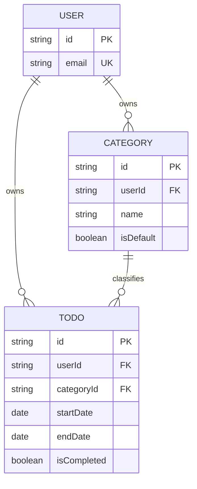

# TodoList 도메인 정의서 (초안)

## 문서 정보

| 항목 | 내용 |
|------|------|
| 현재 버전 | v0.8 |
| 상태 | 초안 (상태 전이: 초안 → 검토 → 승인) |
| 최초 작성일 | 2026-11-03 |
| 최종 수정일 | 2026-11-04 |
| 원본 요구사항 | `prompts/도메인정의생성프롬포트.txt` |
| 관련 문서 | `docs/2-PRD.md` v0.10, `docs/3-user-scenario.md` v0.6, `docs/4-wireframe.md` v0.5 |

ID 규칙: 접두어별로 번호를 부여한다 (F 기능 요구, P 문제, BR 비즈니스 규칙, ST 상태 판정, UC 유스케이스, D 결정 대기, TC 테스트). 번호 공백은 허용하며, 삭제된 ID는 재사용하지 않는다. BR은 10단위 대역으로 영역을 구분한다 (01 인증, 11 카테고리, 21 할일, 31 조회, 41 데이터 제약, 51 오류 처리).

## 변경 이력

| 버전 | 일자 | 작성자 | 변경 내용 | 영향 ID |
|------|------|--------|-----------|---------|
| v0.1 | 2026-11-03 | - | 초안 작성 | 전체 |
| v0.2 | 2026-11-03 | - | 품질 평가 반영. 기능 요구 ID(F) 부여, 상태 판정 ID(ST) 부여, BR에 수용 기준 추가, UC에 사전/사후조건·예외 흐름 추가, 데이터 제약(5.5)·오류 처리(5.6) 신설, 캘린더·필터 규칙 확정, 가정·미결을 결정 대기 표로 통합, 추적표 부록 추가. BR-34는 BR-33에 통합 후 삭제 | F-01~08, ST-01~04, BR-06, BR-17, BR-28, BR-33~36, BR-41~46, BR-51~54, UC 전체, D 전체, 부록 A |
| v0.3 | 2026-11-04 | - | PRD 교차 검토 반영. 가입 시 자동 로그인(UC-01), 타인 카테고리 필터는 `NOT_FOUND`(UC-09), 잘못된 형식 ID·today 처리(BR-02, BR-32), BR-52 검증 순서 고정, 완료 처리는 `isCompleted` 명시 지정(UC-07, D-10), 불변식 위반 데이터 판정 문구 삭제(4.3), 비기능 요구 출처를 PRD로 지정(1.4), D-02/05/09/10/13/14 closed | 1.4, 4.3, BR-02, BR-32, BR-52, UC-01, UC-07, UC-09, D-02, D-05, D-09, D-10, D-13, D-14 |
| v0.4 | 2026-11-04 | - | 3문서 교차 검토 반영. BR-03 대상을 본인(`users/me`)으로 고정, UC-03 사후조건을 쿠키 삭제로 한정, 캘린더 조회에 today 입력 추가(BR-36, UC-10), BR-52 순서에 보호 대상·자격 증명 추가, UC-11 개수 표현 정정, D-12 closed(편집 화면 이동 허용), 부록 A에 US 매핑 | 문서 정보, BR-03, BR-36, BR-52, UC-03, UC-10, UC-11, D-05, D-12, 부록 A |
| v0.5 | 2026-11-04 | - | 관련 문서에 와이어프레임 추가, 참조 버전 갱신 | 문서 정보 |
| v0.6 | 2026-11-04 | - | PRD v0.7 인증 방식 변경(액세스 + 리프레시 토큰) 반영. UC-02 인증 상태 부여 표현, UC-03 기본 흐름·사후조건(리프레시 폐기, 두 쿠키 삭제, 액세스 잔존은 PRD R-06), 참조 버전 갱신 | 문서 정보, UC-02, UC-03 |
| v0.7 | 2026-11-04 | - | 8문서 교차 검토 반영. 용어 '인증'·BR-01의 예외에 로그아웃·토큰 재발급 추가(PRD 6.4 비보호 경로), UC-03 사전조건을 `refresh_token` 쿠키 보유로 변경, 참조 버전 갱신 | 문서 정보, 2장, BR-01, UC-03 |
| v0.8 | 2026-11-04 | - | 참조 버전 갱신 | 문서 정보 |

---

## 1. 개요

### 1.1 목적

인증된 사용자가 자신의 할일을 기간(시작일~종료일) 단위로 등록하고, 상태별·카테고리별로 조회하며, 월/주/일 캘린더에서 한눈에 확인할 수 있도록 한다.

### 1.2 문제 정의

| ID | 문제 | 해결하는 기능 |
|----|------|---------------|
| P-1 | 인증된 사용자 개인별로 할일을 관리할 수 있는 앱이 없다. | F-01, F-03 |
| P-2 | 할일에 시작일과 종료일을 다룰 수 있는 기능이 필요하다. | F-04 |
| P-3 | 할일을 월별·주별·일별 캘린더에서 한꺼번에 조회하고 싶다. | F-08 |

### 1.3 기능 요구 (범위)

| ID | 기능 요구 | 출처 |
|----|-----------|------|
| F-01 | 회원가입 후 로그인(인증)해야 앱을 사용할 수 있다. | 원본 |
| F-02 | 카테고리별로 할일을 등록한다. 카테고리를 지정하지 않으면 '기본' 카테고리를 적용한다. | 원본 |
| F-03 | 로그인한 사용자는 자신의 정보를 수정할 수 있다. | 원본 |
| F-04 | 할일 등록 시 시작일·종료일을 캘린더로 선택해 지정할 수 있다. | 원본 |
| F-05 | 할일 목록을 카테고리, 시작 전, 진행중, 완료, 기한 초과 기준으로 필터링할 수 있다. | 원본 |
| F-06 | 인증된 사용자는 할일을 삭제할 수 있다. | 원본 |
| F-07 | 인증된 사용자는 편집 화면에서 할일을 수정할 수 있다. | 원본 |
| F-08 | 할일은 캘린더 화면(월/주/일)에 나타난다. | 원본 |
| F-09 | 사용자는 로그아웃할 수 있다. | 추가 (D-09) |
| F-10 | 사용자는 할일을 완료 처리하고 취소할 수 있다. | 추가 (D-10) |
| F-11 | 사용자는 카테고리를 추가·이름 변경·삭제할 수 있다. | 추가 (D-02) |

### 1.4 비범위

- 할일 공유, 협업, 담당자 지정
- 반복 일정
- 알림(푸시, 이메일 등)
- 하위 할일(체크리스트), 첨부파일, 태그
- 외부 캘린더 연동
- 관리자 기능
- 이메일 인증, 비밀번호 찾기, 회원 탈퇴 (D-04, D-08에서 결정 전까지 비범위)
- 비기능 요구(성능 목표, 접근성 수준, 지원 브라우저)는 이 문서에서 다루지 않는다. `docs/2-PRD.md` 5장에서 정의한다. 단, 보안 최소 기준은 BR-05, BR-06, BR-44에 포함한다.

---

## 2. 핵심 도메인 개념 및 용어 정의

| 용어 | 정의 |
|------|------|
| 사용자 (User) | 회원가입을 완료한 개인. 자신의 할일과 카테고리만 소유하고 관리한다. 이 문서에서 "사용자"는 항상 인증된 상태를 뜻한다. 미인증 방문자는 "비회원"이라 부른다. |
| 인증 (Authentication) | 사용자가 로그인하여 신원이 확인된 상태. 회원가입·로그인·로그아웃·토큰 재발급(PRD 6.4)을 제외한 모든 기능의 전제 조건이다. |
| 할일 (Todo) | 사용자가 수행할 작업 단위. 제목, 시작일, 종료일, 완료 여부, 카테고리를 가진다. |
| 카테고리 (Category) | 할일을 분류하는 단위. 사용자별로 관리된다. |
| 기본 카테고리 | 카테고리를 지정하지 않은 할일에 적용되는 카테고리. 이름은 '기본'이며 시스템이 생성한다. |
| 시작일 (startDate) | 할일 수행을 시작하는 날짜. 시각 없이 날짜만 다룬다. |
| 종료일 (endDate) | 할일을 완료해야 하는 마감 날짜. 시각 없이 날짜만 다룬다. |
| 완료 여부 (isCompleted) | 사용자가 할일을 완료 처리했는지 나타내는 저장값. |
| 할일 상태 (TodoStatus) | 시작 전 / 진행중 / 완료 / 기한 초과 중 하나. 저장하지 않고 ST-01~04로 계산하는 파생값. '완료' 상태는 `isCompleted = true`에서 파생된다. |
| 기준일 (today) | 상태 판정에 쓰는 현재 날짜. 클라이언트가 사용자 로컬 시간대 기준 날짜를 `YYYY-MM-DD`로 서버에 전달한다 (D-05). |
| 조회 기준 날짜 (anchorDate) | 캘린더에서 사용자가 선택한 날짜. 조회 기간을 산정하는 기준이다. 기준일(today)과 다른 개념이다. |
| 조회 기간 | 캘린더 뷰(월/주/일)가 표시하는 날짜 범위. BR-35로 정의한다. |
| 캘린더 뷰 | 할일을 월·주·일 단위 조회 기간으로 보여주는 조회 방식. |

원본 요구사항 용어 대응: "시작하지 않은 할일" = 시작 전, "일자" = 날짜.

---

## 3. 도메인 모델

### 3.1 엔티티별 핵심 속성

이 표가 속성의 단일 출처다. 3.2의 다이어그램은 관계 파악용이며 핵심 속성만 표시한다.

#### User

| 속성 | 설명 | 필수 | 관련 규칙 |
|------|------|------|-----------|
| id | 사용자 식별자 | O | |
| email | 로그인 ID. 시스템 전체에서 유일 | O | BR-04, BR-43 |
| password | 비밀번호 (해시 저장) | O | BR-05, BR-44 |
| name | 사용자 이름 | O | BR-45 |
| createdAt / updatedAt | 생성·수정 일시 | O | |

#### Category

| 속성 | 설명 | 필수 | 관련 규칙 |
|------|------|------|-----------|
| id | 카테고리 식별자 | O | |
| userId | 소유 사용자 | O | BR-16 |
| name | 카테고리명. 같은 사용자 내 유일 | O | BR-14, BR-17, BR-46 |
| isDefault | 기본 카테고리 여부 | O | BR-11, BR-13 |
| createdAt / updatedAt | 생성·수정 일시 | O | |

#### Todo

| 속성 | 설명 | 필수 | 관련 규칙 |
|------|------|------|-----------|
| id | 할일 식별자 | O | |
| userId | 소유 사용자 | O | BR-02 |
| categoryId | 소속 카테고리 (미지정 시 기본 카테고리) | O | BR-12, BR-16 |
| title | 제목 | O | BR-21, BR-41 |
| description | 상세 내용 | X | BR-42 |
| startDate | 시작일 (날짜) | O | BR-21, BR-22 |
| endDate | 종료일 (날짜) | O | BR-21, BR-22 |
| isCompleted | 완료 여부 (기본값 false) | O | BR-24, BR-28 |
| completedAt | 완료 처리 일시 | X | BR-25, BR-28 |
| createdAt / updatedAt | 생성·수정 일시 | O | |

### 3.2 관계

- User 1 : N Category — 사용자는 여러 카테고리를 소유한다. 그중 정확히 1개가 기본 카테고리다.
- User 1 : N Todo — 사용자는 여러 할일을 소유한다.
- Category 1 : N Todo — 할일은 정확히 1개의 카테고리에 속한다.

---

## 4. 할일 상태 정의와 판정 규칙

### 4.1 상태 정의

| 상태 | 의미 |
|------|------|
| 시작 전 (NOT_STARTED) | 아직 시작일이 도래하지 않은 미완료 할일 |
| 진행중 (IN_PROGRESS) | 기준일이 시작일~종료일 기간 안에 있는 미완료 할일 |
| 완료 (COMPLETED) | 사용자가 완료 처리한 할일 |
| 기한 초과 (OVERDUE) | 종료일이 지났지만 완료되지 않은 할일 |

### 4.2 저장값 vs 파생값

- **저장값**: `startDate`, `endDate`, `isCompleted`, `completedAt`
- **파생값**: `TodoStatus`. DB에 저장하지 않는다. 서버가 요청마다 클라이언트가 전달한 기준일(today)로 계산한다.
- 이유: 상태는 날짜가 지나면 사용자 행위 없이 바뀐다. 저장하면 값이 실제와 어긋난다.

### 4.3 판정 규칙

날짜는 시각 없이 날짜 단위로 비교한다. ST-01부터 순서대로 평가하고, 처음 만족하는 규칙을 적용한다.

| ID | 조건 | 상태 | 검증 예 (today = 2026-11-03) |
|----|------|------|------------------------------|
| ST-01 | `isCompleted = true` | 완료 | 11-01~11-02, 완료 → 완료 (기한 초과 아님) |
| ST-02 | `today > endDate` | 기한 초과 | 11-01~11-02, 미완료 → 기한 초과 |
| ST-03 | `today < startDate` | 시작 전 | 11-04~11-05, 미완료 → 시작 전 |
| ST-04 | `startDate ≤ today ≤ endDate` | 진행중 | 11-03~11-03, 미완료 → 진행중 (시작일·종료일 당일 포함) |

- 완료는 날짜와 무관하게 최우선한다. 종료일 이후에 완료 처리한 할일도 '완료'다.
- 종료일 당일은 '진행중'이다. 종료일 다음 날부터 '기한 초과'다. 시작일 당일은 '진행중'이다.
- 불변식 BR-22(`startDate ≤ endDate`)가 성립하면 네 상태는 서로 겹치지 않고 모든 경우를 포함한다. BR-22는 DB `CHECK` 제약으로도 보장한다 (`docs/2-PRD.md` 7장).
- 완료를 취소하면(`isCompleted = false`) ST-02~04로 다시 판정한다.

---

## 5. 비즈니스 규칙

각 규칙의 수용 기준은 테스트 케이스로 직접 옮길 수 있도록 입력과 기대 결과로 쓴다. 오류 코드는 5.6을 따른다.

### 5.1 인증 및 권한

| ID | 규칙 | 수용 기준 |
|----|------|-----------|
| BR-01 | 회원가입·로그인·로그아웃·토큰 재발급(PRD 6.4)을 제외한 모든 기능은 인증된 사용자만 사용할 수 있다. | 미인증 요청은 `UNAUTHORIZED`를 반환하고 데이터를 변경하지 않는다. |
| BR-02 | 사용자는 자신이 소유한 할일·카테고리만 조회·수정·삭제할 수 있다. 타인의 데이터는 존재 여부도 노출하지 않는다. | 사용자 A가 사용자 B 소유 리소스 ID로 조회·수정·삭제를 요청하면, 존재하지 않는 ID에 대한 응답과 동일한 `NOT_FOUND` 응답(동일 본문)을 반환하고 B의 데이터는 변경되지 않는다. 형식이 잘못된 ID(예: 숫자가 아닌 값)도 같은 `NOT_FOUND`다. |
| BR-03 | 사용자는 자신의 정보만 수정할 수 있다. 수정 대상은 인증된 본인으로 고정된다 (`users/me`, 사용자 ID를 경로·본문으로 받지 않는다). | 요청 본문에 다른 사용자 ID가 있어도 무시하고 본인 정보만 바뀐다. 수정 가능 항목은 name, password다 (email 변경은 D-06). |
| BR-04 | 이메일은 시스템 전체에서 유일하다. 대소문자를 구분하지 않는다. | 이미 등록된 이메일(대소문자 무시)로 가입 요청하면 `DUPLICATE_EMAIL`을 반환하고 계정을 생성하지 않는다. |
| BR-05 | 비밀번호는 단방향 해시로 저장한다. 비밀번호 변경 시 현재 비밀번호를 확인한다. | 저장소에 입력 문자열과 동일한 값이 존재하지 않는다. 현재 비밀번호가 틀리면 `INVALID_CREDENTIALS`를 반환하고 기존 비밀번호가 유지된다. |
| BR-06 | 로그인은 이메일·비밀번호가 모두 일치할 때만 성공한다. 실패 사유(이메일 없음 / 비밀번호 틀림)는 구분해 노출하지 않는다. | 존재하지 않는 이메일과 틀린 비밀번호 두 경우 모두 동일한 `INVALID_CREDENTIALS` 응답을 반환한다. 성공 시 인증 상태가 부여된다. |

### 5.2 카테고리

| ID | 규칙 | 수용 기준 |
|----|------|-----------|
| BR-11 | 회원가입 시 해당 사용자의 '기본' 카테고리를 자동 생성한다. | 가입 직후 사용자의 카테고리 목록에 `name = '기본'`, `isDefault = true`인 카테고리가 정확히 1개 존재한다. |
| BR-12 | 할일 등록·수정 시 `categoryId`를 지정하지 않으면 기본 카테고리를 적용한다. | `categoryId` 없이 등록한 할일의 `categoryId`는 해당 사용자 기본 카테고리의 id와 같다. 수정 시 `categoryId`를 null로 보내면 기본 카테고리로 바뀐다. |
| BR-13 | 기본 카테고리는 사용자당 정확히 1개이며, 삭제할 수 없다. | 기본 카테고리 삭제 요청은 `DEFAULT_CATEGORY_PROTECTED`를 반환하고 카테고리가 유지된다. |
| BR-14 | 카테고리명은 같은 사용자 내에서 중복될 수 없다. 대소문자를 구분하지 않고 앞뒤 공백을 제거해 비교한다. | 같은 사용자가 이미 가진 이름(정규화 후 비교)으로 생성·변경 요청하면 `DUPLICATE_CATEGORY_NAME`을 반환한다. 다른 사용자는 같은 이름을 가질 수 있다. |
| BR-15 | 카테고리를 삭제하면 소속 할일은 기본 카테고리로 이동한다. 할일은 삭제하지 않는다. 이동과 삭제는 하나의 트랜잭션이다. | 할일 N개가 속한 카테고리를 삭제하면, 삭제 후 그 N개 할일의 `categoryId`가 모두 기본 카테고리 id이고 할일 수는 변하지 않는다. 이동 실패 시 카테고리도 삭제되지 않는다. |
| BR-16 | 할일은 자신과 같은 사용자가 소유한 카테고리에만 속할 수 있다. | 타 사용자 소유 또는 존재하지 않는 `categoryId`로 등록·수정하면 `NOT_FOUND`를 반환한다 (BR-02와 동일 응답). |
| BR-17 | 기본 카테고리의 이름은 변경할 수 없다. 다른 카테고리에 '기본'이라는 이름을 붙일 수 없다. | 기본 카테고리 이름 변경 요청은 `DEFAULT_CATEGORY_PROTECTED`를 반환한다. 일반 카테고리를 '기본'으로 생성·변경하면 `DUPLICATE_CATEGORY_NAME`을 반환한다. |

### 5.3 할일

| ID | 규칙 | 수용 기준 |
|----|------|-----------|
| BR-21 | 제목, 시작일, 종료일은 필수다. 제목은 앞뒤 공백을 제거한 뒤 1자 이상이어야 한다. | 제목이 없거나 공백만 있는 요청, 시작일 또는 종료일이 없는 요청은 `VALIDATION_ERROR`를 반환하고 저장하지 않는다. |
| BR-22 | 불변식 `startDate ≤ endDate`. 위반 시 등록·수정을 거부한다. | `startDate > endDate` 요청은 `INVALID_DATE_RANGE`를 반환하고 저장하지 않는다. `startDate = endDate` 요청은 저장된다. |
| BR-23 | 시작일·종료일은 과거 날짜도 허용한다. | 기준일보다 이전인 시작일·종료일로 등록하면 저장된다. |
| BR-24 | 신규 할일의 `isCompleted` 기본값은 false다. | 등록 직후 조회하면 `isCompleted = false`, `completedAt = null`이다. 등록 요청의 `isCompleted` 값은 무시한다. |
| BR-25 | 완료 처리 시 `completedAt`에 처리 일시를 기록한다. 완료 취소 시 `completedAt`을 비운다. | 완료 처리 후 `completedAt`은 null이 아니고 처리 시각과 같다. 완료 취소 후 `completedAt = null`이다. |
| BR-26 | 할일 상태는 ST-01~04로만 결정한다. 상태를 직접 지정할 수 없다. | 등록·수정 요청에 상태 필드가 포함되면 무시하고 저장한다. 조회 응답의 상태는 항상 ST-01~04 결과와 같다. |
| BR-27 | 할일 삭제는 영구 삭제다. | 삭제 후 같은 ID로 조회하면 `NOT_FOUND`다. 복구 수단은 없다. |
| BR-28 | 불변식: `isCompleted = true` ⇔ `completedAt`이 null이 아니다. | 저장된 모든 할일에서 두 조건의 진릿값이 같다. |

### 5.4 조회

| ID | 규칙 | 수용 기준 |
|----|------|-----------|
| BR-31 | 목록 필터는 카테고리 필터(단일 선택)와 상태 필터(단일 선택)를 AND로 조합한다. 각 필터는 미선택 가능하다. | 아래 조합표의 네 경우가 모두 성립한다. |
| BR-32 | 상태 필터 값은 시작 전 / 진행중 / 완료 / 기한 초과 중 하나다. 상태는 요청에 포함된 기준일(today)로 ST-01~04에 따라 판정한다. | 상태 필터 `OVERDUE`, today = 2026-11-03일 때 종료일 11-02·미완료 할일은 포함되고, 종료일 11-03·미완료 할일은 포함되지 않는다. today가 없거나 `YYYY-MM-DD` 형식이 아니면 `VALIDATION_ERROR`다. |
| BR-33 | 캘린더에는 할일 기간 `[startDate, endDate]`이 조회 기간과 하루라도 겹치는 할일을, 겹치는 모든 날짜 칸에 표시한다. 경계일을 포함한다. | 주 뷰 조회 기간이 11-02(월)~11-08(일)일 때: 10-31~11-03 할일은 11-02, 11-03 칸에 표시된다. 10-26~11-01 할일은 표시되지 않는다. 11-08~11-10 할일은 11-08 칸에 표시된다. |
| BR-35 | 조회 기간 정의. 일 뷰: anchorDate 하루. 주 뷰: anchorDate가 속한 월요일~일요일 7일. 월 뷰: anchorDate가 속한 달의 1일이 포함된 주의 월요일부터, 말일이 포함된 주의 일요일까지 (이웃 달 날짜 칸 포함). | anchorDate = 2026-11-03이면 주 뷰는 11-02~11-08, 월 뷰는 10-26~12-06이다. |
| BR-36 | 캘린더에는 완료된 할일도 표시하며, 상태(ST-01~04)를 구분할 수 있는 정보를 함께 제공한다. 상태 판정에는 요청의 기준일(today)을 쓴다 (BR-32와 같은 형식·오류). 캘린더 조회에는 카테고리·상태 필터를 적용하지 않는다. | 완료 할일 1개와 미완료 할일 1개가 같은 날짜에 있으면 캘린더 응답에 둘 다 포함되고, 각각의 상태 값이 다르다. |

필터 조합표 (BR-31):

| 카테고리 필터 | 상태 필터 | 결과 |
|---------------|-----------|------|
| 미선택 | 미선택 | 사용자의 모든 할일 |
| 선택 | 미선택 | 해당 카테고리의 모든 할일 |
| 미선택 | 선택 | 모든 카테고리 중 해당 상태의 할일 |
| 선택 | 선택 | 해당 카테고리이면서 해당 상태인 할일 |

목록 기본 정렬: `endDate` 오름차순, 같으면 `startDate` 오름차순, 같으면 `createdAt` 오름차순.

### 5.5 데이터 제약

| ID | 규칙 | 수용 기준 |
|----|------|-----------|
| BR-41 | 할일 제목은 공백 제거 후 1자 이상 100자 이하다. | 101자 제목은 `VALIDATION_ERROR`, 100자 제목은 저장된다. |
| BR-42 | 할일 설명은 1000자 이하다. 비어 있어도 된다. | 1001자 설명은 `VALIDATION_ERROR`, 설명 없는 요청은 저장된다. |
| BR-43 | 이메일은 `local@domain` 형식이어야 하며 254자 이하다. | `@`가 없는 값, 255자 이상 값은 `VALIDATION_ERROR`다. |
| BR-44 | 비밀번호는 8자 이상 64자 이하다. | 7자는 `VALIDATION_ERROR`, 8자는 허용된다. |
| BR-45 | 사용자 이름은 공백 제거 후 1자 이상 50자 이하다. | 공백만 있는 이름, 51자 이름은 `VALIDATION_ERROR`다. |
| BR-46 | 카테고리명은 공백 제거 후 1자 이상 30자 이하다. 사용자당 카테고리는 기본 포함 최대 20개다. | 31자 이름은 `VALIDATION_ERROR`다. 카테고리가 20개인 사용자의 생성 요청은 `CATEGORY_LIMIT_EXCEEDED`다. |

### 5.6 오류 처리

| ID | 규칙 | 수용 기준 |
|----|------|-----------|
| BR-51 | 모든 거부 응답은 아래 오류 코드 중 하나를 포함한다. 코드별 의미: `UNAUTHORIZED` 미인증, `NOT_FOUND` 리소스 없음 또는 권한 없음, `VALIDATION_ERROR` 입력 형식·길이 위반, `INVALID_DATE_RANGE` BR-22 위반, `INVALID_CREDENTIALS` 자격 증명 불일치, `DUPLICATE_EMAIL`, `DUPLICATE_CATEGORY_NAME`, `DEFAULT_CATEGORY_PROTECTED`, `CATEGORY_LIMIT_EXCEEDED`. | 거부 응답 본문에 위 목록에 있는 코드가 있다. 목록 밖의 코드는 없다. |
| BR-52 | 한 요청에 여러 검증 오류가 있으면 첫 번째 위반 규칙의 코드로 거부하며, 부분 저장하지 않는다. 검증 순서: 인증(BR-01) → 입력 형식·길이(BR-21, BR-32 today, BR-41~46) → 날짜 범위(BR-22) → 리소스 존재·소유(BR-02, BR-16) → 보호 대상(BR-13, BR-17 `DEFAULT_CATEGORY_PROTECTED`) → 중복·개수 제한(BR-04, BR-14, BR-17, BR-46) → 자격 증명(BR-05, BR-06). | 제목 없음 + `startDate > endDate` 요청은 `VALIDATION_ERROR`이고 할일 수는 변하지 않는다. |
| BR-53 | 인증 상태가 만료된 뒤의 저장 요청은 `UNAUTHORIZED`로 거부하고 데이터를 변경하지 않는다. | 만료 후 수정 요청 뒤 조회하면 수정 전 값이다. |
| BR-54 | 같은 할일을 두 요청이 동시에 수정하면 나중에 처리된 요청이 반영된다(last-write-wins). | 동일 할일에 제목 A, 제목 B 수정을 순차 처리하면 최종 제목은 B다. (낙관적 잠금은 D-11) |

---

## 6. 주요 유스케이스

액터: **비회원**(미인증 방문자), **사용자**(인증된 회원)

| ID | 유스케이스 | 액터 | 사전조건 | 기본 흐름 | 예외 흐름 | 사후조건 | 관련 규칙 | 기능 |
|----|-----------|------|----------|-----------|-----------|----------|-----------|------|
| UC-01 | 회원가입 | 비회원 | 미인증 상태 | 이메일·비밀번호·이름 입력 → 형식 검증 → 이메일 중복 검사 → 계정 생성 → 기본 카테고리 생성 → 인증 상태 부여(자동 로그인) | 형식 위반 `VALIDATION_ERROR`, 중복 `DUPLICATE_EMAIL`. 계정·카테고리 모두 생성되지 않음 | 계정 1개, 기본 카테고리 1개 존재, 인증 상태 | BR-04, BR-05, BR-11, BR-43~45 | F-01 |
| UC-02 | 로그인 | 비회원 | 계정 존재 | 이메일·비밀번호 입력 → 자격 증명 확인 → 인증 상태 부여(액세스·리프레시 토큰) | 불일치 `INVALID_CREDENTIALS` | 인증 상태 | BR-06 | F-01 |
| UC-03 | 로그아웃 | 사용자 | `refresh_token` 쿠키 보유 (액세스 만료 상태도 허용, PRD 6.4) | 로그아웃 API 호출 → 서버가 리프레시 토큰을 폐기하고 두 인증 쿠키 삭제 응답(`HttpOnly`라 클라이언트는 직접 지울 수 없다) | 없음 | 쿠키 없는 이후 요청은 `UNAUTHORIZED`. 폐기된 리프레시 토큰으로는 재발급되지 않는다. 액세스 토큰 잔존은 PRD R-06 | BR-01 | F-09 |
| UC-04 | 내 정보 수정 | 사용자 | 인증 상태 | 현재 정보 조회 → 이름/비밀번호 수정 → 검증 후 저장 | 현재 비밀번호 불일치 `INVALID_CREDENTIALS`, 형식 위반 `VALIDATION_ERROR`. 기존 값 유지 | 수정값 저장, `updatedAt` 갱신 | BR-03, BR-05, BR-44, BR-45 | F-03 |
| UC-05 | 할일 등록 | 사용자 | 인증 상태 | 제목·설명 입력 → 캘린더에서 시작일·종료일 선택 → 카테고리 선택(선택 사항) → 검증 후 저장 | `VALIDATION_ERROR`, `INVALID_DATE_RANGE`, 카테고리 없음 `NOT_FOUND`. 저장 안 됨 | 할일 1개 생성, 미완료 상태, 카테고리 미지정 시 기본 카테고리 | BR-12, BR-16, BR-21~24, BR-41, BR-42 | F-02, F-04 |
| UC-06 | 할일 수정 | 사용자 | 인증 상태, 본인 소유 할일 존재 | 할일 선택 → 편집 화면에서 제목·설명·시작일·종료일·카테고리 수정 → 검증 후 저장 | 타인 소유 `NOT_FOUND`, `VALIDATION_ERROR`, `INVALID_DATE_RANGE`, 카테고리 없음 `NOT_FOUND`. 기존 값 유지 | 수정값 저장, `updatedAt` 갱신, 완료 여부는 변하지 않음 | BR-02, BR-12, BR-16, BR-21~23, BR-26 | F-07 |
| UC-07 | 할일 완료/완료 취소 | 사용자 | 인증 상태, 본인 소유 할일 존재 | 할일 선택 → `isCompleted` 값(true/false)을 명시 지정 → `completedAt` 갱신. 같은 값을 다시 지정해도 결과는 같다(멱등) | 타인 소유 `NOT_FOUND` | `isCompleted`와 `completedAt`이 BR-28을 만족 | BR-02, BR-25, BR-28 | F-10 |
| UC-08 | 할일 삭제 | 사용자 | 인증 상태, 본인 소유 할일 존재 | 할일 선택 → 삭제 확인 → 영구 삭제 | 타인 소유 `NOT_FOUND` | 할일 조회 시 `NOT_FOUND` | BR-02, BR-27 | F-06 |
| UC-09 | 할일 목록 필터 조회 | 사용자 | 인증 상태 | 기준일 전달 → 카테고리·상태 필터 선택 → ST-01~04로 상태 판정 → 조건에 맞는 할일을 기본 정렬로 표시 | 조건에 맞는 할일 없음: 빈 목록(오류 아님). 타인 소유·미존재 카테고리 필터: `NOT_FOUND` (BR-02, BR-16). today 누락·형식 오류: `VALIDATION_ERROR` | 데이터 변경 없음 | BR-02, BR-31, BR-32, ST-01~04 | F-05 |
| UC-10 | 캘린더 조회 (월/주/일) | 사용자 | 인증 상태 | 뷰 유형·조회 기준 날짜(anchorDate) 선택 → BR-35로 조회 기간 산정 → 조회 기간과 기준일(today) 전달 → 겹치는 할일을 상태와 함께 날짜 칸별로 표시 → 이전/다음 기간 이동. 할일 선택 시 편집 화면으로 이동 (D-12) | 조회 기간에 할일 없음: 빈 캘린더. today 누락·형식 오류: `VALIDATION_ERROR` | 데이터 변경 없음 | BR-02, BR-33, BR-35, BR-36 | F-08 |
| UC-11 | 카테고리 관리 | 사용자 | 인증 상태 | 카테고리 추가 / 이름 변경 / 삭제 → 삭제 시 소속 할일을 기본 카테고리로 이동 | 중복 `DUPLICATE_CATEGORY_NAME`, 기본 카테고리 삭제·이름 변경 `DEFAULT_CATEGORY_PROTECTED`, 20개 상태에서 추가 `CATEGORY_LIMIT_EXCEEDED` | 추가: 카테고리 +1. 삭제: 카테고리 −1, 할일 수 불변 | BR-13~17, BR-46 | F-11 |

---

## 7. 결정 대기 항목

요구사항에 없어 이 문서가 임시로 정한 사항이다. `closed`는 임시 가정을 그대로 결정으로 확정한 것이다. 결정이 나면 "상태"를 `closed`로 바꾸고 "영향 ID"의 규칙을 갱신한 뒤 변경 이력에 기록한다.

| ID | 질문 | 임시 가정 (현재 문서 기준) | 영향 ID | 담당 | 기한 | 상태 |
|----|------|----------------------------|---------|------|------|------|
| D-01 | 시작일·종료일에 시각(시:분)도 지정해야 하는가? | 날짜만 다룬다. | 용어집, ST-01~04, BR-22 | 미정 | 미정 | open |
| D-02 | 사용자 정의 카테고리를 허용하는가? 개수 제한은? | 허용한다. 사용자당 최대 20개. | F-11, UC-11, BR-46 | - | 2026-11-04 | closed |
| D-03 | 시작일 없이 종료일만 있는 할일을 허용하는가? | 둘 다 필수다. | BR-21, ST-01~04 | 미정 | 미정 | open |
| D-04 | 회원 탈퇴가 필요한가? 소유 데이터 처리 방식은? | 비범위. | 1.4 | 미정 | 미정 | open |
| D-05 | 기준일(today)의 시간대는 어떻게 정하는가? | 클라이언트가 로컬 시간대 기준 `YYYY-MM-DD`를 전달한다. User에 timezone을 저장하지 않는다. | 용어집, 4.2, BR-32, BR-36, UC-09, UC-10 | - | 2026-11-04 | closed |
| D-06 | 내 정보 수정에 이메일 변경이 포함되는가? | 포함하지 않는다. | BR-03, UC-04 | 미정 | 미정 | open |
| D-07 | 상태 필터 다중 선택(예: 진행중 + 기한 초과)이 필요한가? | 단일 선택. | BR-31, BR-32 | 미정 | 미정 | open |
| D-08 | 이메일 인증, 비밀번호 찾기가 필요한가? | 비범위. | 1.4 | 미정 | 미정 | open |
| D-09 | 로그아웃 기능을 포함하는가? | 포함한다. | F-09, UC-03 | - | 2026-11-04 | closed |
| D-10 | 완료 처리는 어떤 방식으로 하는가? | 사용자의 명시적 조작으로만 한다. 요청은 `isCompleted` 값을 명시 지정한다(토글 아님, 멱등). | F-10, UC-07, BR-25 | - | 2026-11-04 | closed |
| D-11 | 동시 수정 충돌을 감지해야 하는가? | 감지하지 않는다 (last-write-wins). | BR-54 | 미정 | 미정 | open |
| D-12 | 캘린더에서 할일 생성·완료 처리 등 직접 조작이 필요한가? | 조회만 한다. 캘린더 내 생성·완료 처리·드래그 앤 드롭은 없다. 할일 선택 시 편집 화면으로 이동하는 것은 허용한다. | UC-10 | - | 2026-11-04 | closed |
| D-13 | 캘린더 주 시작 요일은? | 월요일. | BR-35 | - | 2026-11-04 | closed |
| D-14 | 캘린더에 완료 할일을 표시하는가? 필터를 적용하는가? | 표시한다. 필터는 적용하지 않는다. | BR-36 | - | 2026-11-04 | closed |
| D-15 | 할일 삭제에 복구(휴지통)가 필요한가? | 영구 삭제. | BR-27 | 미정 | 미정 | open |

---

## 부록 A. 추적표

기능 요구 → 비즈니스 규칙 → 유스케이스 → 사용자 시나리오(US, `docs/3-user-scenario.md`). 자동 테스트 ID(TC)는 테스트 설계 시 추가한다.

| 기능 | 관련 BR / ST | UC | US |
|------|--------------|----|----|
| F-01 | BR-01, BR-04, BR-05, BR-06, BR-11, BR-43, BR-44, BR-45 | UC-01, UC-02 | US-01, US-02, US-03, US-16, US-18 |
| F-02 | BR-12, BR-16 | UC-05 | US-07, US-08, US-17, US-18 |
| F-03 | BR-03, BR-05, BR-44, BR-45 | UC-04 | US-19 |
| F-04 | BR-21, BR-22, BR-23 | UC-05 | US-07, US-08, US-09, US-18 |
| F-05 | BR-31, BR-32, ST-01~04 | UC-09 | US-05, US-12, US-17, US-18 |
| F-06 | BR-02, BR-27 | UC-08 | US-11, US-17, US-18 |
| F-07 | BR-02, BR-12, BR-16, BR-21~23, BR-26 | UC-06 | US-09, US-16, US-17, US-18 |
| F-08 | BR-33, BR-35, BR-36 | UC-10 | US-13, US-14, US-15, US-18 |
| F-09 | BR-01 | UC-03 | US-03, US-18 |
| F-10 | BR-25, BR-28 | UC-07 | US-10, US-17, US-18 |
| F-11 | BR-13, BR-14, BR-15, BR-17, BR-46 | UC-11 | US-04, US-05, US-06, US-18 |
| 공통 | BR-02, BR-41, BR-42, BR-51~54 | UC-04~11 | US-08, US-12, US-16, US-17 |
