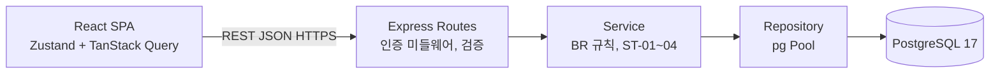

# TodoList PRD (초안)

## 문서 정보

| 항목 | 내용 |
|------|------|
| 현재 버전 | v0.14 |
| 상태 | 초안 |
| 최초 작성일 | 2026-11-04 |
| 최종 수정일 | 2026-11-05 |
| 참조 문서 | `docs/1-domain-definition.md` v0.9, `docs/3-user-scenario.md` v0.6, `docs/4-wireframe.md` v0.8, `docs/5-project-principle.md` v0.13 |

ID 규칙: F, UC, BR, ST, D는 도메인 정의서 ID를 그대로 참조한다 (재정의하지 않는다). 이 문서에서 새로 부여하는 ID는 SC(화면), NFR(비기능 요구), R(리스크), A(가정), PD(결정 대기)이며 도메인 정의서 ID와 충돌하지 않는다. 수치에 "가정"이 붙은 것은 측정값이 아니라 목표 설정을 위한 가정이다.

## 변경 이력

| 버전 | 일자 | 작성자 | 변경 내용 | 영향 섹션 |
|------|------|--------|-----------|-----------|
| v0.1 | 2026-11-04 | - | 초안 작성 | 전체 |
| v0.2 | 2026-11-04 | - | F-11을 P0로 승격(카테고리 CRUD 없이는 F-02·F-05의 카테고리 기능을 검증할 수 없음). PD-01 결정(로그아웃은 쿠키 삭제만, 서버 무효화 없음). R-06 교체 | 2.1, 4.1, 4.2, 6.4, 8, 9.1, 10.1, 11, 부록 A |
| v0.3 | 2026-11-04 | - | 교차 검토 반영. 오류 본문·HTTP status 매핑·캘린더 범위 산정 주체(6.3), 쿠키 세부(NFR-06), NFR-01~03 측정 방법 재정의, id 타입·DATE 문자열 처리·`completed_at` 타입(7장), 완료 요청 멱등·로그아웃 캐시 초기화(4.2), 재기술 문장 축약, 부록 A F-11 일정, 9.1 순서, 9.2 미검증 상태, 1.1 참조 오류 | 1.1, 4.1, 4.2, 4.3, 5.1, 5.2, 6.3, 7, 8, 9, 10.1, 부록 A |
| v0.4 | 2026-11-04 | - | 3문서 교차 검토 반영. 공통 상단 메뉴 정의(4.1), 401 분기는 `code` 기준·`NOT_FOUND` 화면 처리·캘린더 이동 규칙(4.2), 쿼리·본문 ID 형식 검증(6.3), 시드 SQL·완료 처리 표현(8장), R-04·R-06 정정, 용어 통일(미선택, 이름 변경), 시나리오 문서 참조(1.3, 9.1), D-12 표현 | 문서 정보, 1.3, 2.2, 3, 4.1, 4.2, 6.3, 8, 9.1, 10.1 |
| v0.5 | 2026-11-04 | - | 와이어프레임 교차 검토 반영. 내 정보 메뉴 숨김 조건(4.1), 서버 검증 오류의 필드 표시·SC-07 `NOT_FOUND` 재조회(4.2), 모바일 월 뷰 상태 생략·주 뷰 세로 목록 허용(4.3), 참조 문서 갱신 | 문서 정보, 4.1, 4.2, 4.3 |
| v0.6 | 2026-11-04 | - | 설계 원칙 문서 반영. API 경로 접두어 `/api`·헬스체크(6.3), 프론트 BR-35 단위 테스트(R-05), API 설계 문서는 `docs/9-api-design.md`(6·7·8번은 아키텍처 다이어그램·ERD·실행 계획) | 문서 정보, 6.3, 10.1 |
| v0.7 | 2026-11-04 | - | 인증 방식 변경. 액세스 토큰 JWT HS384(15분) + 리프레시 토큰(불투명 난수, DB 해시 저장, 회전·재사용 탐지)으로 교체(NFR-06, 6.4). 클라이언트는 `UNAUTHORIZED` 시 refresh 1회 후 재시도(4.2). 로그아웃은 리프레시 폐기 + 두 쿠키 삭제(4.2). `auth` 리소스에 refresh 추가(6.3). `refresh_tokens` 테이블·인덱스(7장). Day 1 오전 작업(8장). R-06 교체, PD-01 결정 변경(closed). 부하 테스트 k6 401 → refresh 재시도(5.1). 참조 버전 갱신 | 문서 정보, 4.2, 5.1, NFR-06, 6.3, 6.4, 7, 8, 10.1, 10.2, 11 |
| v0.8 | 2026-11-04 | - | 8문서 교차 검토 반영. 4.2 인증 만료·6.4 클라이언트에 `queryClient.clear()` 명시, 7장 `token_hash` 컬럼 UNIQUE 중복 정의 제거(인덱스 `refresh_tokens_token_hash_uk`로 일원화), 참조 버전 갱신 | 문서 정보, 4.2, 6.4, 7 |
| v0.9 | 2026-11-04 | - | 6.3 API 설계 문서 `docs/9-api-design.md` '작성 예정' 표기 제거(8-plan T-X02), 참조 버전 갱신 | 문서 정보, 6.3 |
| v0.10 | 2026-11-05 | - | 연동 방식을 프록시에서 CORS로 변경. NFR-06 (6) SPA와 API를 다른 origin으로 두고 `CORS_ORIGIN` 허용 목록·`Allow-Credentials`·`credentials: 'include'`·같은 site 조건 명시, 6.3 '개발 시 Vite 프록시 대상' 제거, 참조 버전 갱신 | 문서 정보, NFR-06, 6.3 |
| v0.11 | 2026-11-05 | - | 9.1 핵심 기능 완성 체크리스트 12개 체크(P0 11개 + P1 F-03). 근거: 8-plan T-F01~T-F11·T-X03·T-X05 완료 조건, 백엔드 65건·프론트 34건 자동 테스트, 브라우저 US-01~19 검증 | 문서 정보, 9.1 |
| v0.12 | 2026-11-05 | - | 6.4에 비밀번호 변경 시 리프레시 토큰 전부 폐기 + 현재 세션 새 쿠키 발급 규칙 추가 (11-security S-01) | 문서 정보, 6.4 |
| v0.13 | 2026-11-05 | - | 다크 모드를 비범위(2.2)에서 제외하고 4.1 공통 상단 메뉴에 테마 전환 추가. 색·동작은 `docs/style-guide.md` 2.4가 정한다. 참조 버전 갱신 | 문서 정보, 2.2, 4.1 |
| v0.14 | 2026-11-06 | - | 9.2 성능 체크박스 5개 체크(T-X04 완료, `docs/perf-result.md` v0.1). 참조 버전 갱신 | 문서 정보, 9.2 |

---

## 1. 개요

### 1.1 목적

도메인 정의서 1.3의 기능 요구(F-01~F-11)를 웹앱 MVP로 구현하기 위한 범위, 우선순위, 화면, 비기능 요구, 기술 구조, 일정을 정의한다.

### 1.2 배경

문제 정의는 도메인 정의서 1.2(P-1~P-3)를 따른다. 이 문서는 해결 방법과 구현 제약만 다룬다.

### 1.3 목표 사용자

학생 및 20대~50대 직장인. 페르소나별 상세 시나리오는 작성하지 않는다. 검증용 사용자 시나리오는 `docs/3-user-scenario.md`에 두며, 페르소나는 그 문서의 등장인물로만 쓴다.

### 1.4 비즈니스 목표

- 1000명 동시 접속 사용 가능 (측정 가능한 기준은 NFR-01~05).
- 2일 내 P0 기능 완성 (기준은 9장).

---

## 2. 범위

### 2.1 MVP 포함 기능과 우선순위

| 우선순위 | 기능 | 기준 |
|----------|------|------|
| P0 | F-01, F-02, F-04, F-05, F-06, F-07, F-08, F-09, F-10, F-11 | 2일 내 반드시 완성. 앱의 핵심 흐름(가입 → 로그인 → 카테고리 관리 → 할일 등록·조회·수정·완료·삭제 → 캘린더 확인)을 이룬다. |
| P1 | F-03 | P0 완료 후 시간이 남을 때 구현한다. |

F-11을 P0에 둔 이유: F-02(카테고리별 등록)와 F-05(카테고리 필터)는 사용자 정의 카테고리가 있어야 검증할 수 있다. F-11은 단순 CRUD(BR-13~17)라 추가 비용이 작다.

### 2.2 비범위

- 도메인 정의서 1.4의 모든 항목을 따른다.
- PRD에서 추가로 제외한다.
  - 네이티브 앱, PWA, 오프라인 동작
  - 접근성 대응 (스크린리더, 키보드 내비게이션, 대비 기준 등)
  - 다국어 (한국어 단일)
  - 캘린더 내 직접 조작(드래그 앤 드롭, 생성, 완료 처리). 할일 선택 시 편집 화면 이동은 허용 (D-12)
  - 서버 사이드 렌더링
  - E2E 자동화 테스트 (검증 수단은 9장 참조)

---

## 3. 사용자 스토리

| 기능 | 사용자 스토리 | UC |
|------|---------------|----|
| F-01 | 학생·직장인 사용자로서 가입하고 로그인하고 싶다, 그래서 내 할일을 나만 볼 수 있다. | UC-01, UC-02 |
| F-02 | 사용자로서 카테고리를 골라 할일을 등록하고 싶다, 그래서 할일을 분류해 관리할 수 있다. | UC-05 |
| F-03 | 사용자로서 내 이름과 비밀번호를 바꾸고 싶다, 그래서 계정 정보를 최신으로 유지할 수 있다. | UC-04 |
| F-04 | 사용자로서 시작일과 종료일을 캘린더로 골라 지정하고 싶다, 그래서 기간이 있는 일을 표현할 수 있다. | UC-05 |
| F-05 | 사용자로서 카테고리와 상태로 목록을 걸러 보고 싶다, 그래서 지금 해야 할 일에 집중할 수 있다. | UC-09 |
| F-06 | 사용자로서 필요 없어진 할일을 삭제하고 싶다, 그래서 목록을 깔끔하게 유지할 수 있다. | UC-08 |
| F-07 | 사용자로서 편집 화면에서 할일을 고치고 싶다, 그래서 일정 변경에 대응할 수 있다. | UC-06 |
| F-08 | 사용자로서 월/주/일 캘린더에서 할일을 보고 싶다, 그래서 일정이 몰린 때를 한눈에 파악할 수 있다. | UC-10 |
| F-09 | 사용자로서 로그아웃하고 싶다, 그래서 공용 기기에서 내 데이터를 보호할 수 있다. | UC-03 |
| F-10 | 사용자로서 할일을 완료 처리하고 취소하고 싶다, 그래서 진행 상황을 기록할 수 있다. | UC-07 |
| F-11 | 사용자로서 카테고리를 추가·이름 변경·삭제하고 싶다, 그래서 내 방식대로 분류 체계를 만들 수 있다. | UC-11 |

---

## 4. 기능 요구사항

### 4.1 화면 목록

모든 화면은 인증 필요 여부를 가진다. 인증이 필요한 화면에 비회원이 접근하면 로그인 화면으로 이동한다 (BR-01). 인증 후 화면(SC-03~SC-07)은 공통 상단 메뉴를 가진다: 할일 목록, 캘린더, 카테고리 관리, 내 정보(P1, F-03 미구현 시 항목 숨김), 테마 전환(라이트/다크, `docs/style-guide.md` 2.4), 로그아웃.

| ID | 화면 | 경로 | 핵심 요소 | 관련 F / UC / BR |
|----|------|------|-----------|------------------|
| SC-01 | 로그인 | `/login` | 이메일·비밀번호 입력, 로그인 버튼, 가입 화면 링크, 오류 메시지 표시 | F-01 / UC-02 / BR-06 |
| SC-02 | 회원가입 | `/signup` | 이메일·비밀번호·이름 입력, 입력 제약 안내(BR-43~45), 가입 버튼, 오류 메시지 표시 | F-01 / UC-01 / BR-04, BR-43~45 |
| SC-03 | 할일 목록 (홈) | `/todos` | 카테고리 선택(미선택 = 필터 없음), 상태 선택(미선택 = 필터 없음 / 시작 전 / 진행중 / 완료 / 기한 초과), 항목별 제목·기간·카테고리·상태 표시·완료 체크·편집·삭제 버튼, 등록 버튼, 빈 목록 안내, 공통 상단 메뉴 | F-05, F-06, F-09, F-10 / UC-03, UC-07~09 / BR-25, BR-27, BR-31, BR-32 |
| SC-04 | 할일 등록·편집 | `/todos/new`, `/todos/:id/edit` | 제목, 설명, 시작일·종료일 선택, 카테고리 선택(미선택 시 기본), 저장·취소, 필드별 오류 표시 | F-02, F-04, F-07 / UC-05, UC-06 / BR-12, BR-21~24, BR-41, BR-42 |
| SC-05 | 캘린더 | `/calendar` | 월/주/일 전환, 이전·다음·오늘 이동, 날짜 칸별 할일 표시, 상태 구분 표시, 할일 선택 시 SC-04로 이동 | F-08 / UC-10 / BR-33, BR-35, BR-36 |
| SC-06 | 내 정보 (P1) | `/me` | 이름 수정, 비밀번호 변경(현재 비밀번호 입력), 저장 | F-03 / UC-04 / BR-03, BR-05 |
| SC-07 | 카테고리 관리 | `/categories` | 카테고리 목록, 추가, 이름 변경, 삭제(확인), 기본 카테고리 표시와 변경·삭제 제한 | F-11 / UC-11 / BR-13~17, BR-46 |

### 4.2 화면별 흐름 요구

각 항목은 수동 검증 시 그대로 체크리스트가 된다. 오류 코드와 규칙의 상세는 도메인 정의서 BR-51을 따른다.

- 가입(SC-02, UC-01): 가입 API가 로그인과 같은 인증 쿠키를 설정하고, 성공하면 SC-03에 이동한다. `DUPLICATE_EMAIL`, `VALIDATION_ERROR` 시 가입 화면에 머물며 오류를 표시한다.
- 로그인(SC-01, UC-02): 성공하면 SC-03에 이동한다. `INVALID_CREDENTIALS` 시 이메일/비밀번호 중 무엇이 틀렸는지 구분하지 않는 단일 메시지를 표시한다 (BR-06).
- 로그아웃(공통 메뉴, UC-03): 로그아웃 API를 호출하면 서버가 리프레시 토큰 행을 폐기(`revoked_at`)하고 `token`·`refresh_token` 두 쿠키 삭제 응답(`Max-Age=0`)을 보낸다 (6.4). 응답 후 TanStack Query 캐시(`queryClient.clear()`)와 Zustand 스토어를 초기화하고 SC-01로 이동한다. 뒤로 가기로 SC-03에 접근해도 목록 데이터가 표시되지 않는다.
- 할일 등록·수정(SC-04, UC-05, UC-06): 저장 성공 시 SC-03으로 돌아가 변경이 반영된다. `INVALID_DATE_RANGE`, `VALIDATION_ERROR`는 서버 응답 기준으로 표시하며, 클라이언트에서도 시작일 > 종료일을 사전 안내한다 (서버 검증이 최종 기준). 사전 안내는 저장 요청을 막지 않는다. 서버 거부 응답의 `message`는 공통 오류 영역에 표시하고, 제목·날짜처럼 클라이언트가 어느 필드인지 판별할 수 있는 경우에는 해당 입력란 아래에도 표시한다.
- 날짜 선택(F-04): 브라우저 기본 날짜 선택기(`input type="date"`)를 사용한다 (가정, 별도 캘린더 컴포넌트 불필요). 과거 날짜도 선택 가능하다 (BR-23).
- 완료 처리(SC-03, UC-07): 요청은 `isCompleted` 값을 명시 지정한다(멱등, D-10). 낙관적 업데이트 없이 서버 응답 후 상태 배지를 갱신한다. 완료 취소 시 ST-02~04로 다시 판정된 상태가 표시된다.
- 삭제(SC-03, UC-08): 확인 대화상자에서 확정해야 삭제하며, 삭제 후 목록에서 사라진다 (BR-27).
- 목록 필터(SC-03, UC-09): 필터 UI는 단일 선택 2개다 (BR-31). 모든 목록·캘린더 요청에 클라이언트 로컬 날짜 `YYYY-MM-DD`를 `today`로 포함한다 (D-05).
- 캘린더(SC-05, UC-10): 클라이언트가 BR-35로 조회 기간 `from`/`to`를 산정해 요청한다 (6.3). 날짜 칸 배치는 BR-33, 표시는 BR-36을 따른다. 기본 진입 뷰는 월, anchorDate는 오늘이다 (가정). 캘린더에서 직접 생성·완료 처리는 하지 않는다 (D-12).
- 인증 만료: 응답 `code`가 `UNAUTHORIZED`이고 요청이 `/api/auth/*`가 아니면 클라이언트(`api/client.ts`)가 `POST /api/auth/refresh`를 1회 호출하고, 성공하면 원 요청을 1회 재시도한다. 동시에 여러 요청이 실패하면 진행 중인 리프레시 1개를 공유한다. 리프레시 실패 또는 재시도 응답도 `UNAUTHORIZED`일 때만 TanStack Query 캐시(`queryClient.clear()`)와 스토어 초기화 후 SC-01로 이동한다 (BR-53, 6.4). 사용자는 액세스 토큰 만료를 느끼지 못한다. HTTP 401이라도 `INVALID_CREDENTIALS`(SC-01 로그인, SC-06 비밀번호 변경)는 현재 화면을 유지하고 오류를 표시한다.
- 리소스 없음: 편집 화면(SC-04) 진입 시 `NOT_FOUND`를 받으면 오류 메시지를 표시하고 SC-03으로 이동한다. 목록(SC-03)의 수정·완료·삭제 요청, 카테고리 관리(SC-07)의 이름 변경·삭제 요청이 `NOT_FOUND`면 오류를 표시하고 해당 목록을 다시 조회한다.
- 캘린더 이동(SC-05): [이전]/[다음]은 anchorDate를 월 뷰에서는 이전/다음 달 1일로, 주 뷰에서는 ±7일, 일 뷰에서는 ±1일로 옮긴다. [오늘]은 anchorDate를 today로 되돌린다.
- 카테고리 관리(SC-07, UC-11): 기본 카테고리의 삭제·이름 변경 버튼은 비활성이다 (BR-13, BR-17). 삭제 확인 대화상자에 소속 할일이 기본 카테고리로 이동함을 안내한다 (BR-15).

### 4.3 반응형 기준점

- 기준점은 768px 하나다. 768px 미만은 모바일 레이아웃(단일 열, 상단 간이 메뉴), 768px 이상은 데스크톱 레이아웃이다.
- 모바일 월 뷰는 날짜 칸에 할일 제목 대신 개수·점 표시로 축약해도 되며, 이때 상태 구분 표시는 생략할 수 있다 (상태는 주/일 뷰에서 확인). 모바일 주 뷰는 7열 대신 날짜별 세로 목록으로 바꿔도 된다 (모두 가정). 단, 데이터 자체는 BR-33·BR-36대로 모든 겹치는 날짜에 상태와 함께 포함된다.
- 검증: 뷰포트 375px와 1280px에서 SC-01~SC-05, SC-07의 P0 기능이 모두 수행 가능하다.

---

## 5. 비기능 요구사항

### 5.1 성능

"1000명 동시 접속"을 다음 가정으로 측정 가능하게 정의한다.

| ID | 요구 | 기준 |
|----|------|------|
| NFR-01 | 동시 접속 수 | 부하 도구의 가상 사용자(VU) 1000명이 각자 로그인해 받은 쿠키로 요청을 반복한다 (JWT는 서버 세션이 없으므로 VU 수로 정의). 요청 간격(think time)은 평균 10초 지수분포 (가정) → 지속 약 100 req/s (가정). |
| NFR-02 | 응답 시간 | NFR-01 부하의 정상 구간(램프 60초 제외, 5분)에서 조회 API(목록, 캘린더) p95 ≤ 500ms, 쓰기 API(등록·수정·삭제·완료) p95 ≤ 800ms, 로그인은 램프 구간에서 p95 ≤ 1500ms (모두 가정). |
| NFR-03 | 오류율 | 정상 구간에서 5xx 및 타임아웃(10초, 가정) 비율 < 1% (가정). |
| NFR-04 | DB 커넥션 | `pg` Pool `max` = 20 (가정, 서버 프로세스 1개 기준). 프로세스를 늘리면 합계가 PostgreSQL `max_connections` 이하가 되도록 조정한다. |
| NFR-05 | 데이터 규모 | 부하 테스트 데이터: 사용자 1000명, 사용자당 할일 평균 100건 (가정), 총 약 10만 행. 목록은 페이지네이션 없이 전체 반환한다 (PD-02). |

검증 방법: k6로 다음 시나리오를 실행한다. 로그인은 60초에 걸쳐 분산해 1000 VU가 진입하고(bcrypt CPU 부하 분산, R-03), 이후 5분간 조회 80%(목록 50, 캘린더 30) / 쓰기 20%(등록 8, 수정 4, 완료 4, 삭제 4) 비율로 요청한다. 측정은 램프 이후 5분 구간만 집계한다. VU는 로그인 1회 후 받은 액세스 쿠키로 요청한다. 액세스 토큰 만료 15분(NFR-06)이 측정 구간 5분보다 길어 리프레시는 시나리오에 넣지 않는다. 다만 k6 스크립트는 401을 받으면 `POST /api/auth/refresh` 1회 후 원 요청을 재시도한다. 결과 수치와 측정 환경(CPU·메모리, 부하 생성기 위치)을 함께 기록한다. 부하 생성기와 서버가 같은 PC면 결과는 "미검증"으로 기록한다 (R-02).

### 5.2 보안

| ID | 요구 | 기준 |
|----|------|------|
| NFR-06 | 인증 방식 | 액세스 토큰 + 리프레시 토큰. (1) 액세스 토큰: JWT, 서명 HS384, claims `sub`(userId), `iat`, `exp`. 쿠키 이름 `token`, `HttpOnly`, `SameSite=Lax`, `Path=/`, `Max-Age=900`(15분, 가정). (2) 리프레시 토큰: JWT가 아닌 불투명 난수(`crypto.randomBytes(32)` base64url). 서버는 SHA-256 hex 해시(64자)만 `refresh_tokens` 테이블(7장)에 저장한다. 쿠키 이름 `refresh_token`, `HttpOnly`, `SameSite=Lax`, `Path=/api/auth`, `Max-Age=1209600`(14일, 가정). (3) `Secure`는 두 쿠키 모두 `NODE_ENV=production`에서만 설정한다(로컬 HTTP 허용). (4) 인증 미들웨어는 액세스 토큰만 검증한다(`jsonwebtoken` `algorithms: ['HS384']` 고정). 없음·무효·만료는 `UNAUTHORIZED`(BR-53). 리프레시 쿠키는 보지 않는다. (5) `JWT_SECRET`은 48자 이상(HS384 키 길이 384비트 권장). 없거나 짧으면 기동 실패. (6) 발급·회전·폐기 흐름은 6.4. SPA와 API는 개발·운영 모두 다른 origin이다(개발은 Vite `:5173` → Express `:3000`). Express가 CORS 헤더를 직접 붙인다: 허용 origin은 환경변수 `CORS_ORIGIN`(쉼표 구분) 목록만, 응답은 요청 Origin 그대로(`*` 금지) + `Access-Control-Allow-Credentials: true`, 프리플라이트 `OPTIONS`는 204. 클라이언트는 `fetch`에 `credentials: 'include'`를 쓴다. 쿠키가 `SameSite=Lax`이므로 SPA와 API는 같은 site(등록 도메인 동일, 포트·서브도메인만 다름)여야 한다. 의존성 추가 없음(`jsonwebtoken`, Node `crypto`, CORS는 미들웨어 직접 작성). |
| NFR-07 | 비밀번호 | `bcrypt` 해시 저장, cost 10 (가정). 원문 저장·로그 출력 금지 (BR-05). |
| NFR-08 | 전송 | 운영 환경은 HTTPS만 허용한다. 로컬 개발은 HTTP 허용. |
| NFR-09 | 입력·쿼리 | 모든 SQL은 `pg`의 파라미터 바인딩(`$1`)을 사용한다. 문자열 연결로 SQL을 만들지 않는다. 입력 길이·형식 검증은 BR-41~46을 서버에서 수행한다. |
| NFR-10 | 소유권 | 모든 할일·카테고리 쿼리는 `user_id` 조건을 포함한다 (BR-02, BR-16). |

### 5.3 호환성과 접근성

- 브라우저: Chrome, Edge, Firefox, Safari(iOS Safari 포함)의 최신 2개 메이저 버전 (가정).
- 접근성: 비범위다 (2.2). 대응 여부를 검증하지 않는다.

---

## 6. 기술 아키텍처 개요

### 6.1 기술 스택 (제약)

| 영역 | 스택 |
|------|------|
| 프론트엔드 | React 19, TypeScript, Zustand(클라이언트 UI 상태: 인증 사용자, 필터, 캘린더 뷰·anchorDate), TanStack Query(서버 데이터 조회·갱신) |
| 백엔드 | Node.js, JavaScript(TypeScript 아님), Express, `pg` 라이브러리. Prisma 및 ORM 사용 금지 |
| DB | PostgreSQL 17 |
| 플랫폼 | 웹 우선, 모바일은 반응형 웹 UI만 |

### 6.2 구조

브라우저의 React SPA가 REST + JSON API로 Express 서버를 호출한다. 서버는 라우트(요청 검증·인증) → 서비스(비즈니스 규칙 BR, 상태 계산 ST) → 저장소(`pg`로 SQL 실행) 계층으로 나눈다. 인증은 6.4의 JWT 쿠키 미들웨어가 라우트 앞단에서 처리한다.

### 6.3 API 스타일

- REST + JSON. 리소스는 auth(가입·로그인·로그아웃·리프레시 `POST /api/auth/refresh`), users/me(내 정보), categories, todos. 모든 API 경로는 `/api` 접두어를 가진다. 헬스체크 `GET /api/health`는 인증 없이 DB 연결을 확인해 200 또는 503을 반환한다. 엔드포인트 상세는 API 설계 문서(`docs/9-api-design.md`)에서 정한다.
- 캘린더 조회는 별도 리소스가 아니다. 클라이언트가 BR-35로 `from`/`to`를 산정해 `todos` 목록을 기간 조건으로 조회하고, 서버는 BR-33 겹침 조건만 적용한다. 응답 정렬은 기본 정렬(도메인 정의서 5.4)이다.
- 모든 todos 조회 요청은 `today`(`YYYY-MM-DD`)를 받는다 (D-05). 누락·형식 오류는 `VALIDATION_ERROR`.
- 거부 응답 본문은 `{ "code": "<BR-51 코드>", "message": "<사람이 읽는 설명>" }`로 고정한다. HTTP status 매핑: `UNAUTHORIZED`·`INVALID_CREDENTIALS` 401, `NOT_FOUND` 404, `VALIDATION_ERROR`·`INVALID_DATE_RANGE` 400, `DUPLICATE_EMAIL`·`DUPLICATE_CATEGORY_NAME`·`CATEGORY_LIMIT_EXCEEDED` 409, `DEFAULT_CATEGORY_PROTECTED` 403.
- 경로 파라미터, 쿼리(`categoryId` 필터), 본문(`categoryId`)의 모든 ID는 양의 정수 형식이어야 한다. 아니면 DB 조회 없이 `NOT_FOUND`를 반환한다 (BR-02, BR-16, `pg` 22P02 오류로 5xx가 나지 않도록).

### 6.4 인증 방식

NFR-06의 액세스 토큰(JWT HS384, 15분) + 리프레시 토큰(불투명 난수, DB 해시 저장, 14일) 방식이다 (PD-01 closed).

- 발급: 가입·로그인 성공 시 액세스·리프레시 토큰을 둘 다 발급하고 `refresh_tokens`에 행을 삽입한다. 로그인 시 그 사용자의 만료·폐기된 행을 삭제한다 (별도 정리 작업 없음).
- `POST /api/auth/refresh`: 인증 미들웨어를 거치지 않는다. `refresh_token` 쿠키의 해시로 행을 조회한다. 행 없음 또는 `expires_at` 경과면 401 `UNAUTHORIZED` + 두 쿠키 삭제. `revoked_at`이 이미 있으면(재사용 탐지) 그 사용자의 리프레시 행 전부를 `revoked_at = now()`로 폐기한 뒤 401 + 두 쿠키 삭제. 정상이면 회전한다: 기존 행 `revoked_at = now()`, 새 행 삽입, 새 액세스·리프레시 쿠키 발급, 200 `{ user: { id, name } }`. 회전은 한 트랜잭션이다.
- `POST /api/auth/logout`: 인증 미들웨어를 거치지 않는다(액세스 만료 상태에서도 로그아웃 가능). `refresh_token` 쿠키가 있고 행이 있으면 `revoked_at = now()`. 항상 두 쿠키를 `Max-Age=0`으로 삭제하는 응답, 204. `HttpOnly` 쿠키는 클라이언트가 직접 지울 수 없다.
- `PATCH /api/users/me`로 비밀번호를 바꾸면 같은 트랜잭션에서 그 사용자의 리프레시 행 전부를 `revoked_at = now()`로 폐기하고, 현재 요청에 새 액세스·리프레시 쿠키를 발급한다. 다른 기기 세션은 액세스 만료(최대 15분) 후 로그아웃된다 (11-security S-01).
- 클라이언트: `UNAUTHORIZED` 수신 시 refresh 1회 → 원 요청 재시도 → 실패 시 `queryClient.clear()`·스토어 초기화 후 SC-01 이동 (4.2 인증 만료).
- 서버 측 무효화: 로그아웃·재사용 탐지로 리프레시 토큰은 DB에서 폐기된다. 액세스 토큰 블랙리스트는 없고, 로그아웃 후 최대 15분 잔존한다. 이 잔존은 MVP에서 수용한다 (R-06).
- 오류 코드는 BR-51 목록 그대로다. 리프레시 실패도 `UNAUTHORIZED`다.

### 6.5 상태 계산

TodoStatus는 DB에 저장하지 않고 서버가 요청마다 ST-01~04 순서로 계산한다. 목록 필터(BR-32)는 같은 판정을 SQL 조건으로 옮겨 조회하며, 응답의 상태 값과 필터 결과가 항상 일치해야 한다. ST-01~04의 검증 예(도메인 정의서 4.3)는 단위 테스트로 옮긴다.

---

## 7. 데이터 요구

엔티티, 속성, 관계, 제약은 도메인 정의서 3장과 5.5를 따른다. 아래는 PostgreSQL 구현 후보이며 최종 DDL은 구현 시 확정한다.

| 테이블 | 대응 엔티티 | 구현 메모 |
|--------|-------------|-----------|
| 공통 | - | id는 `BIGINT GENERATED ALWAYS AS IDENTITY`. 날짜 컬럼은 `DATE`, 일시 컬럼(`created_at`, `updated_at`, `completed_at`)은 `TIMESTAMPTZ`. `pg` type parser로 `DATE`(OID 1082)를 JS `Date`가 아닌 `YYYY-MM-DD` 문자열로 받는다(시간대 밀림 방지) |
| `users` | User | email 대소문자 무시 유일(BR-04), password는 해시 저장 |
| `categories` | Category | 사용자당 기본 카테고리 1개(BR-13), 이름 정규화 후 사용자 내 유일(BR-14) |
| `todos` | Todo | 상태 컬럼 없음(도메인 정의서 4.2). BR-22(`start_date <= end_date`), BR-28(`is_completed = (completed_at IS NOT NULL)`)은 `CHECK` 제약으로 보장 |
| `refresh_tokens` | - (기술 엔티티, NFR-06) | `id BIGINT GENERATED ALWAYS AS IDENTITY PK`, `user_id BIGINT NOT NULL REFERENCES users(id) ON DELETE CASCADE`, `token_hash CHAR(64) NOT NULL`(SHA-256 hex, 유일성은 아래 인덱스 `refresh_tokens_token_hash_uk`), `expires_at TIMESTAMPTZ NOT NULL`, `created_at TIMESTAMPTZ NOT NULL DEFAULT now()`, `revoked_at TIMESTAMPTZ NULL`. 리프레시 토큰 원문은 저장하지 않는다 |

인덱스 후보:

| 대상 | 인덱스 | 목적 |
|------|--------|------|
| `users` | `UNIQUE (lower(email))` | BR-04 |
| `categories` | `UNIQUE (user_id, lower(btrim(name)))` | BR-14 |
| `categories` | `UNIQUE (user_id) WHERE is_default` (부분 유일 인덱스) | BR-13 |
| `todos` | `(user_id, end_date, start_date, created_at)` | 목록 기본 정렬, 상태 필터 (UC-09) |
| `todos` | `(user_id, start_date, end_date)` | 캘린더 기간 겹침 조회 (BR-33) |
| `todos` | `(user_id, category_id)` | 카테고리 필터, 카테고리 삭제 시 이동 (BR-15) |
| `refresh_tokens` | `(user_id)` (`refresh_tokens_user_idx`) | 로그아웃·재사용 탐지 시 사용자 전체 폐기, 로그인 시 만료·폐기 행 삭제 (NFR-06, 6.4) |
| `refresh_tokens` | `UNIQUE (token_hash)` (`refresh_tokens_token_hash_uk`) | 리프레시 쿠키 해시 조회 (6.4) |

검증: 합격 기준은 NFR-02다. NFR-05 규모(약 10만 행)에서 목록·캘린더 쿼리의 `EXPLAIN (ANALYZE)`를 1회 기록해 참고한다 (사용자당 약 100행이라 플래너가 seq scan을 고를 수 있으며, 그 자체는 불합격이 아니다).

---

## 8. 일정 및 마일스톤

1인 개발, 총 2일(반나절 4구간). 각 구간 종료 시 완료 기준을 만족하지 못하면 다음 구간 앞에서 처리하고 P1을 먼저 포기한다.

| 구간 | 작업 | 완료 기준 |
|------|------|-----------|
| Day 1 오전 | 프로젝트 세팅(백엔드·프론트 골격), DB 스키마·인덱스, 인증(가입·로그인·로그아웃, 리프레시 회전·로그아웃 폐기, 기본 카테고리 자동 생성) | F-01, F-09 API가 동작하고 BR-04~06, BR-11 수용 기준을 통과 |
| Day 1 오후 | 카테고리 CRUD(삭제 시 기본 카테고리 이동 트랜잭션), 할일 CRUD, 완료 처리·취소(`isCompleted` 명시 지정), 상태 계산(ST-01~04), 목록 필터 API, 캘린더 조회 API, 오류 코드, 시드 SQL(`docs/3-user-scenario.md` 3장 샘플 데이터) | F-02, F-04~F-08, F-10, F-11 API가 동작하고 ST 검증 예·BR-15 수용 기준 통과 |
| Day 2 오전 | 프론트 인증 화면(SC-01, SC-02), 할일 목록·등록·편집(SC-03, SC-04), 필터, 완료·삭제, 카테고리 관리(SC-07) | F-01, F-02, F-04~F-07, F-09, F-10, F-11이 화면에서 동작 |
| Day 2 오후 | 캘린더 화면(SC-05, 월 → 주 → 일 순), 반응형 점검(768px), 부하 테스트(k6 스크립트 작성 + 1회 실행 + 결과 기록, 미달이어도 기록), P0 체크리스트 점검. 시간이 남으면 P1(F-03) | F-08 화면 동작, 9장 체크리스트 점검 완료 |

---

## 9. 성공 지표

### 9.1 핵심 기능 완성 체크리스트

각 항목은 해당 기능의 UC 기본 흐름과 BR 수용 기준을 수동 또는 단위 테스트로 통과하면 완료다. 수동 검증 절차는 `docs/3-user-scenario.md`의 US를 따른다 (도메인 정의서 부록 A에 F → US 매핑).

- [x] F-01 가입·로그인 (UC-01, UC-02)
- [x] F-02 카테고리 지정 등록, 미지정 시 기본 카테고리 (UC-05)
- [x] F-04 시작일·종료일 선택 (UC-05)
- [x] F-05 카테고리·상태 필터 (UC-09, ST-01~04 검증 예 4건 통과)
- [x] F-06 삭제 (UC-08)
- [x] F-07 편집 (UC-06)
- [x] F-08 월/주/일 캘린더 (UC-10, BR-35 예시 통과)
- [x] F-09 로그아웃 (UC-03)
- [x] F-10 완료·완료 취소 (UC-07)
- [x] F-11 카테고리 관리 (UC-11)
- [x] 모바일(375px)과 데스크톱(1280px)에서 P0 기능 수행 가능
- [x] (P1) F-03 내 정보 수정 (UC-04)

### 9.2 성능 목표 달성 여부

- [x] NFR-01 시나리오(가상 사용자 1000명 동시 유지)를 실행했다 (`docs/perf-result.md`)
- [x] NFR-02 응답 시간 p95 기준을 만족했다 (같은 PC 측정이라 참고치)
- [x] NFR-03 오류율 1% 미만을 만족했다
- [x] 측정 환경과 결과 수치를 기록했다 (미달 시에도 기록하고 원인을 남긴다)
- [x] 환경 한계로 확정 불가하면 "미검증"으로 표시하고 사유를 남겼다 (R-02) — NFR-02는 참고치로 표기

---

## 10. 리스크 및 가정

### 10.1 리스크

| ID | 리스크 | 완화책 |
|----|--------|--------|
| R-01 | 1인 2일 일정 초과 | P0/P1 분리(2.1). 구간별 완료 기준(8장) 미달 시 P1부터 포기. 날짜 선택기는 브라우저 기본 컴포넌트 사용, 별도 UI 라이브러리 도입 금지. 캘린더는 월 → 주 → 일 뷰 순으로 구현해 미완 시 주/일 뷰만 남긴다 |
| R-02 | 1000명 동시 접속 검증 환경 한계: 부하 생성기와 서버가 같은 PC면 수치가 왜곡되고, 단일 서버 성능이 목표에 못 미칠 수 있음 | 측정 환경을 결과와 함께 기록. 미달 시 Node 프로세스 증설(cluster)·Pool 조정·인덱스 확인 순으로 대응. 환경 한계로 확정 불가한 경우 "미검증"으로 보고 |
| R-03 | bcrypt 해시 연산의 CPU 부하로 로그인 동시 폭주 시 지연 | 부하 테스트에서 로그인을 60초에 분산(5.1). 필요 시 cost 조정(PD-03과 함께 판단) |
| R-04 | 기준일을 클라이언트가 전달(D-05)하므로 기기 시간 오설정 시 상태 표시가 어긋남 | 본인 화면의 표시에만 영향을 주고 타인에게는 영향 없음을 허용 리스크로 수용 (D-05 closed) |
| R-05 | 자동화 테스트 최소화로 회귀 오류 발견이 늦음 | ST-01~04 단위 테스트, 프론트 BR-35 조회 기간 계산 단위 테스트, BR 수용 기준 기반 수동 체크리스트(9.1), 핵심 API 호출 스크립트 1벌 |
| R-06 | 로그아웃 후 액세스 토큰이 최대 15분 잔존(블랙리스트 없음) (PD-01) | 리프레시는 DB 폐기·회전·재사용 탐지로 차단 (6.4). 액세스 토큰은 `HttpOnly`·`SameSite=Lax` 쿠키(운영은 `Secure` 추가, NFR-06)로 스크립트 탈취를 막고 만료 15분에 맡긴다. 잔존은 MVP 수용 리스크 |

### 10.2 가정

| ID | 가정 |
|----|------|
| A-01 | 서버는 1대, Node 프로세스 1개로 시작한다. 배포·호스팅 사양은 PD-04에서 확정한다. |
| A-02 | 사용자당 할일 수는 평균 100건 수준이다 (NFR-05). 이를 크게 넘는 사용은 MVP 대상이 아니다. |
| A-03 | 예산은 1인 개발에 준하며 유료 부하 테스트 서비스·별도 인프라를 쓰지 않는다. |
| A-04 | NFR의 모든 수치(응답 시간, 오류율, Pool 크기, 토큰 만료 시간, bcrypt cost)는 목표 설정을 위한 가정이며, 부하 테스트 결과로 조정한다. |

---

## 11. 결정 대기 항목

도메인 정의서 D-01~15와 별개로, PRD 수준에서 새로 생긴 항목이다.

| ID | 질문 | 임시 가정 (현재 문서 기준) | 영향 | 담당 | 기한 | 상태 |
|----|------|----------------------------|------|------|------|------|
| PD-01 | 로그아웃 시 서버 측에서 JWT를 무효화해야 하는가? | 결정: 리프레시 토큰은 DB에서 무효화한다. 액세스 토큰은 무효화하지 않고 15분 만료에 맡긴다. 잔존 리스크는 R-06 | NFR-06, 6.4, UC-03 | - | 2026-11-04 | closed |
| PD-02 | 목록 조회에 페이지네이션이 필요한가? | 필요 없다. 전체 반환 (사용자당 평균 100건 가정). | NFR-05, UC-09 | 미정 | 미정 | open |
| PD-03 | 로그인 시도 횟수 제한(브루트포스 방어)이 필요한가? | MVP에서는 적용하지 않는다. | NFR-06, NFR-07, UC-02 | 미정 | 미정 | open |
| PD-04 | 배포 환경(호스팅, 서버 사양, HTTPS 종료 지점)은? | 미정. 사양이 정해지기 전까지 로컬 부하 테스트 결과는 참고치로 본다. | NFR-02, NFR-08, A-01 | 미정 | 미정 | open |

---

## 부록 A. 기능 매핑표

| 기능 | 우선순위 | 화면 | 구현 Day |
|------|----------|------|----------|
| F-01 | P0 | SC-01, SC-02 | Day 1 오전(API), Day 2 오전(화면) |
| F-02 | P0 | SC-04 | Day 1 오후(API), Day 2 오전(화면) |
| F-03 | P1 | SC-06 | Day 2 오후 (시간 여유 시) |
| F-04 | P0 | SC-04 | Day 1 오후(API), Day 2 오전(화면) |
| F-05 | P0 | SC-03 | Day 1 오후(API), Day 2 오전(화면) |
| F-06 | P0 | SC-03 | Day 1 오후(API), Day 2 오전(화면) |
| F-07 | P0 | SC-04 | Day 1 오후(API), Day 2 오전(화면) |
| F-08 | P0 | SC-05 | Day 1 오후(API), Day 2 오후(화면) |
| F-09 | P0 | SC-03 | Day 1 오전(API), Day 2 오전(화면) |
| F-10 | P0 | SC-03 | Day 1 오후(API), Day 2 오전(화면) |
| F-11 | P0 | SC-07 | Day 1 오후(API), Day 2 오전(화면) |
