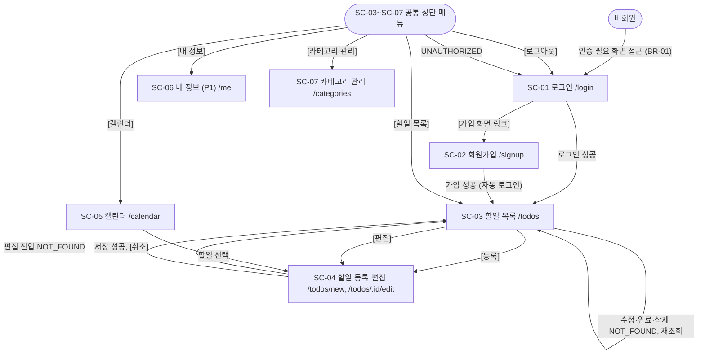

# TodoList 와이어프레임 (초안)

## 문서 정보

| 항목 | 내용 |
|------|------|
| 현재 버전 | v0.1 |
| 상태 | 초안 |
| 최초 작성일 | 2026-11-04 |
| 최종 수정일 | 2026-11-04 |
| 참조 문서 | `docs/1-domain-definition.md` v0.4, `docs/2-PRD.md` v0.4, `docs/3-user-scenario.md` v0.2 |

ID 규칙: 이 문서에서 새로 부여하는 ID는 WF(화면별 와이어프레임)와 CP(공통 컴포넌트)뿐이다. F, UC, BR, ST, D는 도메인 정의서, SC, NFR, PD는 PRD, US, PS는 사용자 시나리오의 ID를 참조만 하며 재정의하지 않는다. 번호 공백은 허용하고, 삭제된 ID는 재사용하지 않는다.

## 변경 이력

| 버전 | 일자 | 작성자 | 변경 내용 | 영향 ID |
|------|------|--------|-----------|---------|
| v0.1 | 2026-11-04 | - | 초안 작성 | 전체 (WF-01~07, CP-01~06) |

---

## 1. 개요

### 1.1 목적

PRD 4.1의 화면 SC-01~SC-07을 구현하기 전에 구조, 배치, 요소를 합의하기 위한 텍스트(ASCII) 와이어프레임을 정의한다. 구현자는 화면별 요소 표를 그대로 컴포넌트 목록으로 쓴다.

### 1.2 범위

- 대상: SC-01~SC-07 전부. SC-06(내 정보)은 P1이므로 WF-06 제목에 "(P1)"을 붙인다.
- 포함: 화면별 요소 배치, 요소의 동작·이동, 관련 BR·오류 코드, 상태 변형(빈 목록·오류·로딩), 화면 흐름, 반응형 차이.
- 제외: 색, 폰트, 여백 수치, 이미지, 접근성, 다크 모드, 별도 UI 라이브러리 (PRD 2.2, R-01). 날짜 선택기는 브라우저 기본 `input type="date"`다.
- 데스크톱은 1280px, 모바일은 375px 기준이다. 기준점은 768px 하나다 (PRD 4.3).
- PRD에 정의가 없는 화면 문구(안내문, 빈 목록 문구, 로딩 문구)는 이 문서가 예시로 정한 것이며 구현 시 바꿀 수 있다.

### 1.3 표기법

| 기호 | 의미 |
|------|------|
| `[로그인]` | 버튼·링크. 이름은 PRD·시나리오와 같다 |
| `[______]` | 텍스트 입력. 값이 있으면 `[이서준____]`처럼 값 뒤를 `_`로 채운다 |
| `[____-__-__]` | 날짜 입력 (브라우저 기본 `input type="date"`) |
| `[미선택 (v)]` | 선택 상자(드롭다운). `(v)`가 붙는다 |
| `[x]` / `[ ]` | 체크 상자 켜짐 / 꺼짐. 할일 행에서는 `[완료 체크]` |
| `<시작 전>` `<진행중>` `<완료>` `<기한 초과>` | 상태 배지 (CP-04) |
| `<전>` `<진>` `<완>` `<초>` | 캘린더 칸 안의 축약 배지 |
| `[-삭제-]` | 비활성 버튼 |
| `!! {message}` | 오류 메시지 영역 (CP-02) |
| `{ }` | 값 또는 문구 자리표시 |
| `(필수)` | 필수 입력 |
| `*` | 캘린더에서 오늘 날짜, 현재 선택된 뷰 |
| `(10-26)` | 캘린더 월 뷰의 이웃 달 날짜 칸 (BR-35) |
| `+ - \|` | 화면, 영역, 표 경계 |

- 날짜는 `MM-DD`이며 연도를 생략하면 2026년이다. 기준일 today = 2026-11-03(화)이다.
- 샘플 데이터는 시나리오 3장의 PS-02(이서준) 할일 7건과 카테고리(기본, 업무, 개인)다. 목록 기본 정렬 순서는 id 6, 1, 2, 5, 4, 3, 7이다 (BR-31 아래 기본 정렬).
- 캘린더 칸의 제목은 칸 너비에 맞춰 앞 3자만 쓴다(실제 화면은 말줄임).
- 각 ASCII는 터미널 80열 안에 들어간다.

---

## 2. 공통 컴포넌트

### CP-01 상단 메뉴

인증 후 화면(SC-03~SC-07)에 둔다. SC-01, SC-02에는 없다 (PRD 4.1).

```text
[데스크톱 768px 이상]
+----------------------------------------------------------------------------+
| TodoList  [할일 목록] [캘린더] [카테고리 관리] [내 정보] [로그아웃]        |
+----------------------------------------------------------------------------+

[모바일 768px 미만 - 닫힘]
+-----------------------------------------+
| TodoList                         [메뉴] |
+-----------------------------------------+

[모바일 - 열림]
+-----------------------------------------+
| TodoList                         [메뉴] |
+-----------------------------------------+
| [할일 목록]                             |
| [캘린더]                                |
| [카테고리 관리]                         |
| [내 정보]                               |
| [로그아웃]                              |
+-----------------------------------------+
```

| 요소 | 동작 | 관련 규칙 ID |
|------|------|--------------|
| [할일 목록] | SC-03(`/todos`)으로 이동 | F-05 |
| [캘린더] | SC-05(`/calendar`)로 이동 | F-08 |
| [카테고리 관리] | SC-07(`/categories`)로 이동 | F-11 |
| [내 정보] | SC-06(`/me`)으로 이동. P1이므로 F-03 구현 전에는 항목을 숨긴다 | F-03 |
| [로그아웃] | 로그아웃 API 호출, 서버의 쿠키 삭제 응답 후 TanStack Query 캐시·Zustand 스토어를 초기화하고 SC-01로 이동 | F-09, UC-03, BR-01 |
| [메뉴] (모바일만) | 간이 메뉴를 열고 닫는다. 열린 항목은 데스크톱과 같다 | - |

### CP-02 오류 메시지 영역

화면 제목 바로 아래, 본문 맨 위에 둔다. 오류가 없으면 보이지 않는다. SC-04는 입력란 아래에 필드 오류 표시를 추가한다.

```text
[화면 상단 영역]
+----------------------------------------------------------------+
| !! {message}                                                   |
+----------------------------------------------------------------+

[SC-04 필드 오류]
제목 (필수)  [____________________]
             !! {필드 오류}
```

| 요소 | 동작 | 관련 규칙 ID |
|------|------|--------------|
| `!! {message}` | 거부 응답 `{ code, message }`의 message를 그대로 표시한다. code는 화면에 표시하지 않고 동작 분기에만 쓴다. 새 요청을 시작하면 이전 메시지를 지운다 | BR-51 |
| `UNAUTHORIZED` 분기 | 메시지를 표시하지 않고 SC-01로 이동한다 | BR-01, BR-53 |
| `INVALID_CREDENTIALS` 분기 | 현재 화면(SC-01, SC-06)을 유지하고 단일 message를 표시한다 | BR-05, BR-06 |
| `NOT_FOUND` 분기 | 화면별로 다르다. 편집 화면 진입 시 표시 후 SC-03으로 이동, SC-03 요청 시 표시 후 목록 재조회 | BR-02, BR-16 |
| 필드 오류 (SC-04) | 제목 비움, 시작일 > 종료일처럼 클라이언트가 판별할 수 있는 경우에 해당 입력란 아래에 표시한다 | BR-21, BR-22 |

### CP-03 확인 대화상자

SC-03의 할일 삭제와 SC-07의 카테고리 삭제에서 쓴다.

```text
+--------------------------------------------+
| {제목}                                     |
|                                            |
| {안내 문구}                                |
|                                            |
|              [취소]   [확인]               |
+--------------------------------------------+
```

| 요소 | 동작 | 관련 규칙 ID |
|------|------|--------------|
| {제목} | 대상 이름을 포함한다. 예: 할일 `헬스장 등록` 삭제 | UC-08, UC-11 |
| {안내 문구} | SC-03: 영구 삭제이며 복구할 수 없음을 안내. SC-07: 소속 할일이 기본 카테고리로 이동함을 안내 | BR-27, BR-15 |
| [취소] | 대화상자를 닫는다. 데이터 변화 없음 | - |
| [확인] | 삭제 요청을 보낸다. 성공하면 목록에서 사라진다. `NOT_FOUND`면 CP-02에 표시하고 목록을 다시 조회한다 | BR-27, BR-15, `NOT_FOUND` |

### CP-04 상태 배지

서버가 계산해 응답한 상태 값을 글자로만 구분해 표시한다. 클릭할 수 없다.

```text
시작 전      진행중      완료      기한 초과
<시작 전>    <진행중>    <완료>    <기한 초과>
캘린더 축약:  <전>        <진>      <완>      <초>
```

| 요소 | 동작 | 관련 규칙 ID |
|------|------|--------------|
| `<시작 전>` | 미완료이고 today < 시작일 | ST-03 |
| `<진행중>` | 미완료이고 시작일 ≤ today ≤ 종료일 | ST-04 |
| `<완료>` | 완료 처리된 할일. 종료일이 지났어도 완료다 | ST-01 |
| `<기한 초과>` | 미완료이고 today > 종료일 | ST-02 |
| 갱신 시점 | 완료 체크 변경은 서버 응답 후에만 배지를 바꾼다 (낙관적 업데이트 없음) | BR-26, ST-01~04 |

### CP-05 할일 행

SC-03 목록의 한 항목이다. 데스크톱은 열 6개 표 형태, 모바일은 2줄 카드형이다.

```text
[데스크톱]
+-----+------------------+------------+----------+------------+--------------+
| [ ] | 헬스장 등록      | 10-26~11-01| 기본     | <기한 초과>| [편집] [삭제]|
+-----+------------------+------------+----------+------------+--------------+

[모바일]
+-----------------------------------------+
| [ ] 헬스장 등록             <기한 초과> |
|     10-26~11-01  기본  [편집] [삭제]    |
+-----------------------------------------+
```

| 요소 | 동작 | 관련 규칙 ID |
|------|------|--------------|
| `[완료 체크]` (`[ ]`/`[x]`) | 변경 시 `isCompleted` 값을 명시 지정해 요청한다. 서버 응답 후 체크와 배지를 갱신한다 | F-10, UC-07, BR-25, BR-28 |
| 제목 | 표시만 한다 | BR-41 |
| 기간 | `시작일~종료일`로 표시한다 | BR-21 |
| 카테고리 | 카테고리 이름을 표시한다 | BR-12 |
| 상태 배지 | CP-04 | ST-01~04 |
| [편집] | SC-04 편집 모드(`/todos/:id/edit`)로 이동 | F-07, UC-06 |
| [삭제] | CP-03을 연다 | F-06, UC-08 |

### CP-06 빈 목록 안내

SC-03 목록에 항목이 없을 때 목록 자리에 표시한다. 오류가 아니다 (UC-09).

```text
[할일이 하나도 없을 때]
+----------------------------------------------------------------+
|   등록된 할일이 없습니다. [등록]으로 첫 할일을 추가하세요.     |
+----------------------------------------------------------------+

[필터 결과가 없을 때]
+----------------------------------------------------------------+
|   조건에 맞는 할일이 없습니다.                                 |
+----------------------------------------------------------------+
```

| 요소 | 동작 | 관련 규칙 ID |
|------|------|--------------|
| 안내 문구 (필터 미선택) | 가입 직후처럼 할일이 0건일 때 표시한다 | UC-01, UC-09 |
| 안내 문구 (필터 선택) | 카테고리·상태 선택 결과가 0건일 때 표시한다. 필터 선택은 유지한다 | BR-31, UC-09 |

---

## 3. 화면별 와이어프레임

### WF-01 로그인 (SC-01)

- 경로: `/login`
- 관련 ID: SC-01 / F-01 / UC-02

데스크톱 1280px:

```text
+----------------------------------------------------------------------------+
| TodoList                                                                   |
+----------------------------------------------------------------------------+
|                                                                            |
|                                로그인                                      |
|                                                                            |
|   !! {message}   (CP-02, 오류 시에만 표시)                                 |
|                                                                            |
|        이메일      [______________________________]                        |
|        비밀번호    [______________________________]                        |
|                                                                            |
|                    [로그인]                                                |
|                                                                            |
|        계정이 없으신가요?  [가입 화면 링크]                                |
|                                                                            |
+----------------------------------------------------------------------------+
```

모바일 375px: 단일 열이므로 데스크톱과 같고, 입력란이 화면 너비를 채운다.

| 요소 | 동작·이동 | 관련 BR·오류 코드 |
|------|-----------|-------------------|
| 이메일 입력 | 로그인 ID 입력 | BR-06 |
| 비밀번호 입력 | 입력값은 가려서 표시 | BR-06 |
| [로그인] | 로그인 요청. 성공하면 SC-03으로 이동 | BR-06 |
| [가입 화면 링크] | SC-02(`/signup`)로 이동 | - |
| 오류 메시지 영역 (CP-02) | 실패 시 이메일·비밀번호 중 무엇이 틀렸는지 구분하지 않는 단일 message 표시, SC-01 유지 | BR-06, `INVALID_CREDENTIALS` |

상태 변형: 빈 목록 해당 없음. 오류는 CP-02에 표시하고 `UNAUTHORIZED`로 이동해 온 경우는 별도 문구 없이 이 화면만 보인다. 로딩은 요청 중 [로그인]을 비활성(`[-로그인-]`)으로 둔다.

### WF-02 회원가입 (SC-02)

- 경로: `/signup`
- 관련 ID: SC-02 / F-01 / UC-01

데스크톱 1280px:

```text
+----------------------------------------------------------------------------+
| TodoList                                                                   |
+----------------------------------------------------------------------------+
|                                                                            |
|                              회원가입                                      |
|                                                                            |
|   !! {message}   (CP-02, 오류 시에만 표시)                                 |
|                                                                            |
|   이메일      [________________________]  {제약 안내: BR-43}               |
|   비밀번호    [________________________]  {제약 안내: BR-44}               |
|   이름        [________________________]  {제약 안내: BR-45}               |
|                                                                            |
|               [가입]                                                       |
|                                                                            |
+----------------------------------------------------------------------------+
```

모바일 375px: 단일 열이므로 데스크톱과 같다. 제약 안내는 각 입력란 아래 줄로 내려간다.

| 요소 | 동작·이동 | 관련 BR·오류 코드 |
|------|-----------|-------------------|
| 이메일 입력 | 가입 ID 입력 | BR-43, BR-04 |
| 비밀번호 입력 | 입력값은 가려서 표시 | BR-44 |
| 이름 입력 | 표시 이름 입력 | BR-45 |
| 입력 제약 안내 | 각 입력란 옆에 해당 BR의 제약을 안내 문구로 표시 | BR-43~45 |
| [가입] | 가입 요청. 성공하면 자동 로그인 상태로 SC-03으로 이동(SC-01을 거치지 않음) | BR-04, BR-11 |
| 오류 메시지 영역 (CP-02) | 실패 시 SC-02에 머물며 message 표시. 계정은 만들어지지 않는다 | `DUPLICATE_EMAIL`, `VALIDATION_ERROR` |

상태 변형: 빈 목록 해당 없음. 오류는 CP-02에 표시한다. 로딩은 요청 중 [가입]을 비활성(`[-가입-]`)으로 둔다. SC-01로 돌아가는 별도 링크는 없고 브라우저 뒤로 가기를 쓴다 (PRD 4.1 핵심 요소, US-18 1단계).

### WF-03 할일 목록 (SC-03)

- 경로: `/todos` (홈)
- 관련 ID: SC-03 / F-05, F-06, F-09, F-10 / UC-03, UC-07, UC-08, UC-09

데스크톱 1280px:

```text
+----------------------------------------------------------------------------+
| TodoList  [할일 목록] [캘린더] [카테고리 관리] [내 정보] [로그아웃]        |
+----------------------------------------------------------------------------+
| 할일 목록                                                           [등록] |
| 카테고리 [미선택 (v)]     상태 [미선택 (v)]                                |
| !! {message}   (CP-02, 오류 시에만 표시)                                   |
+-----+------------------+------------+----------+------------+--------------+
| 완료| 제목             | 기간       | 카테고리 | 상태       | 동작         |
+-----+------------------+------------+----------+------------+--------------+
| [ ] | 헬스장 등록      | 10-26~11-01| 기본     | <기한 초과>| [편집] [삭제]|
| [x] | 주간 보고서 제출 | 11-01~11-02| 업무     | <완료>     | [편집] [삭제]|
| [ ] | 거래처 견적 회신 | 11-01~11-02| 업무     | <기한 초과>| [편집] [삭제]|
| [ ] | 분기 계획 작성   | 10-31~11-03| 업무     | <진행중>   | [편집] [삭제]|
| [ ] | 은행 서류 제출   | 11-03~11-03| 개인     | <진행중>   | [편집] [삭제]|
| [ ] | 팀 회의 자료 준비| 11-04~11-05| 업무     | <시작 전>  | [편집] [삭제]|
| [ ] | 가족 여행 준비   | 11-08~11-10| 개인     | <시작 전>  | [편집] [삭제]|
+-----+------------------+------------+----------+------------+--------------+
```

모바일 375px:

```text
+-----------------------------------------+
| TodoList                         [메뉴] |
+-----------------------------------------+
| 할일 목록                        [등록] |
| 카테고리  [미선택 (v)]                  |
| 상태      [미선택 (v)]                  |
| !! {message}   (CP-02)                  |
+-----------------------------------------+
| [ ] 헬스장 등록             <기한 초과> |
|     10-26~11-01  기본  [편집] [삭제]    |
+-----------------------------------------+
| [x] 주간 보고서 제출             <완료> |
|     11-01~11-02  업무  [편집] [삭제]    |
+-----------------------------------------+
| [ ] 거래처 견적 회신        <기한 초과> |
|     11-01~11-02  업무  [편집] [삭제]    |
+-----------------------------------------+
| [ ] 분기 계획 작성             <진행중> |
|     10-31~11-03  업무  [편집] [삭제]    |
+-----------------------------------------+
| [ ] 은행 서류 제출             <진행중> |
|     11-03~11-03  개인  [편집] [삭제]    |
+-----------------------------------------+
| [ ] 팀 회의 자료 준비         <시작 전> |
|     11-04~11-05  업무  [편집] [삭제]    |
+-----------------------------------------+
| [ ] 가족 여행 준비            <시작 전> |
|     11-08~11-10  개인  [편집] [삭제]    |
+-----------------------------------------+
```

| 요소 | 동작·이동 | 관련 BR·오류 코드 |
|------|-----------|-------------------|
| 공통 상단 메뉴 (CP-01) | 데스크톱은 가로 메뉴, 모바일은 [메뉴] 간이 메뉴 | BR-01 |
| [등록] | SC-04 등록 모드(`/todos/new`)로 이동 | BR-21 |
| 카테고리 선택 | 미선택(필터 없음) 또는 내 카테고리 하나. 변경하면 목록을 다시 조회한다. 모든 요청에 today 포함 | BR-31, BR-16, `NOT_FOUND` |
| 상태 선택 | 미선택(필터 없음) / 시작 전 / 진행중 / 완료 / 기한 초과 중 하나. 카테고리 선택과 AND | BR-31, BR-32, ST-01~04, `VALIDATION_ERROR` |
| 할일 행 (CP-05) | 기본 정렬 순서로 표시 | BR-31 |
| `[완료 체크]` | CP-05 참조. 서버 응답 후 배지 갱신 | BR-25, BR-28, `NOT_FOUND` |
| [편집] | SC-04 편집 모드(`/todos/:id/edit`)로 이동 | BR-02 |
| [삭제] | CP-03 표시 후 [확인]하면 삭제 | BR-27, `NOT_FOUND` |
| 빈 목록 안내 (CP-06) | 항목이 0건일 때 목록 자리에 표시 | BR-31 |
| [로그아웃] | CP-01 참조. SC-01로 이동 | BR-01 |
| 오류 메시지 영역 (CP-02) | 요청 실패 시 message 표시. `NOT_FOUND`면 표시 후 목록 재조회, `UNAUTHORIZED`면 SC-01로 이동 | BR-51, BR-53, `NOT_FOUND`, `UNAUTHORIZED` |

상태 변형: 빈 목록은 목록 자리를 CP-06으로 바꾸고, 오류는 CP-02에 표시하며, 로딩은 목록 자리에 `불러오는 중...` 한 줄을 표시한다.

### WF-04 할일 등록·편집 (SC-04)

- 경로: `/todos/new` (등록), `/todos/:id/edit` (편집)
- 관련 ID: SC-04 / F-02, F-04, F-07 / UC-05, UC-06

데스크톱 1280px (편집 모드, 할일 3의 값):

```text
+----------------------------------------------------------------------------+
| TodoList  [할일 목록] [캘린더] [카테고리 관리] [내 정보] [로그아웃]        |
+----------------------------------------------------------------------------+
| 할일 편집   (등록 모드의 제목은 "할일 등록", 모든 입력란이 비어 있음)      |
| !! {message}   (CP-02, 오류 시에만 표시)                                   |
|                                                                            |
|   제목 (필수)    [팀 회의 자료 준비______________________]                 |
|   설명           [______________________________________]                  |
|                  [______________________________________]                  |
|   시작일 (필수)  [2026-11-04]        종료일 (필수)  [2026-11-05]           |
|                  {사전 안내: 시작일 > 종료일일 때만 표시}                  |
|   카테고리       [업무 (v)]                                                |
|                                                                            |
|   [저장]  [취소]                                                           |
+----------------------------------------------------------------------------+
```

모바일 375px:

```text
+-----------------------------------------+
| TodoList                         [메뉴] |
+-----------------------------------------+
| 할일 편집                               |
| !! {message}   (CP-02)                  |
|                                         |
| 제목 (필수)                             |
| [팀 회의 자료 준비_______________]      |
| 설명                                    |
| [_______________________________]       |
| [_______________________________]       |
| 시작일 (필수)                           |
| [2026-11-04]                            |
| 종료일 (필수)                           |
| [2026-11-05]                            |
| {사전 안내: 시작일 > 종료일일 때만}     |
| 카테고리                                |
| [업무 (v)]                              |
|                                         |
| [저장]  [취소]                          |
+-----------------------------------------+
```

| 요소 | 동작·이동 | 관련 BR·오류 코드 |
|------|-----------|-------------------|
| 제목 입력 | 필수. 비우면 필드 오류 | BR-21, BR-41, `VALIDATION_ERROR` |
| 설명 입력 | 선택, 여러 줄 | BR-42, `VALIDATION_ERROR` |
| 시작일·종료일 입력 | 브라우저 기본 날짜 선택기. 과거 날짜 선택 가능. 클라이언트가 시작일 > 종료일을 사전 안내하되 서버 응답이 최종 기준 | BR-21, BR-22, BR-23, `INVALID_DATE_RANGE` |
| 카테고리 선택 | 내 카테고리 목록. 미선택이면 기본 카테고리 적용 | BR-12, BR-16, `NOT_FOUND` |
| [저장] | 저장 요청. 성공하면 SC-03으로 이동해 변경이 반영된다. 실패하면 SC-04에 머물고 입력값을 유지한다 | BR-52, `VALIDATION_ERROR`, `INVALID_DATE_RANGE`, `UNAUTHORIZED` |
| [취소] | 변경 없이 SC-03으로 이동 | - |
| 편집 모드 진입 | 기존 값을 채운다. 완료 여부는 이 화면에서 바꾸지 않는다 | BR-02, BR-26, `NOT_FOUND` |
| 오류 메시지 영역 (CP-02) | 서버 message 표시. 편집 진입 시 `NOT_FOUND`면 표시 후 SC-03으로 이동. `UNAUTHORIZED`면 SC-01로 이동 | BR-53, `NOT_FOUND`, `UNAUTHORIZED` |

상태 변형: 빈 목록 해당 없음(등록 모드는 빈 입력란). 오류는 CP-02와 필드 오류로 표시하고, 로딩(편집 진입 시 조회)은 입력란 자리에 `불러오는 중...` 한 줄을 표시하며 [저장]을 비활성(`[-저장-]`)으로 둔다.

---

### WF-05 캘린더 (SC-05)

- 경로: `/calendar`
- 관련 ID: SC-05 / F-08 / UC-10

데스크톱은 뷰마다 칸 배치가 달라 월(기본 진입 뷰), 주, 일 순으로 세 장을 둔다. 세 뷰는 anchorDate 11-03, today 11-03이다. 칸에는 BR-33에 따라 겹치는 모든 날짜에 할일이 표시되고, 필터는 적용하지 않는다 (BR-36).

데스크톱 1280px, 월 뷰 (10-26~12-06, 42칸. 칸 높이는 내용에 맞춰 축약해 그렸다):

```text
+----------------------------------------------------------------------------+
| TodoList  [할일 목록] [캘린더] [카테고리 관리] [내 정보] [로그아웃]        |
+----------------------------------------------------------------------------+
| 캘린더                                                                     |
| [이전] [오늘] [다음]   2026-11                             [월*] [주] [일] |
| !! {message}   (CP-02, 오류 시에만 표시)                                   |
+----------+----------+----------+----------+----------+----------+----------+
| 월       | 화       | 수       | 목       | 금       | 토       | 일       |
+----------+----------+----------+----------+----------+----------+----------+
| (10-26)  | (10-27)  | (10-28)  | (10-29)  | (10-30)  | (10-31)  | 11-01    |
|<초>헬스장|<초>헬스장|<초>헬스장|<초>헬스장|<초>헬스장|<초>헬스장|<초>헬스장|
|          |          |          |          |          |<진>분기계|<완>주간보|
|          |          |          |          |          |          |<초>거래처|
|          |          |          |          |          |          |<진>분기계|
+----------+----------+----------+----------+----------+----------+----------+
| 11-02    |*11-03    | 11-04    | 11-05    | 11-06    | 11-07    | 11-08    |
|<완>주간보|<진>분기계|<전>팀회의|<전>팀회의|          |          |<전>가족여|
|<초>거래처|<진>은행서|          |          |          |          |          |
|<진>분기계|          |          |          |          |          |          |
+----------+----------+----------+----------+----------+----------+----------+
| 11-09    | 11-10    | 11-11    | 11-12    | 11-13    | 11-14    | 11-15    |
|<전>가족여|<전>가족여|          |          |          |          |          |
+----------+----------+----------+----------+----------+----------+----------+
| 11-16    | 11-17    | 11-18    | 11-19    | 11-20    | 11-21    | 11-22    |
+----------+----------+----------+----------+----------+----------+----------+
| 11-23    | 11-24    | 11-25    | 11-26    | 11-27    | 11-28    | 11-29    |
+----------+----------+----------+----------+----------+----------+----------+
| 11-30    | (12-01)  | (12-02)  | (12-03)  | (12-04)  | (12-05)  | (12-06)  |
+----------+----------+----------+----------+----------+----------+----------+
```

데스크톱 1280px, 주 뷰 (11-02~11-08, 칸 배치는 US-14 표와 같다):

```text
+----------------------------------------------------------------------------+
| TodoList  [할일 목록] [캘린더] [카테고리 관리] [내 정보] [로그아웃]        |
+----------------------------------------------------------------------------+
| 캘린더                                                                     |
| [이전] [오늘] [다음]   11-02 ~ 11-08                       [월] [주*] [일] |
| !! {message}   (CP-02, 오류 시에만 표시)                                   |
+----------+----------+----------+----------+----------+----------+----------+
| 11-02(월)|*11-03(화)| 11-04(수)| 11-05(목)| 11-06(금)| 11-07(토)| 11-08(일)|
+----------+----------+----------+----------+----------+----------+----------+
|<완>주간보|<진>분기계|<전>팀회의|<전>팀회의|          |          |<전>가족여|
|<초>거래처|<진>은행서|          |          |          |          |          |
|<진>분기계|          |          |          |          |          |          |
+----------+----------+----------+----------+----------+----------+----------+
```

데스크톱 1280px, 일 뷰 (11-03):

```text
+----------------------------------------------------------------------------+
| TodoList  [할일 목록] [캘린더] [카테고리 관리] [내 정보] [로그아웃]        |
+----------------------------------------------------------------------------+
| 캘린더                                                                     |
| [이전] [오늘] [다음]   11-03(화)                           [월] [주] [일*] |
| !! {message}   (CP-02, 오류 시에만 표시)                                   |
+----------------------------------------------------------------------------+
| *11-03(화)                                                                 |
|   <진행중> 분기 계획 작성        10-31~11-03    업무                       |
|   <진행중> 은행 서류 제출        11-03~11-03    개인                       |
+----------------------------------------------------------------------------+
```

모바일 375px, 월 뷰 (칸에 제목 대신 개수·점으로 축약, PRD 4.3):

```text
+-----------------------------------------+
| TodoList                         [메뉴] |
+-----------------------------------------+
| 캘린더                                  |
| [이전] [오늘] [다음]                    |
| 2026-11                 [월*] [주] [일] |
| !! {message}   (CP-02)                  |
+-----+-----+-----+-----+-----+-----+-----+
| 월  | 화  | 수  | 목  | 금  | 토  | 일  |
+-----+-----+-----+-----+-----+-----+-----+
| (26)| (27)| (28)| (29)| (30)| (31)| 01  |
| o   | o   | o   | o   | o   | oo  | oooo|
+-----+-----+-----+-----+-----+-----+-----+
| 02  |*03  | 04  | 05  | 06  | 07  | 08  |
| ooo | oo  | o   | o   |     |     | o   |
+-----+-----+-----+-----+-----+-----+-----+
| 09  | 10  | 11  | 12  | 13  | 14  | 15  |
| o   | o   |     |     |     |     |     |
+-----+-----+-----+-----+-----+-----+-----+
| 16  | 17  | 18  | 19  | 20  | 21  | 22  |
+-----+-----+-----+-----+-----+-----+-----+
| 23  | 24  | 25  | 26  | 27  | 28  | 29  |
+-----+-----+-----+-----+-----+-----+-----+
| 30  | (01)| (02)| (03)| (04)| (05)| (06)|
+-----+-----+-----+-----+-----+-----+-----+
o = 할일 1건
```

모바일 375px, 주 뷰 (7열 대신 날짜별 세로 목록. 일 뷰는 이 목록의 날짜 하나와 같다):

```text
+-----------------------------------------+
| TodoList                         [메뉴] |
+-----------------------------------------+
| 캘린더                                  |
| [이전] [오늘] [다음]                    |
| 11-02 ~ 11-08           [월] [주*] [일] |
| !! {message}   (CP-02)                  |
+-----------------------------------------+
| 11-02(월)                               |
|   <완료> 주간 보고서 제출               |
|   <기한 초과> 거래처 견적 회신          |
|   <진행중> 분기 계획 작성               |
+-----------------------------------------+
| *11-03(화)                              |
|   <진행중> 분기 계획 작성               |
|   <진행중> 은행 서류 제출               |
+-----------------------------------------+
| 11-04(수)                               |
|   <시작 전> 팀 회의 자료 준비           |
+-----------------------------------------+
| 11-05(목)                               |
|   <시작 전> 팀 회의 자료 준비           |
+-----------------------------------------+
| 11-06(금)                               |
|   (없음)                                |
+-----------------------------------------+
| 11-07(토)                               |
|   (없음)                                |
+-----------------------------------------+
| 11-08(일)                               |
|   <시작 전> 가족 여행 준비              |
+-----------------------------------------+
```

| 요소 | 동작·이동 | 관련 BR·오류 코드 |
|------|-----------|-------------------|
| 공통 상단 메뉴 (CP-01) | 데스크톱은 가로 메뉴, 모바일은 [메뉴] 간이 메뉴 | BR-01 |
| [월] [주] [일] | 뷰 전환. 기본 진입 뷰는 월, anchorDate는 오늘 | BR-35 |
| [이전] / [다음] | anchorDate를 월 뷰는 이전/다음 달 1일, 주 뷰는 ±7일, 일 뷰는 ±1일로 옮기고 재조회한다 | BR-35 |
| [오늘] | anchorDate를 today로 되돌린다 | BR-35 |
| 기간 표시 | 월 뷰는 표시 달, 주 뷰는 `from ~ to`, 일 뷰는 날짜 하나 | BR-35 |
| 날짜 칸 | 조회 기간과 겹치는 할일을 겹치는 모든 날짜 칸에 표시한다. 이웃 달 칸 포함. 요청에 from, to, today를 포함한다 | BR-33, BR-35, `VALIDATION_ERROR` |
| 할일 항목 | 약어 배지 + 제목. 선택하면 SC-04 편집 모드로 이동. 칸 안의 생성·완료 처리·드래그는 없다 | BR-36, BR-02, `NOT_FOUND` |
| 상태 배지 (CP-04 축약) | 완료 할일도 표시하며 상태를 글자로 구분한다. 모바일 월 뷰는 점 개수만 표시하므로 상태 구분은 [주]/[일] 뷰에서 확인한다 | BR-36, ST-01~04 |
| 오류 메시지 영역 (CP-02) | 조회 실패 시 message 표시. `UNAUTHORIZED`면 SC-01로 이동 | BR-51, BR-53, `UNAUTHORIZED` |

상태 변형: 빈 목록은 조회 기간에 할일이 없는 빈 캘린더(칸만 표시, 안내 문구 없음)이고, 오류는 CP-02에 표시하며, 로딩은 칸 자리에 `불러오는 중...` 한 줄을 표시한다.

### WF-06 내 정보 (SC-06) (P1)

- 경로: `/me`
- 관련 ID: SC-06 / F-03 / UC-04

데스크톱 1280px:

```text
+----------------------------------------------------------------------------+
| TodoList  [할일 목록] [캘린더] [카테고리 관리] [내 정보] [로그아웃]        |
+----------------------------------------------------------------------------+
| 내 정보                                                                    |
| !! {message}   (CP-02, 오류 시에만 표시)                                   |
|                                                                            |
|   이름           [이서준____________________]                              |
|   현재 비밀번호  [__________________________]                              |
|   새 비밀번호    [__________________________]                              |
|                  (비밀번호를 바꿀 때만 두 칸을 입력)                       |
|                                                                            |
|   [저장]                                                                   |
+----------------------------------------------------------------------------+
```

모바일 375px: 단일 열이므로 데스크톱과 같고, 상단 메뉴만 CP-01의 모바일형이다.

| 요소 | 동작·이동 | 관련 BR·오류 코드 |
|------|-----------|-------------------|
| 이름 입력 | 현재 이름(`이서준`)을 채워 둔다. 수정 가능 | BR-03, BR-45, `VALIDATION_ERROR` |
| 현재 비밀번호 입력 | 비밀번호를 바꿀 때 입력한다 | BR-05, `INVALID_CREDENTIALS` |
| 새 비밀번호 입력 | 비밀번호를 바꿀 때 입력한다 | BR-44, `VALIDATION_ERROR` |
| [저장] | 본인 정보(`users/me`)만 저장한다. 성공하면 SC-06에 머물며 반영된 값을 보여준다. 이메일은 수정 대상이 아니다 | BR-03, BR-05 |
| 오류 메시지 영역 (CP-02) | 실패 시 SC-06을 유지한다. `INVALID_CREDENTIALS`여도 SC-01로 이동하지 않는다. 기존 비밀번호는 유지된다 | BR-05, `INVALID_CREDENTIALS`, `VALIDATION_ERROR`, `UNAUTHORIZED` |

상태 변형: 빈 목록 해당 없음. 오류는 CP-02에 표시하고, 로딩(현재 정보 조회)은 입력란 자리에 `불러오는 중...` 한 줄을 표시한다.

### WF-07 카테고리 관리 (SC-07)

- 경로: `/categories`
- 관련 ID: SC-07 / F-11 / UC-11

데스크톱 1280px:

```text
+----------------------------------------------------------------------------+
| TodoList  [할일 목록] [캘린더] [카테고리 관리] [내 정보] [로그아웃]        |
+----------------------------------------------------------------------------+
| 카테고리 관리                                                              |
| 이름 [________________________]  [추가]                                    |
| !! {message}   (CP-02, 오류 시에만 표시)                                   |
+----------------------+------------------+----------------------------------+
| 이름                 | 구분             | 동작                             |
+----------------------+------------------+----------------------------------+
| 기본                 | 기본 카테고리    | [-이름 변경-] [-삭제-]           |
| 업무                 |                  | [이름 변경] [삭제]               |
| 개인                 |                  | [이름 변경] [삭제]               |
+----------------------+------------------+----------------------------------+

[이름 변경 중인 행]
+----------------------+------------------+----------------------------------+
| [업무____________]   |                  | [저장] [취소]                    |
+----------------------+------------------+----------------------------------+
```

모바일 375px:

```text
+-----------------------------------------+
| TodoList                         [메뉴] |
+-----------------------------------------+
| 카테고리 관리                           |
| 이름 [______________________]           |
| [추가]                                  |
| !! {message}   (CP-02)                  |
+-----------------------------------------+
| 기본   (기본 카테고리)                  |
| [-이름 변경-] [-삭제-]                  |
+-----------------------------------------+
| 업무                                    |
| [이름 변경] [삭제]                      |
+-----------------------------------------+
| 개인                                    |
| [이름 변경] [삭제]                      |
+-----------------------------------------+
```

| 요소 | 동작·이동 | 관련 BR·오류 코드 |
|------|-----------|-------------------|
| 이름 입력 + [추가] | 새 카테고리를 만든다. 실패하면 SC-07을 유지하고 개수를 바꾸지 않는다 | BR-14, BR-17, BR-46, `DUPLICATE_CATEGORY_NAME`, `VALIDATION_ERROR`, `CATEGORY_LIMIT_EXCEEDED` |
| 카테고리 목록 | 내 카테고리를 표시한다. 기본 카테고리에는 구분 표시(`기본 카테고리`)를 붙인다 | BR-11, BR-13 |
| [이름 변경] | 그 행이 입력란과 [저장] [취소]로 바뀐다. [저장]하면 이름이 갱신된다. [취소]는 원래 행으로 돌아간다 | BR-14, BR-17, BR-46, `DUPLICATE_CATEGORY_NAME`, `VALIDATION_ERROR` |
| [삭제] | CP-03을 열고, 안내 문구에 소속 할일의 기본 카테고리 이동을 안내한다. [확인]하면 삭제한다 | BR-15, `NOT_FOUND` |
| 기본 행의 [-이름 변경-] [-삭제-] | 항상 비활성이다. API 직접 호출 때만 `DEFAULT_CATEGORY_PROTECTED`가 나온다 | BR-13, BR-17, `DEFAULT_CATEGORY_PROTECTED` |
| 오류 메시지 영역 (CP-02) | 실패 시 message 표시. `UNAUTHORIZED`면 SC-01로 이동 | BR-51, BR-53, `UNAUTHORIZED` |

상태 변형: 빈 목록은 해당 없음(기본 카테고리가 항상 1개 있다, BR-11). 오류는 CP-02에 표시하고, 로딩은 목록 자리에 `불러오는 중...` 한 줄을 표시한다.

---

## 4. 화면 흐름도

PRD 4.2 기준이다. `AUTH`는 SC-03~SC-07이 공통으로 가진 상단 메뉴(CP-01)를 뜻한다. SC-06은 P1이다.



---

## 5. 반응형 규칙

기준점은 768px 하나다. 768px 미만은 모바일, 768px 이상은 데스크톱이다 (PRD 4.3). 아래는 모바일에서 바뀌는 것만 적었다. SC-01, SC-02, SC-06은 단일 열 그대로이고 CP-03 대화상자, CP-04 배지, CP-06 안내도 바뀌지 않는다.

| 화면 | 데스크톱 | 모바일 |
|------|----------|--------|
| 공통 (SC-03~SC-07) | 상단 가로 메뉴 (CP-01) | [메뉴] 버튼으로 여는 간이 메뉴 |
| SC-03 필터 | 카테고리·상태 선택이 한 줄 | 두 줄로 세로 배치 |
| SC-03 할일 행 | 열 6개 표 형태, 한 항목 1줄 (CP-05) | 2줄 카드형: 체크·제목·배지 / 기간·카테고리·버튼 |
| SC-04 입력란 | 시작일·종료일이 한 줄, 라벨이 입력란 왼쪽 | 모든 입력란이 세로 한 줄씩, 라벨이 입력란 위 |
| SC-05 도구줄 | [이전] [오늘] [다음], 기간, 뷰 전환이 한 줄 | 두 줄로 나뉨 |
| SC-05 월 뷰 | 칸에 약어 배지와 제목 일부 | 칸에 날짜와 점(할일 개수)만 표시 |
| SC-05 주 뷰 | 7열 칸 배치 | 날짜별 세로 목록 |
| SC-07 카테고리 목록 | 이름·구분·동작 3열 표 | 2줄 카드형: 이름 / 버튼 |

---

## 부록 A. 추적표

### A.1 WF → SC → F → US

US 열은 `docs/3-user-scenario.md` 부록 A.1에서 해당 SC를 가진 US를 모은 것이다.

| WF | SC | F | US |
|----|----|---|----|
| WF-01 | SC-01 | F-01 | US-01, US-02, US-03, US-16, US-18 |
| WF-02 | SC-02 | F-01 | US-01, US-18 |
| WF-03 | SC-03 | F-05, F-06, F-09, F-10 | US-01, US-02, US-03, US-04, US-05, US-07, US-08, US-09, US-10, US-11, US-12, US-13, US-16, US-18 |
| WF-04 | SC-04 | F-02, F-04, F-07 | US-04, US-07, US-08, US-09, US-11, US-13, US-16, US-17, US-18 |
| WF-05 | SC-05 | F-08 | US-13, US-14, US-15, US-18 |
| WF-06 | SC-06 | F-03 | US-19 |
| WF-07 | SC-07 | F-11 | US-01, US-04, US-05, US-06, US-18 |

### A.2 CP → 사용하는 WF

| CP | WF |
|----|----|
| CP-01 | WF-03, WF-04, WF-05, WF-06, WF-07 |
| CP-02 | WF-01, WF-02, WF-03, WF-04, WF-05, WF-06, WF-07 |
| CP-03 | WF-03, WF-07 |
| CP-04 | WF-03, WF-05 (축약형) |
| CP-05 | WF-03 |
| CP-06 | WF-03 |
