# TodoList 아키텍처 다이어그램 (초안)

## 문서 정보

| 항목 | 내용 |
|------|------|
| 문서명 | TodoList 아키텍처 다이어그램 |
| 현재 버전 | v0.5 |
| 상태 | 초안 |
| 작성일 | 2026-11-04 |
| 참조 문서 | `docs/1-domain-definition.md` v0.8, `docs/2-PRD.md` v0.9, `docs/3-user-scenario.md` v0.6, `docs/4-wireframe.md` v0.5, `docs/5-project-principle.md` v0.5, `docs/7-erd.md` v0.4, `docs/9-api-design.md` v0.1 |

ID 규칙: 이 문서에서 새로 부여하는 ID는 AD(아키텍처 다이어그램)뿐이다. F, UC, BR, ST, D는 도메인 정의서, SC, NFR, R, A, PD는 PRD, US는 사용자 시나리오, WF, CP는 와이어프레임, PR은 프로젝트 원칙의 ID를 참조만 하며 재정의하지 않는다. 다이어그램은 모두 mermaid 코드 블록이다. 문서 간 표현이 다른 지점은 PRD를 기준으로 그리고 10장에 나열한다.

## 변경 이력

| 버전 | 일자 | 작성자 | 변경 내용 | 영향 ID |
|------|------|--------|-----------|---------|
| v0.1 | 2026-11-04 | - | 초안 작성 | AD-01~15 |
| v0.2 | 2026-11-04 | - | AD-05 ERD를 docs/7-erd.md로 분리 | 문서 정보, 4장, AD-05, 8장 |
| v0.3 | 2026-11-04 | - | PRD v0.7 인증 방식 변경 반영. AD-07·AD-08을 HS384·두 쿠키 발급으로 수정, AD-06에 refresh·logout 비보호 경로, AD-14 로그아웃을 인증 미들웨어 없이 리프레시 폐기 + 두 쿠키 삭제로 수정, AD-16(액세스 만료 → 리프레시 → 재시도) 추가, AD-01·AD-04 라벨, AD-A3 변경됨, AD-C8 해결, 참조 버전 갱신 | 문서 정보, 1.2, AD-01, AD-04, AD-06, AD-07, AD-08, AD-14, AD-16, 8장, AD-A3, AD-C8 |
| v0.4 | 2026-11-04 | - | 8문서 교차 검토 반영. AD-09 인증 실패 분기를 AD-16 리프레시·재시도 후 실패 시 이동으로 수정, AD-14에 auth-service 참여자 추가(라우트는 DB를 직접 호출하지 않음, 원칙 3장), 1장 문서 수 6개·API 설계 문서 경로, 참조 버전 갱신 | 문서 정보, 1장, AD-09, AD-14 |
| v0.5 | 2026-11-04 | - | AD-C3·C4·C5 해결(`docs/9-api-design.md` 4장), 1장 '작성 예정' 표기 제거, 참조 문서에 `docs/9-api-design.md` 추가, 참조 버전 갱신 | 문서 정보, 1장, 10장 |

---

## 1. 개요

### 1.1 목적

6개 설계 문서에 흩어진 구조·흐름을 그림 한 벌로 모아, 구현자가 레이어 배치·요청 처리 순서·검증 순서·상태 판정을 문서와 대조할 수 있게 한다. 새 규칙을 정하지 않는다.

### 1.2 읽는 법

- 시퀀스 다이어그램의 participant 약어: U 사용자, FE 프론트엔드(React SPA), MW 인증 미들웨어(`middlewares/auth.js`), RT 라우트(`routes/*.js` + `validate.js`), SV 서비스(`services/*.js`), RP 저장소(`repositories/*.js`), DB PostgreSQL 17, EH 오류 미들웨어(`middlewares/error-handler.js`).
- 거부 응답은 모두 `AppError` → 오류 미들웨어 → `{ code, message }` + HTTP status(PRD 6.3) 경로를 지난다 (PR-06). 시퀀스에서는 지면을 줄이기 위해 `BE-->>FE: 4xx CODE` 한 줄로 축약한다.
- API 함수명(`todos.create` 등)은 프로젝트 원칙 7.3 `api/todos.ts`의 함수다. 엔드포인트 경로·메서드 상세는 API 설계 문서(`docs/9-api-design.md`)에서 정하므로, 원칙 7.2에 적힌 `POST /api/auth/signup|login|logout|refresh`와 PRD 6.3의 `GET /api/health` 외에는 경로를 쓰지 않는다.
- 날짜는 전 구간 `YYYY-MM-DD` 문자열이다 (PR-05). today = 클라이언트 로컬 날짜 (D-05).

---

## 2. 시스템 컨텍스트

### AD-01 시스템 컨텍스트

사용자 → 브라우저(React SPA) → Express → PostgreSQL 단일 경로다 (PRD 6.2). 서버 세션은 없고 액세스 토큰(JWT) 쿠키와 리프레시 토큰(DB에 해시 저장) 쿠키로 인증한다 (NFR-06, PRD 6.4). SPA와 API는 같은 origin이라 CORS 설정이 없다.

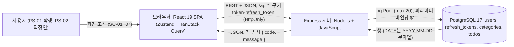

### AD-02 개발 / 운영 배포 차이

개발은 Vite 개발 서버가 `/api`를 Express로 프록시하고, 운영은 Express 하나가 `frontend/dist`와 `/api`를 함께 제공한다 (NFR-06, 원칙 6.1, 7.3). 운영은 HTTPS만 허용한다 (NFR-08). HTTPS 종료 지점은 PD-04(open)다.

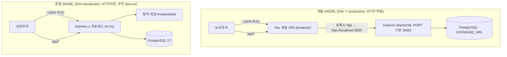

---

## 3. 컴포넌트 / 레이어 아키텍처

원칙 7.2·7.3 디렉토리 구조와 1:1이다. 화살표는 import 방향이며 한 방향만 허용된다 (원칙 3.1, 3.2, 3.4).

### AD-03 프론트엔드 레이어 (frontend/src)

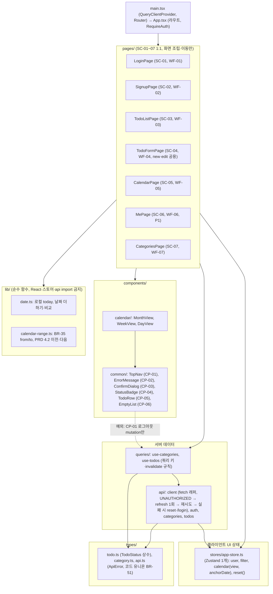

### AD-04 백엔드 레이어 (backend/src)

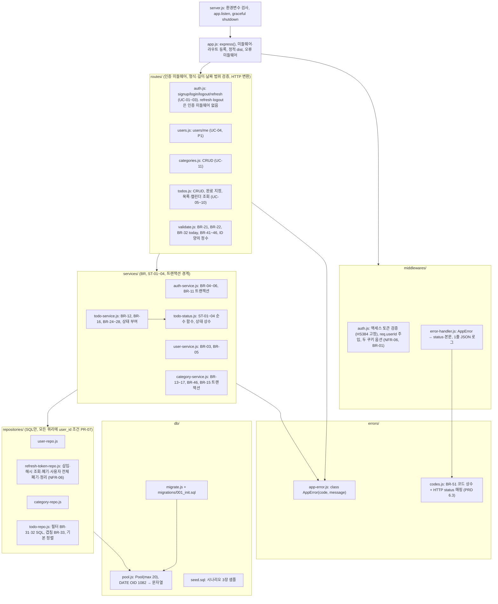

---

## 4. 데이터 모델 ERD

### AD-05 ERD

ERD는 `docs/7-erd.md`(ERD-01 개념, ERD-02 물리)로 분리했다. 이 번호는 추적표 호환을 위해 유지한다.

---

## 5. 요청 처리 파이프라인

### AD-06 미들웨어 체인

`app.js` 등록 순서다 (원칙 7.2, 3.1). `POST /api/auth/refresh`와 `POST /api/auth/logout`은 인증 미들웨어를 거치지 않는다 (PRD 6.4, AD-14, AD-16). BR-52 검증 순서의 분담: 인증 → 형식·길이 → 날짜 범위는 라우트, 존재·소유 → 보호 대상 → 중복·개수 → 자격 증명은 서비스다. ID 형식(양의 정수) 검사는 라우트에서 DB 조회 없이 `NOT_FOUND`를 낸다 (PRD 6.3, 원칙 6.2).

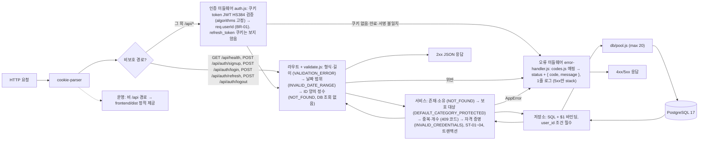

HTTP status 매핑 (PRD 6.3):

| 코드 | status |
|------|--------|
| `UNAUTHORIZED`, `INVALID_CREDENTIALS` | 401 |
| `NOT_FOUND` | 404 |
| `VALIDATION_ERROR`, `INVALID_DATE_RANGE` | 400 |
| `DUPLICATE_EMAIL`, `DUPLICATE_CATEGORY_NAME`, `CATEGORY_LIMIT_EXCEEDED` | 409 |
| `DEFAULT_CATEGORY_PROTECTED` | 403 |

---

## 6. 시퀀스 다이어그램

### AD-07 회원가입 → 자동 로그인 → 기본 카테고리 생성 (UC-01, BR-04, BR-11, BR-43~45, US-01, SC-02)

계정 생성과 기본 카테고리 생성은 `auth-service.js`의 한 트랜잭션이다 (원칙 3.1). 실패 시 둘 다 생성되지 않는다 (UC-01 예외 흐름).

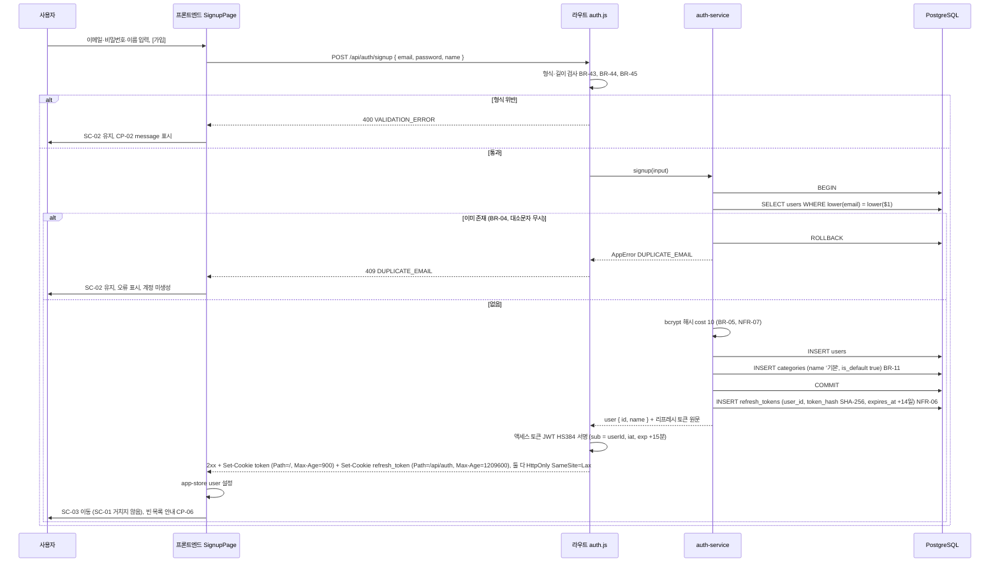

### AD-08 로그인 + 액세스·리프레시 쿠키 발급 + 보호 API 인증 검사 (UC-02, BR-01, BR-06, BR-53, US-02, US-16, NFR-06)

로그인 실패 사유는 구분하지 않는다 (BR-06). `INVALID_CREDENTIALS`는 401이지만 화면 이동이 없다. 보호 API의 `UNAUTHORIZED`는 클라이언트가 먼저 리프레시 1회 후 재시도하고(AD-16), 그래도 실패할 때만 SC-01로 이동한다 (PRD 4.2, CP-02). 로그인 시 그 사용자의 만료·폐기된 리프레시 행을 삭제한다 (PRD 6.4).

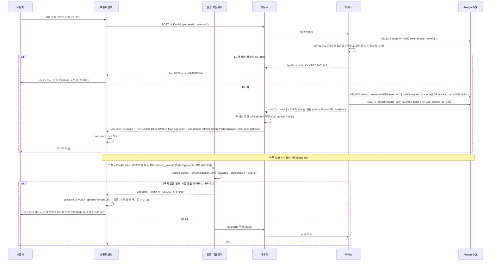

### AD-09 할일 생성·수정의 BR-52 검증 순서 (UC-05, UC-06, BR-12, BR-16, BR-21~24, BR-41, BR-42, BR-52, US-07, US-08, US-09, SC-04)

한 요청에 여러 위반이 있으면 첫 위반 코드로 거부하고 부분 저장하지 않는다 (BR-52). 수정 시에도 `isCompleted`는 바뀌지 않는다 (UC-06). 할일에는 보호 대상·중복·자격 증명 단계가 없다.

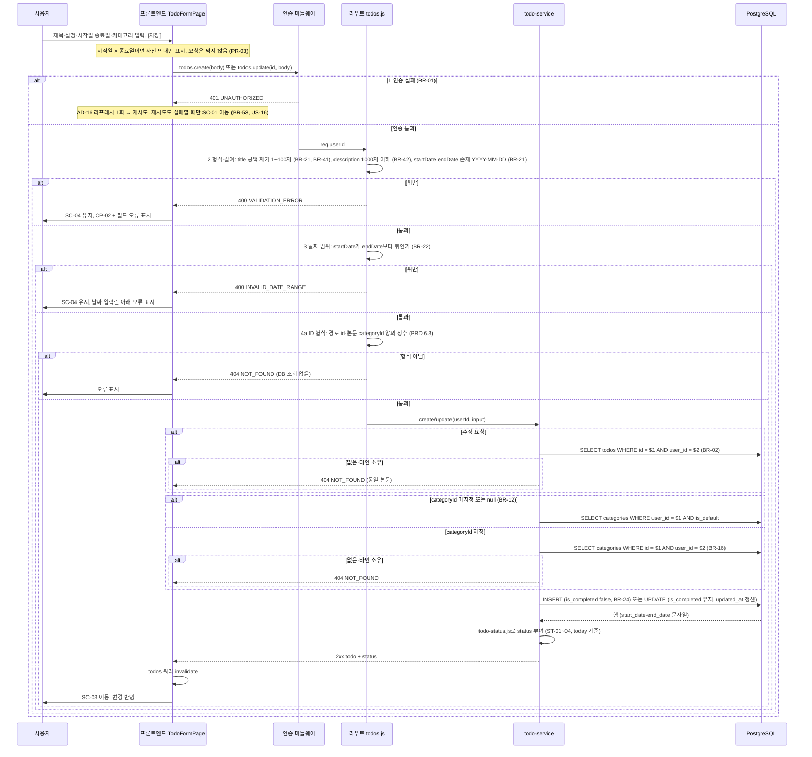

### AD-10 완료 처리와 상태 파생 (UC-07, BR-25, BR-28, ST-01~04, D-10, US-10, CP-04, CP-05)

요청은 `isCompleted` 값을 명시 지정한다 (토글 아님, 멱등). 낙관적 업데이트 없이 서버 응답 후 배지를 갱신한다 (PRD 4.2).

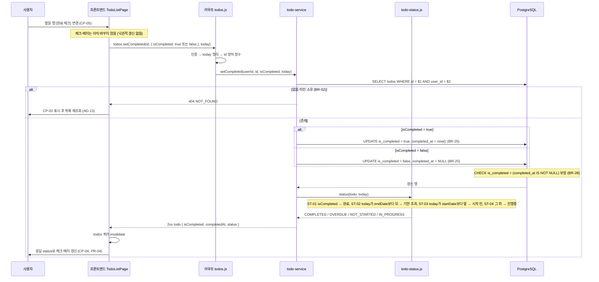

### AD-11 캘린더 조회와 기간 이동 (UC-10, BR-33, BR-35, BR-36, US-13, US-14, US-15, SC-05, PRD 4.2)

캘린더는 별도 리소스가 아니다. 클라이언트가 BR-35로 `from`/`to`를 산정해 todos 목록을 기간 조건으로 조회하고, 서버는 BR-33 겹침 조건과 today 상태 판정만 적용한다 (PRD 6.3). 카테고리·상태 필터는 적용하지 않는다 (BR-36).

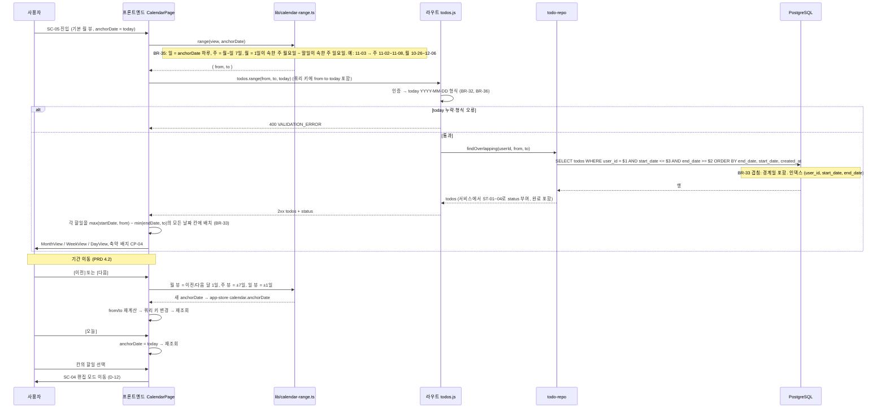

### AD-12 카테고리 삭제 (UC-11, BR-13, BR-15, US-05, US-06, SC-07, CP-03)

기본 카테고리 삭제는 `DEFAULT_CATEGORY_PROTECTED`(403)로 거부한다 (BR-13). 일반 카테고리 삭제는 소속 할일을 기본 카테고리로 이동한 뒤 삭제하며, 이동과 삭제는 하나의 트랜잭션이다 (BR-15). 할일은 삭제하지 않는다.

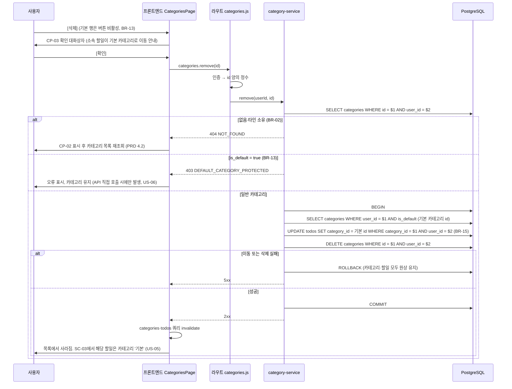

### AD-13 목록에서 NOT_FOUND 처리 (BR-02, BR-27, UC-06~08, US-11, US-17, SC-03, PRD 4.2)

SC-03의 수정·완료·삭제 요청과 SC-07의 이름 변경·삭제 요청이 `NOT_FOUND`면 오류를 표시하고 해당 목록을 다시 조회한다. 편집 화면 진입 시 `NOT_FOUND`는 오류 표시 후 SC-03으로 이동한다. 타인 소유·미존재·형식 오류 ID의 응답 본문은 모두 같다 (BR-02).

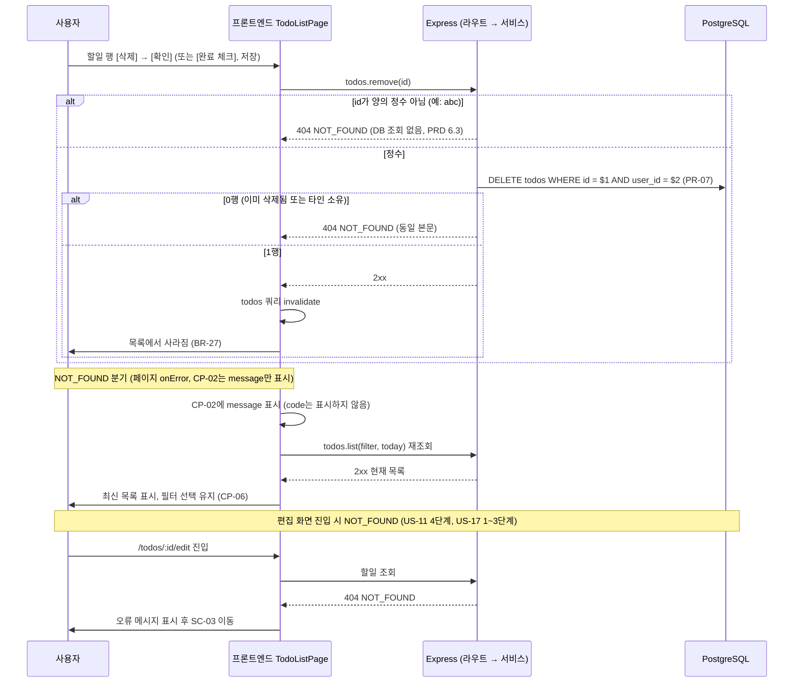

### AD-14 로그아웃 (UC-03, BR-01, F-09, US-03, CP-01, PD-01, NFR-06)

`POST /api/auth/logout`은 인증 미들웨어를 거치지 않는다 (액세스 만료 상태에서도 로그아웃 가능). `refresh_token` 쿠키가 있고 행이 있으면 `revoked_at = now()`로 폐기하고, 항상 두 쿠키를 `Max-Age=0`으로 삭제하는 204 응답을 보낸다 (PRD 6.4). `HttpOnly` 쿠키라 클라이언트는 직접 지울 수 없다. 액세스 토큰은 블랙리스트 없이 최대 15분 잔존한다 (R-06).

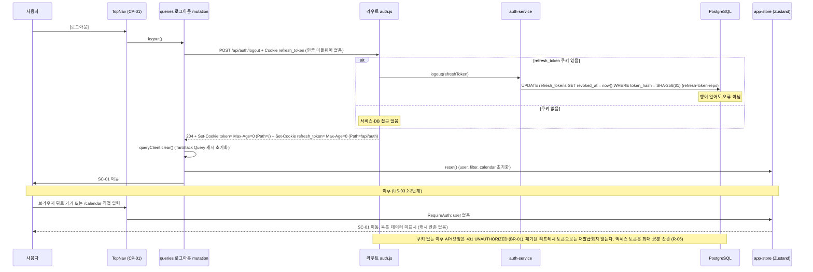

### AD-16 액세스 토큰 만료 → 리프레시 → 재시도 (NFR-06, BR-53, US-16, PRD 4.2)

보호 API가 `UNAUTHORIZED`를 반환하면 `api/client.ts`가 `POST /api/auth/refresh`를 1회 호출하고, 성공하면 원 요청을 1회 재시도한다. 동시에 여러 요청이 실패하면 진행 중인 리프레시 Promise 1개를 공유한다. `/api/auth/*` 요청의 `UNAUTHORIZED`는 리프레시를 시도하지 않는다. 회전(기존 행 폐기 + 새 행 삽입)은 한 트랜잭션이다. `revoked_at`이 이미 있는 토큰이 다시 오면 재사용 탐지로 그 사용자의 리프레시 행 전부를 폐기한다 (PRD 6.4).

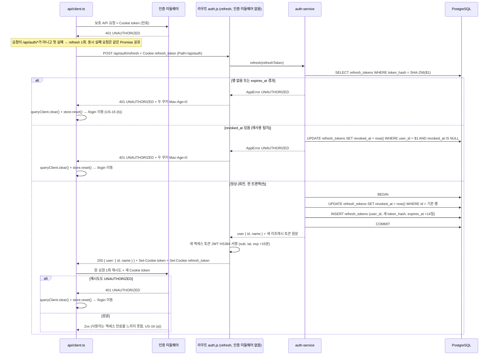

---

## 7. 상태 판정 플로우차트

### AD-15 TodoStatus 판정 (ST-01~04, BR-26, PR-04)

ST-01부터 순서대로 평가하고 처음 만족하는 규칙을 적용한다 (도메인 정의서 4.3). 날짜는 시각 없이 문자열 `YYYY-MM-DD`로 비교한다. 백엔드 `services/todo-status.js`에만 있고 프론트는 응답의 `status`만 표시한다. 목록 상태 필터(BR-32)의 SQL 조건은 이 판정과 결과가 같아야 한다 (PRD 6.5).

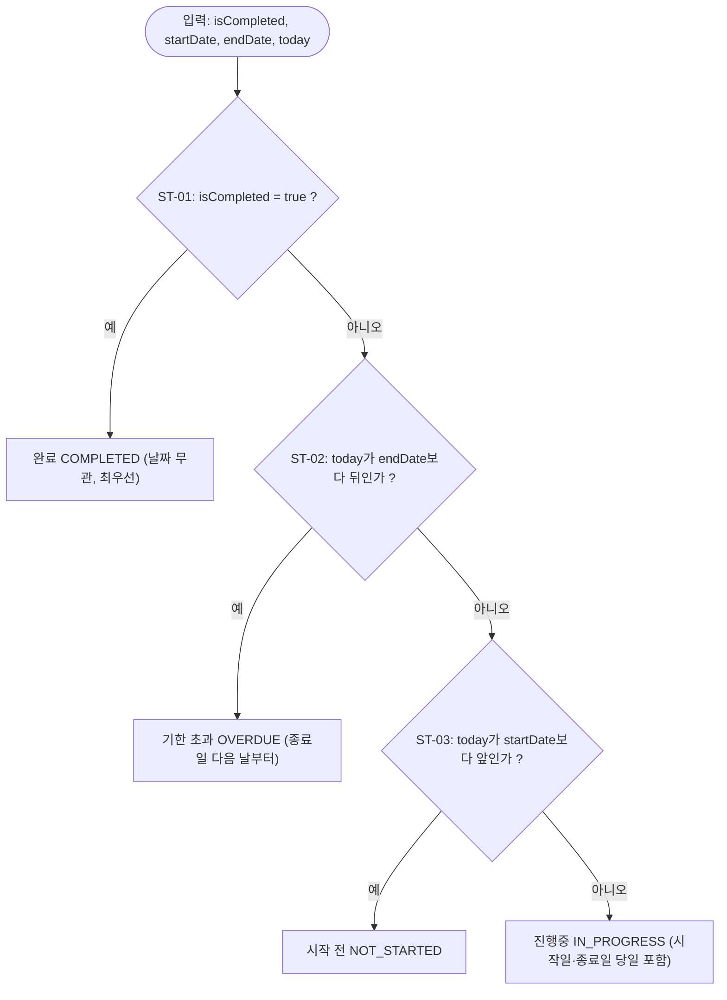

검증 예 (today = 2026-11-03, `backend/tests/todo-status.test.js`로 옮긴다):

| ID | 입력 | 결과 |
|----|------|------|
| ST-01 | 11-01~11-02, 완료 | 완료 |
| ST-02 | 11-01~11-02, 미완료 | 기한 초과 |
| ST-03 | 11-04~11-05, 미완료 | 시작 전 |
| ST-04 | 11-03~11-03, 미완료 | 진행중 |

---

## 8. 부록: 다이어그램 ↔ 문서 ID 추적표

| AD | 종류 | 제목 | 도메인 정의서 | PRD | 시나리오 | 와이어프레임 | 원칙 |
|----|------|------|---------------|-----|----------|--------------|------|
| AD-01 | flowchart | 시스템 컨텍스트 | - | 6.2, 6.4, NFR-06 | PS-01, PS-02 | - | PR-05, PR-06 |
| AD-02 | flowchart | 개발 / 운영 배포 | - | NFR-06, NFR-08, A-01, PD-04 | - | - | 6.1, 7.3 |
| AD-03 | flowchart | 프론트엔드 레이어 | - | 6.1, 4.1 | - | WF-01~07, CP-01~06 | 3.2, 3.3, 3.4, 7.3 |
| AD-04 | flowchart | 백엔드 레이어 | BR-51, BR-52 | 6.2, 6.3, NFR-04 | - | - | 3.1, 7.2, PR-06, PR-07 |
| AD-05 | → 7-erd.md ERD-01/02 | ERD | 3.1, 3.2, BR-04, BR-13, BR-14, BR-22, BR-28, BR-41~46 | 7장 | - | - | PR-04, PR-05 |
| AD-06 | flowchart | 요청 파이프라인 | BR-01, BR-51, BR-52 | 6.2, 6.3 | - | - | 3.1, 6.2, 6.3, 7.2 |
| AD-07 | sequenceDiagram | 회원가입 | UC-01, BR-04, BR-05, BR-11, BR-43~45 | 4.2, NFR-06, NFR-07 | US-01 | WF-02, CP-02, CP-06 | 3.1 |
| AD-08 | sequenceDiagram | 로그인·인증 검사 | UC-02, BR-01, BR-06, BR-53 | 4.2, 6.4, NFR-06 | US-02, US-16 | WF-01, CP-02 | 3.3, 7.3 |
| AD-09 | sequenceDiagram | 할일 생성·수정 BR-52 | UC-05, UC-06, BR-12, BR-16, BR-21~24, BR-41, BR-42, BR-52 | 4.2, 6.3 | US-07, US-08, US-09 | WF-04, CP-02 | PR-03, 3.1 |
| AD-10 | sequenceDiagram | 완료 처리·상태 파생 | UC-07, BR-25, BR-28, ST-01~04, D-10 | 4.2, 6.5 | US-10 | CP-04, CP-05 | PR-04 |
| AD-11 | sequenceDiagram | 캘린더 조회·이동 | UC-10, BR-33, BR-35, BR-36, D-12 | 4.2, 6.3, 7장 | US-13, US-14, US-15 | WF-05 | 3.2, 3.3, 7.3 |
| AD-12 | sequenceDiagram | 카테고리 삭제 | UC-11, BR-13, BR-15 | 4.2 | US-05, US-06 | WF-07, CP-03 | 3.1 |
| AD-13 | sequenceDiagram | NOT_FOUND 처리 | BR-02, BR-27, UC-06~08 | 4.2, 6.3 | US-11, US-17 | WF-03, CP-02, CP-06 | PR-07 |
| AD-14 | sequenceDiagram | 로그아웃 | UC-03, BR-01 | 4.2, 6.4, NFR-06, PD-01, R-06 | US-03 | CP-01 | 3.3 |
| AD-15 | flowchart | 상태 판정 | 4.3, ST-01~04, BR-26 | 6.5 | 3.4 | CP-04 | PR-04, 5장 |
| AD-16 | sequenceDiagram | 액세스 만료 → 리프레시 → 재시도 | BR-01, BR-53 | 4.2, 6.4, NFR-06, 7장, R-06 | US-16 | CP-02 | 3.3, 6.2, 7.2, 7.3 |

---

## 9. 다이어그램에서 추정한 지점

문서에 명시가 없어 그림을 완성하기 위해 택한 표현이다. 구현 전 API 설계 문서에서 확정한다.

| ID | 추정 | 근거 문서 | 위치 |
|----|------|-----------|------|
| AD-A1 | 이메일 중복 검사를 BR-11 트랜잭션 안에서 `SELECT lower(email)`로 먼저 수행 | UC-01 흐름 "중복 검사 → 계정 생성", 원칙 3.1 트랜잭션 | AD-07 |
| AD-A2 | 가입·로그인 응답 본문에 `user { id, name }`이 포함되고 이를 Zustand에 저장 | 원칙 3.3 "서버 응답을 한 번 받아" | AD-07, AD-08 |
| AD-A3 | 변경됨: 로그아웃 API는 인증 미들웨어를 거치지 않는다 (PRD v0.7 6.4에서 확정. 액세스 만료 상태에서도 로그아웃 가능) | PRD 6.4, UC-03 | AD-06, AD-14 |
| AD-A4 | ID 양의 정수 검사(`NOT_FOUND`)의 위치를 형식·길이·날짜 범위 검사 다음, DB 조회 전으로 둠 | 원칙 6.2 "먼저 검사", BR-52의 존재·소유 단계와 같은 코드 | AD-06, AD-09 |
| AD-A5 | 카테고리 삭제 성공 시 `categories`와 `todos` 쿼리를 모두 invalidate | 원칙 3.3 "관련 쿼리 invalidate", US-05 4단계 | AD-12 |
| AD-A6 | `RequireAuth`가 스토어 `user` 유무로 SC-01 리다이렉트 | 원칙 7.3 `App.tsx` RequireAuth, US-03 2·3단계 | AD-14 |
| AD-A7 | 완료 처리 요청에도 `today`를 보내 응답에 `status`를 포함 | PRD 6.3 "모든 todos 조회 요청은 today", US-10 "응답 후 배지 갱신" | AD-10 |
| AD-A8 | BR-15 트랜잭션 내부 실패는 5xx로 응답 | BR-51 목록에 해당 코드 없음 | AD-12 |

---

## 10. 확인 필요

문서 간 어긋남 또는 공백이다. 다이어그램은 PRD 기준으로 그렸다.

| ID | 내용 | 관련 ID |
|----|------|---------|
| AD-C1 | PRD 6.3·원칙 4장·7.1이 API 설계 문서를 `docs/6-api-design.md`로 지정했으나 이 문서가 6번을 사용. `docs/9-api-design.md`로 재지정 완료 (7번은 ERD, 해결) | PRD 6.3, 원칙 4장, 7.1 |
| AD-C2 | 도메인 정의서 3.2 ERD는 id를 `string`으로 표기하고 PRD 7장은 `BIGINT IDENTITY`다. 도메인 정의서는 관계 파악용이라 명시했으므로 PRD를 따랐다 | 도메인 3.2, PRD 7장 |
| AD-C3 | 해결: 편집 진입용 단건 조회 `GET /api/todos/:id` 추가, 원칙 7.3 `api/todos.ts`에 `get(id, today)` (`docs/9-api-design.md` 4장) | 원칙 7.3, WF-04, PRD 4.2, US-11, US-17 |
| AD-C4 | 해결: `from`/`to`는 둘 다 있거나 둘 다 없어야 하며, 한쪽만 있거나 형식 오류면 `VALIDATION_ERROR` (`docs/9-api-design.md` 4장) | BR-36, PRD 6.3, UC-10 |
| AD-C5 | 해결: 형식 위반(BR-43, BR-44)은 BR-52 순서대로 `VALIDATION_ERROR`, 형식이 맞으면 `INVALID_CREDENTIALS` (`docs/9-api-design.md` 4장) | BR-52, UC-02, SC-01 |
| AD-C6 | 도메인 정의서·시나리오·원칙의 참조 버전이 PRD v0.5였음. v0.6으로 갱신 완료 (해결) | 각 문서 "문서 정보" |
| AD-C7 | 작업 지시의 "완료 토글"은 D-10(명시 지정, 토글 아님)과 표현이 다르다. 다이어그램은 D-10을 따랐다 | D-10, UC-07 |
| AD-C8 | 로그아웃 API의 인증 미들웨어 적용 여부. 해결(인증 미들웨어 없음, PRD v0.7 6.4). refresh도 같다 | UC-03, PRD 6.4, 원칙 7.2 |
