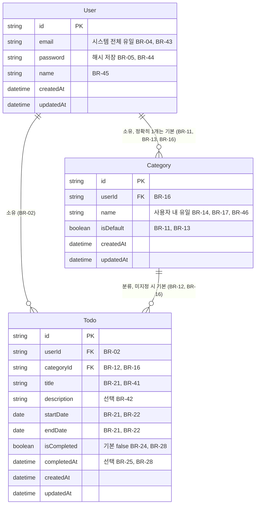
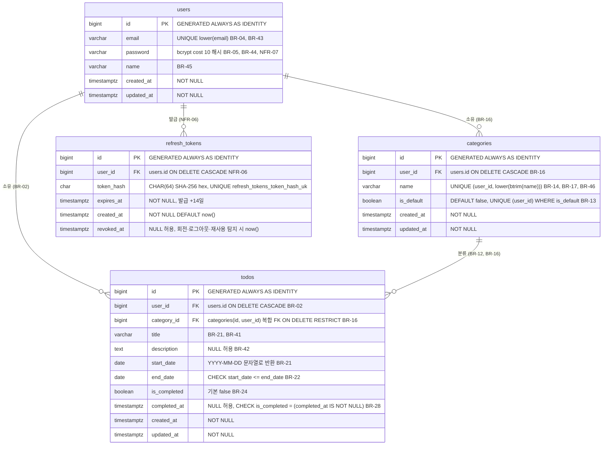

# TodoList ERD (초안)

## 문서 정보

| 항목 | 내용 |
|------|------|
| 문서명 | TodoList ERD |
| 현재 버전 | v0.3 |
| 상태 | 초안 |
| 작성일 | 2026-11-04 |
| 참조 문서 | `docs/1-domain-definition.md` v0.7, `docs/2-PRD.md` v0.8, `docs/6-arch-diagram.md` v0.4 |

ID 규칙: 이 문서에서 새로 부여하는 ID는 ERD-xx(다이어그램·표)와 ERD-Cx(확인 필요)뿐이다. BR, ST, D, F, UC는 도메인 정의서, NFR, PD는 PRD, AD는 아키텍처 다이어그램의 ID를 참조만 하며 재정의하지 않는다. 문서 간 표현이 다른 지점은 PRD 7장을 기준으로 하고 9장에 나열한다. 최종 DDL은 구현 시 확정한다 (PRD 7장).

## 변경 이력

| 버전 | 일자 | 작성자 | 변경 내용 | 영향 ID |
|------|------|--------|-----------|---------|
| v0.1 | 2026-11-04 | - | 초안 작성. `docs/6-arch-diagram.md` AD-05에서 분리·확장 | ERD-01~07, ERD-C1~C8 |
| v0.2 | 2026-11-04 | - | PRD v0.7 인증 방식 변경 반영. ERD-02에 `refresh_tokens` 엔티티·관계 추가, ERD-08 컬럼 명세 추가, ERD-06에 FK·인덱스·유일 인덱스 행 추가, ERD-C9 추가, 참조 버전 갱신. ERD-01은 변경 없음 | 문서 정보, ERD-02, ERD-06, ERD-08, 8장, ERD-C9 |
| v0.3 | 2026-11-04 | - | 8문서 교차 검토 반영. `schema.sql` 결정을 본문에 반영: ERD-02 코멘트(ON DELETE, 복합 FK, `DEFAULT false`), ERD-03~05 기본값 `now()`·`false`와 FK ON DELETE·복합 FK, ERD-06에 제약·인덱스 이름, FK 동작 확정, `categories UNIQUE (id, user_id)` 행 추가, ERD-C2·C5·C6·C7 해결 표기, 참조 버전 갱신 | 문서 정보, ERD-02, ERD-03, ERD-04, ERD-05, ERD-06, 9장 |

---

## 1. 개요

### 1.1 목적

도메인 정의서 3장(개념)과 PRD 7장(PostgreSQL 17 구현 후보)을 한 문서에 모아, 개념 모델과 물리 모델의 대응을 확인할 수 있게 한다. 새 규칙을 정하지 않는다. 문서에 없는 사항은 9장에 적는다.

### 1.2 읽는 법

- 개념 ERD(ERD-01)는 camelCase 속성명, 물리 ERD(ERD-02)는 snake_case 컬럼명이다. 대응은 7장이다.
- 속성의 단일 출처는 도메인 정의서 3.1이다. 타입·제약의 단일 출처는 PRD 7장이다.
- 길이 제한(BR-41~46)은 서버 검증으로 보장하며 DDL 길이는 지정하지 않는다 (PRD 7장).

---

## 2. 개념 ERD

### ERD-01 개념 ERD (도메인 정의서 3.1, 3.2)

관계는 도메인 정의서 3.2의 세 가지다. 개념 모델이라 id는 도메인 정의서 표기대로 `string`이다 (ERD-C1). 상태(TodoStatus)는 파생값이라 속성에 없다 (도메인 4.2).



---

## 3. 물리 ERD

### ERD-02 물리 ERD (PRD 7장, PostgreSQL 17)

`id`는 `bigint GENERATED ALWAYS AS IDENTITY`, 날짜는 `date`, 일시는 `timestamptz`다. 상태 컬럼은 없다. 컬럼 전체는 도메인 정의서 3.1과 대조했다 (빠진 속성 없음). `refresh_tokens`는 도메인 정의서에 없는 기술 엔티티다 (PRD NFR-06, ERD-C9).



---

## 4. 컬럼 명세

NULL 열은 도메인 정의서 3.1의 필수 O/X에서 옮겼다. 기본값은 PRD 7장·도메인 정의서에 명시된 것만 적고, 없으면 `-`다. 길이 제한 BR-41~46은 "서버 검증, DDL 길이 미지정(PRD 7장)"이다.

### ERD-03 `users`

| 컬럼 | 타입 | NULL | 기본값 | 제약 | 도메인 속성명 | 관련 BR |
|------|------|------|--------|------|---------------|---------|
| `id` | `bigint` | NOT NULL | `GENERATED ALWAYS AS IDENTITY` | PK | `id` | BR-02 |
| `email` | `varchar` | NOT NULL | - | `UNIQUE (lower(email))`. 서버 검증, DDL 길이 미지정(PRD 7장) | `email` | BR-04, BR-43 |
| `password` | `varchar` | NOT NULL | - | bcrypt cost 10 해시 저장 (NFR-07). 서버 검증, DDL 길이 미지정(PRD 7장) | `password` | BR-05, BR-44 |
| `name` | `varchar` | NOT NULL | - | 서버 검증, DDL 길이 미지정(PRD 7장) | `name` | BR-45 |
| `created_at` | `timestamptz` | NOT NULL | `now()` (ERD-C7) | - | `createdAt` | - |
| `updated_at` | `timestamptz` | NOT NULL | `now()` (ERD-C7) | - | `updatedAt` | - |

### ERD-04 `categories`

| 컬럼 | 타입 | NULL | 기본값 | 제약 | 도메인 속성명 | 관련 BR |
|------|------|------|--------|------|---------------|---------|
| `id` | `bigint` | NOT NULL | `GENERATED ALWAYS AS IDENTITY` | PK | `id` | BR-02 |
| `user_id` | `bigint` | NOT NULL | - | FK `users(id) ON DELETE CASCADE` | `userId` | BR-16 |
| `name` | `varchar` | NOT NULL | - | `UNIQUE (user_id, lower(btrim(name)))`. 서버 검증, DDL 길이 미지정(PRD 7장) | `name` | BR-14, BR-17, BR-46 |
| `is_default` | `boolean` | NOT NULL | `false` (ERD-C5) | `UNIQUE (user_id) WHERE is_default` | `isDefault` | BR-11, BR-13 |
| `created_at` | `timestamptz` | NOT NULL | `now()` (ERD-C7) | - | `createdAt` | - |
| `updated_at` | `timestamptz` | NOT NULL | `now()` (ERD-C7) | - | `updatedAt` | - |

### ERD-05 `todos`

| 컬럼 | 타입 | NULL | 기본값 | 제약 | 도메인 속성명 | 관련 BR |
|------|------|------|--------|------|---------------|---------|
| `id` | `bigint` | NOT NULL | `GENERATED ALWAYS AS IDENTITY` | PK | `id` | BR-02 |
| `user_id` | `bigint` | NOT NULL | - | FK `users(id) ON DELETE CASCADE` | `userId` | BR-02 |
| `category_id` | `bigint` | NOT NULL | - | FK `categories(id, user_id)` 복합, `ON DELETE RESTRICT` (ERD-C6) | `categoryId` | BR-12, BR-16 |
| `title` | `varchar` | NOT NULL | - | 서버 검증, DDL 길이 미지정(PRD 7장) | `title` | BR-21, BR-41 |
| `description` | `text` | NULL | - | 서버 검증 1000자 이하 (BR-42), DDL 길이 미지정(PRD 7장) | `description` | BR-42 |
| `start_date` | `date` | NOT NULL | - | `CHECK (start_date <= end_date)` | `startDate` | BR-21, BR-22 |
| `end_date` | `date` | NOT NULL | - | 위 CHECK | `endDate` | BR-21, BR-22 |
| `is_completed` | `boolean` | NOT NULL | `false` | `CHECK (is_completed = (completed_at IS NOT NULL))` | `isCompleted` | BR-24, BR-28 |
| `completed_at` | `timestamptz` | NULL | - | 위 CHECK | `completedAt` | BR-25, BR-28 |
| `created_at` | `timestamptz` | NOT NULL | `now()` (ERD-C7) | - | `createdAt` | - |
| `updated_at` | `timestamptz` | NOT NULL | `now()` (ERD-C7) | - | `updatedAt` | - |

### ERD-08 `refresh_tokens`

기술 엔티티다 (ERD-C9). 타입·제약의 출처는 PRD NFR-06·7장이다. 리프레시 토큰 원문은 저장하지 않는다.

| 컬럼 | 타입 | NULL | 기본값 | 제약 | 도메인 속성명 | 관련 BR |
|------|------|------|--------|------|---------------|---------|
| `id` | `bigint` | NOT NULL | `GENERATED ALWAYS AS IDENTITY` | PK | - | - |
| `user_id` | `bigint` | NOT NULL | - | FK `users(id) ON DELETE CASCADE`. 인덱스 `refresh_tokens_user_idx` | - | NFR-06 |
| `token_hash` | `char(64)` | NOT NULL | - | `UNIQUE` (`refresh_tokens_token_hash_uk`). SHA-256 hex | - | NFR-06 |
| `expires_at` | `timestamptz` | NOT NULL | - | 발급 시각 + 14일. 경과 시 `UNAUTHORIZED` | - | NFR-06, BR-53 |
| `created_at` | `timestamptz` | NOT NULL | `now()` | - | - | - |
| `revoked_at` | `timestamptz` | NULL | - | 회전·로그아웃·재사용 탐지 시 `now()`. 값이 있는 토큰이 다시 오면 사용자 전체 폐기 (PRD 6.4) | - | NFR-06 |

---

## 5. 제약과 인덱스

### ERD-06 제약·인덱스

PRD 7장의 인덱스 8개(`refresh_tokens` 2개 포함, PK·유일 제약의 암묵 인덱스 제외), CHECK 2개, 외래 키 4개다. 이름은 `docs/schema.sql` 기준이다. `user_id` FK는 `ON DELETE CASCADE`, `todos.category_id` FK는 `ON DELETE RESTRICT`다 (ERD-C2). `refresh_tokens.user_id` FK는 PRD 7장이 `ON DELETE CASCADE`로 정한다. 카테고리 삭제 시 할일 이동은 애플리케이션 트랜잭션이 처리한다 (BR-15, AD-12).

| 종류 | 테이블 | 정의 | 목적 BR / UC |
|------|--------|------|--------------|
| 유일 인덱스 | `users` | `UNIQUE (lower(email))` (`users_email_lower_uk`) | BR-04 |
| 유일 인덱스 | `categories` | `UNIQUE (user_id, lower(btrim(name)))` (`categories_user_name_uk`) | BR-14 (ERD-C8) |
| 부분 유일 인덱스 | `categories` | `UNIQUE (user_id) WHERE is_default` (`categories_user_default_uk`) | BR-13 |
| 유일 제약 | `categories` | `UNIQUE (id, user_id)` (복합 FK 참조 대상, ERD-C6) | BR-16 |
| 인덱스 | `todos` | `(user_id, end_date, start_date, created_at)` (`todos_user_end_start_created_idx`) | 목록 기본 정렬, 상태 필터 (UC-09, BR-31, BR-32) |
| 인덱스 | `todos` | `(user_id, start_date, end_date)` (`todos_user_start_end_idx`) | 캘린더 기간 겹침 (UC-10, BR-33) |
| 인덱스 | `todos` | `(user_id, category_id)` (`todos_user_category_idx`) | 카테고리 필터 (BR-31), 카테고리 삭제 시 이동 (UC-11, BR-15) |
| 인덱스 | `refresh_tokens` | `(user_id)` (`refresh_tokens_user_idx`) | 로그아웃·재사용 탐지 시 사용자 전체 폐기, 로그인 시 만료·폐기 행 삭제 (NFR-06, PRD 6.4) |
| 유일 인덱스 | `refresh_tokens` | `UNIQUE (token_hash)` (`refresh_tokens_token_hash_uk`) | 리프레시 쿠키 해시 조회 (NFR-06, PRD 6.4) |
| CHECK | `todos` | `start_date <= end_date` (`todos_date_range_chk`) | BR-22 |
| CHECK | `todos` | `is_completed = (completed_at IS NOT NULL)` (`todos_completed_chk`) | BR-28 |
| FK | `categories` | `user_id` → `users(id) ON DELETE CASCADE` (ERD-C2) | BR-16 |
| FK | `todos` | `user_id` → `users(id) ON DELETE CASCADE` (ERD-C2) | BR-02 |
| FK | `todos` | `(category_id, user_id)` → `categories(id, user_id) ON DELETE RESTRICT` (`todos_category_fk`, ERD-C2·C6) | BR-12, BR-15, BR-16 |
| FK | `refresh_tokens` | `user_id` → `users(id) ON DELETE CASCADE` | NFR-06 |

---

## 6. 저장값과 파생값

### ERD-07 TodoStatus는 저장하지 않는다

- 저장값: `start_date`, `end_date`, `is_completed`, `completed_at`. 파생값: TodoStatus (도메인 정의서 4.2).
- 근거: 상태는 날짜가 지나면 사용자 행위 없이 바뀐다. 저장하면 값이 실제와 어긋난다 (도메인 4.2). 서버가 요청마다 ST-01~04 순서로 계산한다 (PRD 6.5). 따라서 `todos`에 상태 컬럼이 없다.
- 목록 상태 필터(BR-32)의 SQL 조건은 ST-01~04 판정 결과와 항상 일치해야 한다 (PRD 6.5). 아래는 판정의 SQL 표현이다. `$n`은 클라이언트가 전달한 today(`YYYY-MM-DD`, D-05)의 바인딩 파라미터다.

```sql
CASE
  WHEN is_completed          THEN 'COMPLETED'    -- ST-01
  WHEN $n::date > end_date   THEN 'OVERDUE'      -- ST-02
  WHEN $n::date < start_date THEN 'NOT_STARTED'  -- ST-03
  ELSE                            'IN_PROGRESS'  -- ST-04 (start_date <= today <= end_date, BR-22 전제)
END
```

- ST-01부터 순서대로 평가하고 처음 만족하는 규칙을 적용한다. 상태 필터 값은 이 CASE 결과와 같은 조건으로 `WHERE`에 옮긴다.
- 위 SQL은 PRD 6.5와 도메인 4.3의 규칙을 표현만 바꾼 것이다. 실제 쿼리는 구현 시 확정한다.

---

## 7. 이름 대응

### 7.1 논리 이름과 물리 이름

| 논리 (도메인 정의서) | 물리 (PRD 7장) | 비고 |
|----------------------|----------------|------|
| `User` | `users` | - |
| `Category` | `categories` | - |
| `Todo` | `todos` | - |
| `id` | `id` | 개념 `string`, 물리 `bigint` (ERD-C1) |
| `userId` | `user_id` | - |
| `categoryId` | `category_id` | - |
| `email`, `password`, `name`, `title`, `description` | 동일 | - |
| `isDefault` | `is_default` | - |
| `startDate` | `start_date` | `date` |
| `endDate` | `end_date` | `date` |
| `isCompleted` | `is_completed` | - |
| `completedAt` | `completed_at` | `timestamptz` |
| `createdAt` | `created_at` | `timestamptz` |
| `updatedAt` | `updated_at` | `timestamptz` |

### 7.2 날짜 타입 변환

`date` 컬럼은 `pg` type parser로 `DATE`(OID 1082)를 JS `Date`가 아닌 `YYYY-MM-DD` 문자열로 받는다 (시간대 밀림 방지, PRD 7장). 응답과 요청의 날짜는 전 구간 문자열이다.

---

## 8. 부록: ERD ↔ 문서 ID 추적표

| ERD | 종류 | 제목 | 도메인 정의서 | PRD | 아키텍처 다이어그램 |
|-----|------|------|---------------|-----|---------------------|
| ERD-01 | erDiagram | 개념 ERD | 3.1, 3.2, BR-02, BR-04, BR-05, BR-11~14, BR-16, BR-17, BR-21~25, BR-28, BR-41~46 | 7장 | AD-05 |
| ERD-02 | erDiagram | 물리 ERD | 3.1, BR-04, BR-13, BR-14, BR-22, BR-28, BR-41~46 | 7장, NFR-07 | AD-05 |
| ERD-03 | 표 | `users` 컬럼 | 3.1 User, BR-02, BR-04, BR-05, BR-43~45 | 7장, NFR-07 | AD-05 |
| ERD-04 | 표 | `categories` 컬럼 | 3.1 Category, BR-11, BR-13, BR-14, BR-16, BR-17, BR-46 | 7장 | AD-05 |
| ERD-05 | 표 | `todos` 컬럼 | 3.1 Todo, BR-12, BR-16, BR-21, BR-22, BR-24, BR-25, BR-28, BR-41, BR-42 | 7장 | AD-05 |
| ERD-06 | 표 | 제약·인덱스 | BR-02, BR-04, BR-12~16, BR-22, BR-28, UC-09~11 | 7장 | AD-05 |
| ERD-07 | SQL, 설명 | 저장값·파생값 | 4.2, 4.3, ST-01~04, BR-26, BR-32 | 6.5 | AD-15 |
| ERD-08 | 표 | `refresh_tokens` 컬럼 | - (UC-03 사후조건) | NFR-06, 6.4, 7장 | AD-08, AD-14, AD-16 |

---

## 9. 확인 필요

문서 간 어긋남 또는 공백이다. 다이어그램과 표는 PRD 7장 기준으로 그렸고, 문서에 없는 사실은 새로 정하지 않았다. DDL 전문은 `docs/schema.sql`이다 (ERD-C2·C5·C6·C7의 결정 포함). 마이그레이션·시드는 구현 단계에서 정한다 (PRD 7장, 8장).

| ID | 내용 | 관련 ID |
|----|------|---------|
| ERD-C1 | 도메인 정의서 3.2는 id를 `string`으로, PRD 7장은 `BIGINT GENERATED ALWAYS AS IDENTITY`로 적는다. 도메인 정의서 3.2는 관계 파악용이므로 물리 ERD는 PRD를 따랐고 개념 ERD(ERD-01)는 도메인 표기를 유지했다 | 도메인 3.2, PRD 7장 |
| ERD-C2 | FK 3개의 ON DELETE 동작이 어느 문서에도 없다. 회원 탈퇴는 비범위(D-04)이고 카테고리 삭제는 이동 후 삭제(BR-15)다. `schema.sql` 결정: `user_id` FK는 `ON DELETE CASCADE`, `category_id` FK는 `ON DELETE RESTRICT`(BR-15 이동이 선행되므로 보호). 해결, ERD-02·04·05·06에 반영 | PRD 7장, D-04, BR-15 |
| ERD-C3 | `varchar` 길이가 미정이다. BR-41~46은 서버 검증이며 DDL 길이는 구현 시 확정한다 (PRD 7장). 정한다면 BR-41~46 상한과 맞춰야 한다 | PRD 7장, BR-41~46 |
| ERD-C4 | 도메인 정의서 3.1은 email을 시스템 전체 유일로, BR-04는 대소문자 무시로 적는다. 도메인 3.2 다이어그램은 `email UK`로 표기하고, PRD 7장은 `UNIQUE (lower(email))` 함수 인덱스다. 물리 ERD는 함수 인덱스를 코멘트로 적었다 (`UK` 마커는 mermaid 9.x 미지원이라 쓰지 않는다). 컬럼 자체의 `UNIQUE` 제약은 아니다 | 도메인 3.1, 3.2, BR-04, PRD 7장 |
| ERD-C5 | `categories.is_default`의 기본값이 PRD 7장에 없다. 도메인 3.1은 필수 O로만 적는다 (BR-11은 가입 시 `isDefault = true`로 생성). `schema.sql` 결정: `DEFAULT false`. 해결, ERD-02·04에 반영 | 도메인 3.1, BR-11, PRD 7장 |
| ERD-C6 | `todos.category_id`가 같은 `user_id` 소유여야 한다(BR-16)는 DB 제약(복합 FK 등)이 PRD 7장에 없다. 아키텍처 다이어그램은 서비스 검증으로 그렸다. `schema.sql` 결정: `categories UNIQUE (id, user_id)` + `todos FOREIGN KEY (category_id, user_id)` 복합 FK로 DB에서도 보장. 해결, ERD-02·05·06에 반영 | BR-16, PRD 7장, AD-09 |
| ERD-C7 | `created_at`, `updated_at`의 기본값(`now()` 등)과 `updated_at` 갱신 방식(트리거 또는 애플리케이션)이 PRD 7장에 없다. NULL 열은 도메인 3.1의 필수 O에서 옮겼다. `schema.sql` 결정: 둘 다 `DEFAULT now()`, `updated_at` 갱신은 애플리케이션 UPDATE 문에서. 해결, ERD-03~05에 반영 | 도메인 3.1, PRD 7장 |
| ERD-C8 | 이전 AD-05는 `categories` 이름 유일 인덱스 목적에 BR-17도 적었으나 PRD 7장은 BR-14만 적는다. ERD-06은 PRD를 따랐다. ERD-02의 `name` 코멘트에는 BR-17이 남아 있다 (BR-17은 '기본' 이름 금지 규칙) | PRD 7장, BR-14, BR-17 |
| ERD-C9 | `refresh_tokens`는 도메인 정의서 3장에 없는 기술 엔티티다. PRD NFR-06 근거로 물리 모델(ERD-02, ERD-08)에만 둔다. 개념 ERD(ERD-01)와 7.1 이름 대응에는 넣지 않는다 | PRD NFR-06, 6.4, 7장 |
