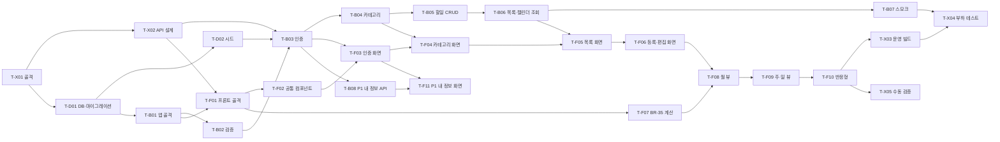

# TodoList 실행 계획 (WBS, 초안)

## 문서 정보

| 항목 | 내용 |
|------|------|
| 문서명 | TodoList 실행 계획 |
| 현재 버전 | v0.13 |
| 상태 | 초안 |
| 작성일 | 2026-11-04 |
| 참조 문서 | `docs/1-domain-definition.md` v0.9, `docs/2-PRD.md` v0.15, `docs/3-user-scenario.md` v0.6, `docs/4-wireframe.md` v0.8, `docs/5-project-principle.md` v0.14, `docs/6-arch-diagram.md` v0.9, `docs/7-erd.md` v0.6, `docs/schema.sql`, `docs/9-api-design.md` v0.7, `backend/swagger.yaml` v0.11 |

ID 규칙: 이 문서가 새로 부여하는 ID는 Task ID뿐이다. `T-D` 데이터베이스, `T-B` 백엔드, `T-F` 프론트엔드, `T-X` 공통·통합. F, UC, BR, ST, US, SC, WF, CP, NFR, R, PR, AD, ERD는 각 문서의 ID를 참조만 한다. 일정 구간은 PRD 8장의 4구간(Day 1 오전/오후, Day 2 오전/오후)을 그대로 쓴다.

## 변경 이력

| 버전 | 일자 | 작성자 | 변경 내용 | 영향 ID |
|------|------|--------|-----------|---------|
| v0.1 | 2026-11-04 | - | 초안 작성 | 전체 |
| v0.2 | 2026-11-04 | - | PRD v0.7 인증 방식 변경 반영. T-D01 테이블 5개·인덱스 8개, T-X02 refresh 엔드포인트·비보호 경로, T-B01 `JWT_SECRET` 48자, T-B03 HS384·두 쿠키·리프레시 회전·재사용 탐지·로그아웃 폐기, T-F01 refresh 재시도, T-F03 US-16 (a)/(b), T-X04 k6 401 → refresh, 참조 버전 갱신 | 문서 정보, 2장, T-D01, T-X02, T-B01, T-B03, T-F01, T-F03, T-X04 |
| v0.3 | 2026-11-04 | - | 8문서 교차 검토 반영. T-X02 미결 3건(AD-C8은 이미 해결)과 '작성 예정' 표기 제거 조건, T-B06 필터 결과 순서, T-B07 US-17 데이터·로그인 두 쿠키, T-F01 라우트 6개, T-F03 SC-02 오류 표시 위치·US-01 조건, T-F04 US-04 데이터, T-F06 US-08 날짜, T-F07·F08 월 뷰 칸 수 일반화, T-F09 US-15 순서, T-F10 US-18 단계, T-F11 `me`·US-19 조건을 시나리오·와이어프레임에 맞춤, 참조 버전 갱신 | 문서 정보, T-X02, T-B06, T-B07, T-F01, T-F03, T-F04, T-F06, T-F07, T-F08, T-F09, T-F10, T-F11 |
| v0.4 | 2026-11-04 | - | T-X01·T-X02·T-D01·T-D02 완료 조건 체크, 참조 문서에 `docs/9-api-design.md` 추가, 참조 버전 갱신 | 문서 정보, T-X01, T-X02, T-D01, T-D02 |
| v0.5 | 2026-11-04 | - | T-B01~T-B08 완료 조건 체크(85개). 테스트 실행은 `node --test "tests/*.test.js" --test-concurrency=1`(Node 24는 디렉터리 인자 미지원, 테스트 DB 공유로 직렬) | 문서 정보, T-B01~T-B08 |
| v0.6 | 2026-11-05 | - | 참조 문서에 `backend/swagger.yaml` 추가, T-X02 산출물에 `backend/swagger.yaml`, T-B01·T-B07·T-B08 수동 확인 조건 4개 표기, 참조 버전 갱신 | 문서 정보, T-X02, T-B01, T-B07, T-B08 |
| v0.7 | 2026-11-05 | - | PRD v0.10 CORS 방식 반영. T-F01 프록시 → `VITE_API_URL` + `credentials: 'include'`, T-X03을 정적 제공에서 CORS 배포 확인으로 변경, 참조 버전 갱신 | 문서 정보, 2장, T-F01, T-X03 |
| v0.8 | 2026-11-05 | - | T-B07 수행 작업에 `tests/scenarios.test.js`(US-01~17·19 HTTP 재현) 추가. T-F01~T-F11 구현 후 자동 테스트(vitest 34건)·브라우저로 확인한 완료 조건 체크(T-F01·F02·F07·F08·F09 전부, F03·F04·F05·F06·F10·F11 일부). 미체크 항목은 수동 검증 대기, 참조 버전 갱신 | 문서 정보, T-B07, T-F01~T-F11 |
| v0.9 | 2026-11-05 | - | 브라우저(Playwright, 기기 날짜 2026-11-03 고정) 검증으로 T-F03~T-F06·T-F10·T-F11 잔여 완료 조건 전부 체크, T-X03 운영 빌드·CORS 배포 확인(`NODE_ENV=production`, `CORS_ORIGIN=http://localhost:4173`, `serve -s dist`) 완료, T-X05 수동 검증 체크(T-X04 제외: k6 미설치·`load.js` 미작성), 참조 버전 갱신 | 문서 정보, T-F03~T-F06, T-F10, T-F11, T-X03, T-X05 |
| v0.10 | 2026-11-05 | - | 코드 리뷰 반영. T-F01 라우트 수·health 확인 방법, T-F02 로그아웃 mutation(`queries/use-auth.ts`), T-F08 월 뷰 표시를 스타일 가이드 3.7 막대로·기준 SVG를 `sg-calendar-month.svg`로, T-F01·F08·F09·F10 산출물에 실제 파일 추가, 참조 버전 갱신 | 문서 정보, 2장, T-F01, T-F02, T-F08, T-F09, T-F10 |
| v0.11 | 2026-11-05 | - | T-X04 완료: `tests/load-seed.js`(`npm run load:seed`)·`tests/load.js`(k6 v2.3.0, `noCookiesReset`), `docs/perf-result.md` v0.1(로컬 1000 VU 결과, EXPLAIN 2건), 완료 조건 5개 체크. 11-security S-01~S-06 조치 반영(PRD v0.12, 도메인 v0.9), 참조 버전 갱신 | 문서 정보, 2장, T-X04 |
| v0.12 | 2026-11-05 | - | T-F02에 다크 모드(`lib/theme.ts`, CP-01 테마 버튼, `styles.css` 다크 토큰) 수행 작업·완료 조건 추가(vitest 37건). 참조 버전 갱신 | 문서 정보, T-F02 |
| v0.13 | 2026-11-06 | - | 코드 대조: T-X01 scripts(`swagger:json`, `load:seed`)·`.env.example`(`CORS_ORIGIN`)·README 5단계, T-B08 산출물 `tests/user-service.test.js`, T-X05에 Playwright MCP 통합 테스트(`test/e2e/`, US-01~19 114항목) 기록. 참조 버전 갱신 | 문서 정보, 2장, T-X01, T-X05 |

---

## 1. 개요

### 1.1 목적

docs 1~7과 `schema.sql`을 실행 가능한 Task로 분해한다. 각 Task는 1인 개발자가 반나절 안에 끝낼 수 있는 크기이고, 완료 조건은 전부 확인 가능한 사실(명령 결과, 응답 코드, 화면 동작)로 적는다.

### 1.2 분해 원칙

- 영역 단위(DB → 백엔드 → 프론트엔드)로 나누되, 한 Task는 한 영역만 건드린다. 영역을 넘는 작업은 `T-X`에 둔다.
- 선행 Task가 끝나면 다른 Task와 무관하게 시작할 수 있다. 같은 구간 안의 Task 순서는 "선행" 열이 정한다.
- 완료 조건은 체크박스다. 전부 체크되면 Task 완료다. 테스트·스모크는 `docs/5-project-principle.md` 5장의 범위(R-05)를 넘지 않는다.
- 구현 방법은 적지 않는다. 파일 위치는 원칙 문서 7장을 따르고, 규칙은 BR·ST ID로만 가리킨다.
- P1(F-03) Task는 맨 뒤에 두고, 구간 완료 기준 미달 시 가장 먼저 버린다 (PRD 8장, R-01).

### 1.3 산출물 위치

| 영역 | 디렉토리 | 근거 |
|------|----------|------|
| DB | `backend/src/db/` (`pool.js`, `migrate.js`, `migrations/`, `seed.sql`) | 원칙 7.2 |
| 백엔드 | `backend/src/`, `backend/tests/` | 원칙 7.2 |
| 프론트엔드 | `frontend/src/` | 원칙 7.3 |
| 문서 | `docs/` | - |

---

## 2. Task 목록

| ID | Task | 영역 | 구간 | 선행 | 주요 산출물 |
|----|------|------|------|------|-------------|
| T-X01 | 저장소 골격·공통 설정 | 공통 | Day 1 오전 | - | `backend/package.json`, `frontend/package.json`, `.gitignore`, `README.md` |
| T-X02 | API 설계 문서 | 공통 | Day 1 오전 | T-X01 | `docs/9-api-design.md`, `backend/swagger.yaml` |
| T-D01 | DB 생성·마이그레이션 러너 | DB | Day 1 오전 | T-X01 | `db/pool.js`, `db/migrate.js`, `db/migrations/001_init.sql` |
| T-D02 | 시드 SQL | DB | Day 1 오전 | T-D01 | `db/seed.sql`, `tests/setup.js` |
| T-B01 | 백엔드 앱 골격·오류 처리·헬스체크 | 백엔드 | Day 1 오전 | T-D01 | `server.js`, `app.js`, `errors/`, `middlewares/error-handler.js` |
| T-B02 | 입력 검증 모듈 | 백엔드 | Day 1 오전 | T-B01 | `routes/validate.js` |
| T-B03 | 인증 API (가입·로그인·로그아웃·리프레시·인증 미들웨어) | 백엔드 | Day 1 오전 | T-X02, T-D02, T-B02 | `routes/auth.js`, `services/auth-service.js`, `repositories/user-repo.js`, `repositories/refresh-token-repo.js`, `middlewares/auth.js`, `tests/auth-service.test.js` |
| T-B04 | 카테고리 API | 백엔드 | Day 1 오후 | T-B03 | `routes/categories.js`, `services/category-service.js`, `repositories/category-repo.js`, `tests/category-service.test.js` |
| T-B05 | 할일 CRUD·완료 처리·상태 판정 | 백엔드 | Day 1 오후 | T-B04 | `routes/todos.js`, `services/todo-service.js`, `services/todo-status.js`, `repositories/todo-repo.js`, `tests/todo-status.test.js`, `tests/todo-service.test.js` |
| T-B06 | 할일 목록 필터·캘린더 기간 조회 | 백엔드 | Day 1 오후 | T-B05 | `repositories/todo-repo.js`(조회 함수), `routes/todos.js`(GET) |
| T-B07 | API 스모크 스크립트 | 백엔드 | Day 1 오후 | T-B06 | `tests/smoke.js` |
| T-F01 | 프론트 골격·API 클라이언트·스토어·타입 | 프론트 | Day 2 오전 | T-X02, T-B01 | `vite.config.ts`, `main.tsx`, `App.tsx`, `api/client.ts`(+`client.test.ts`), `queries/use-auth.ts`, `stores/app-store.ts`, `types/`, `lib/error-text.ts`, `lib/status.ts`, `styles.css` |
| T-F02 | 공통 컴포넌트 CP-01~06 | 프론트 | Day 2 오전 | T-F01 | `components/common/*.tsx`, `lib/theme.ts` |
| T-F03 | 인증 화면·라우트 보호·로그아웃 | 프론트 | Day 2 오전 | T-F02, T-B03 | `pages/LoginPage.tsx`, `pages/SignupPage.tsx`, `api/auth.ts` |
| T-F04 | 카테고리 관리 화면 | 프론트 | Day 2 오전 | T-F03, T-B04 | `pages/CategoriesPage.tsx`, `api/categories.ts`, `queries/use-categories.ts` |
| T-F05 | 할일 목록 화면 | 프론트 | Day 2 오전 | T-F04, T-B06 | `pages/TodoListPage.tsx`, `api/todos.ts`, `queries/use-todos.ts` |
| T-F06 | 할일 등록·편집 화면 | 프론트 | Day 2 오전 | T-F05 | `pages/TodoFormPage.tsx` |
| T-F07 | 날짜 유틸·조회 기간 계산 (BR-35) | 프론트 | Day 2 오전 | T-F01 | `lib/date.ts`, `lib/calendar-range.ts`, `lib/calendar-range.test.ts` |
| T-F08 | 캘린더 월 뷰 | 프론트 | Day 2 오후 | T-F06, T-F07 | `pages/CalendarPage.tsx`, `components/calendar/CalendarBar.tsx`, `MonthView.tsx`, `lib/calendar-lanes.ts`(+`.test.ts`), `calendar.test.tsx` |
| T-F09 | 캘린더 주·일 뷰·기간 이동 | 프론트 | Day 2 오후 | T-F08 | `components/calendar/WeekView.tsx`, `DayView.tsx`, `calendar.test.tsx` |
| T-F10 | 반응형 375px | 프론트 | Day 2 오후 | T-F09 | `styles.css`, `TopNav.tsx`, `MonthView.tsx`, `WeekView.tsx` |
| T-X03 | 운영 빌드·CORS 배포 확인 | 공통 | Day 2 오후 | T-F10 | `frontend/dist`, `CORS_ORIGIN` 운영 값 |
| T-X04 | 부하 테스트·쿼리 계획 기록 | 공통 | Day 2 오후 | T-B07, T-X03 | `backend/tests/load-seed.js`, `backend/tests/load.js`(k6), `docs/perf-result.md` |
| T-X05 | 수동 검증 체크리스트 실행 | 공통 | Day 2 오후 | T-F10 | PRD 9.1 체크 결과 |
| T-B08 | (P1) 내 정보 API | 백엔드 | 여유 시 | T-B03 | `routes/users.js`, `services/user-service.js`, `tests/user-service.test.js` |
| T-F11 | (P1) 내 정보 화면 | 프론트 | 여유 시 | T-B08, T-F03 | `pages/MePage.tsx` |

---

## 3. Task 상세

### T-X01 저장소 골격·공통 설정

| 항목 | 내용 |
|------|------|
| 영역 | 공통 |
| 구간 | Day 1 오전 |
| 선행 | 없음 |
| 관련 ID | PR-02, PR-08, 원칙 3.5, 4장, 6.1, 7.1 |

수행 작업:

1. `backend/`, `frontend/` 디렉토리와 각 `package.json`을 만든다. 루트 `package.json`은 두지 않는다.
2. 백엔드 의존성 `express`, `pg`, `bcrypt`, `jsonwebtoken`, `cookie-parser`, 프론트 의존성 `react`, `react-dom`, `react-router`, `zustand`, `@tanstack/react-query`, 개발용 `vite`, `typescript`, `vitest`만 설치한다.
3. `backend/package.json` scripts: `dev`, `start`, `migrate`, `seed`, `test`, `smoke`(뒤에 `swagger:json`, `load:seed` 추가). `frontend/package.json` scripts: `dev`, `build`, `test`.
4. `.gitignore`(`node_modules`, `dist`, `.env`, `.env.test`), `backend/.env.example`(`DATABASE_URL`, `JWT_SECRET`, `PORT`, `NODE_ENV`, 뒤에 `CORS_ORIGIN` 추가), 양쪽 `eslint.config.js`, 빈 `.prettierrc`, `README.md`(DB 생성 → env → migrate·seed → dev)를 만든다.

완료 조건:

- [x] `backend`, `frontend` 각각에서 `npm install`이 오류 없이 끝난다
- [x] 설치된 의존성이 원칙 3.5 허용 목록 밖에 없다 (`dotenv`, ORM, UI 라이브러리 없음)
- [x] `.env.example`에 키 4개가 설명과 함께 있고 `.env`·`.env.test`는 추적되지 않는다
- [x] 양쪽 `npx eslint .`가 통과한다
- [x] `README.md`에 실행 순서가 있다 (현재 5단계: DB 생성, 백엔드 env, 프론트 env, migrate·seed, dev)

### T-X02 API 설계 문서

| 항목 | 내용 |
|------|------|
| 영역 | 공통 |
| 구간 | Day 1 오전 |
| 선행 | T-X01 |
| 관련 ID | PRD 6.3, BR-51, BR-52, AD-C3, AD-C4, AD-C5, AD-C8, 원칙 4장 "API 경로" |

수행 작업:

1. `docs/9-api-design.md`에 엔드포인트 전부를 표로 적는다: 메서드, 경로(`/api` 접두어), 인증 필요 여부, 요청 본문·쿼리 필드와 형식, 성공 status·응답 본문, 가능한 오류 코드(BR-51)와 BR-52 순서.
2. 리소스: `POST /api/auth/signup`, `POST /api/auth/login`, `POST /api/auth/logout`, `POST /api/auth/refresh`(refresh·logout은 인증 미들웨어 없음, PRD 6.4), `GET /api/health`, `GET|POST /api/categories`, `PATCH|DELETE /api/categories/:id`, `GET|POST /api/todos`, `GET|PATCH|DELETE /api/todos/:id`, `PATCH /api/todos/:id/completed`, `GET|PATCH /api/users/me`(P1).
3. 아키텍처 문서 10장의 미결 3건을 닫는다: AD-C3(편집 진입용 단건 조회 `GET /api/todos/:id` 추가), AD-C4(캘린더 `from`/`to` 누락·형식 오류는 `VALIDATION_ERROR`), AD-C5(로그인 형식 위반은 BR-52 순서대로 `VALIDATION_ERROR`).
4. 응답 객체 필드명(camelCase), `status` 값(`NOT_STARTED`, `IN_PROGRESS`, `COMPLETED`, `OVERDUE`), 날짜 문자열 형식을 고정한다.

완료 조건:

- [x] 모든 엔드포인트가 표 한 줄씩 있고 각 줄에 오류 코드 목록이 있다
- [x] AD-C3·C4·C5가 결정과 함께 적혀 있고 `docs/6-arch-diagram.md` 10장 해당 행이 "해결"로 바뀌었다
- [x] PRD 6.3·원칙 4장·원칙 7.1·아키텍처 1장의 `docs/9-api-design.md` '작성 예정' 표기가 제거됐다
- [x] 형식 검증(제목 앞뒤·표 앞뒤 빈 줄, 열 수 동일)을 통과한다

### T-D01 DB 생성·마이그레이션 러너

| 항목 | 내용 |
|------|------|
| 영역 | DB |
| 구간 | Day 1 오전 |
| 선행 | T-X01 |
| 관련 ID | ERD-02~06, `docs/schema.sql`, PRD 7장, NFR-04, 원칙 6.3, PR-05 |

수행 작업:

1. PostgreSQL 17에 `todolist`, `todolist_test` 데이터베이스를 만든다. `.env`와 `.env.test`의 `DATABASE_URL`이 각각을 가리킨다.
2. `db/migrations/001_init.sql`에 `docs/schema.sql`을 그대로 복사한다 (`BEGIN`/`COMMIT` 포함).
3. `db/migrate.js`: `schema_migrations(filename, applied_at)` 테이블을 만들고, `migrations/`의 번호순 파일 중 미적용분만 실행해 기록한다.
4. `db/pool.js`: `Pool({ max: 20 })` 1개 인스턴스, `DATE`(OID 1082) type parser를 문자열 반환으로 설정한다.

완료 조건:

- [x] `npm run migrate` 후 `users`, `refresh_tokens`, `categories`, `todos`, `schema_migrations` 5개 테이블이 있다
- [x] 인덱스 8개(`users_email_lower_uk`, `refresh_tokens_token_hash_uk`, `refresh_tokens_user_idx`, `categories_user_name_uk`, `categories_user_default_uk`, `todos_user_end_start_created_idx`, `todos_user_start_end_idx`, `todos_user_category_idx`)가 `pg_indexes`에 있다
- [x] `npm run migrate`를 다시 실행해도 `001_init.sql`이 재실행되지 않는다
- [x] `start_date > end_date`인 INSERT가 `todos_date_range_chk` 위반으로 실패한다
- [x] `is_completed = true`, `completed_at = NULL`인 INSERT가 `todos_completed_chk` 위반으로 실패한다
- [x] 다른 사용자의 `category_id`로 INSERT하면 `todos_category_fk` 위반으로 실패한다
- [x] `pool.query('SELECT DATE \'2026-11-03\' AS d')`의 결과가 JS `Date`가 아닌 문자열 `'2026-11-03'`이다
- [x] `todolist_test`에도 같은 마이그레이션이 적용된다

### T-D02 시드 SQL

| 항목 | 내용 |
|------|------|
| 영역 | DB |
| 구간 | Day 1 오전 |
| 선행 | T-D01 |
| 관련 ID | 시나리오 3장(PS-01, PS-02, 샘플 데이터), NFR-07, 원칙 5장 "시드" |

수행 작업:

1. `db/seed.sql`: `TRUNCATE users, categories, todos RESTART IDENTITY CASCADE` 후 시나리오 3장 순서대로 사용자 2명, 카테고리 5개, 할일 8건을 넣는다. id가 1부터 문서와 같게 붙는다.
2. 비밀번호 `haneul1234`, `seojun1234`의 bcrypt cost 10 해시를 미리 계산해 SQL에 넣는다.
3. 할일 1(주간 보고서 제출)은 `is_completed = true`, `completed_at = '2026-11-02 18:00'`(로컬 시간대)으로 넣는다.
4. `tests/setup.js`: `.env.test`의 DB에 마이그레이션과 시드를 다시 적용한다. `npm run seed`는 개발 DB에 적용한다.

완료 조건:

- [x] `npm run seed` 후 `users` 2행, `categories` 5행, `todos` 8행이다
- [x] `users` id 1 = `haneul@example.com`, id 2 = `seojun@example.com`
- [x] `categories` id 1·3이 `is_default = true`이고 사용자당 기본 카테고리가 정확히 1개다
- [x] `todos` 1~7의 `user_id` = 2, 8의 `user_id` = 1이고 시작일·종료일이 시나리오 표와 같다
- [x] 할일 1만 `is_completed = true`이고 `completed_at`이 null이 아니다
- [x] `npm run seed`를 두 번 실행해도 행 수와 id가 같다
- [x] `node tests/setup.js`가 `todolist_test`에 같은 결과를 만든다

### T-B01 백엔드 앱 골격·오류 처리·헬스체크

| 항목 | 내용 |
|------|------|
| 영역 | 백엔드 |
| 구간 | Day 1 오전 |
| 선행 | T-D01 |
| 관련 ID | PRD 6.3, BR-51, PR-06, PR-08, 원칙 6.1, 6.3, AD-04, AD-06 |

수행 작업:

1. `errors/codes.js`에 BR-51 코드 9개와 HTTP status 매핑(PRD 6.3)을, `errors/app-error.js`에 `AppError(code, message)`를 만든다.
2. `app.js`: `express.json()`, `cookie-parser`, 라우트 등록 자리, 미등록 경로 404, 오류 미들웨어(`AppError` → status·`{ code, message }`, 그 외 → 500, 1줄 JSON 로그, 5xx만 stack).
3. `server.js`: `JWT_SECRET`(48자 이상, NFR-06)·`DATABASE_URL` 없으면 기동 실패, `PORT` 기본 3000, `SIGTERM`·`SIGINT`에서 `server.close()` 후 `pool.end()`.
4. `GET /api/health`: `SELECT 1` 성공 시 200 `{ "ok": true }`, 실패 시 503.

완료 조건:

- [x] `JWT_SECRET` 없이 `npm run dev`를 실행하면 종료 코드가 0이 아니고 원인이 출력된다
- [x] `GET /api/health`가 200 `{ "ok": true, "db": "up" }`를 반환한다
- [x] DB를 중지한 상태에서 `GET /api/health`가 503을 반환한다 (수동 확인)
- [x] `GET /api/nope`가 404 `{ "code": "NOT_FOUND", "message": ... }`를 반환한다
- [x] 라우트에서 `throw new AppError('VALIDATION_ERROR', 'x')`를 던지면 400 `{ "code": "VALIDATION_ERROR", "message": "x" }`가 온다
- [x] 4xx 로그 1줄에 `ts, method, path, status, code, message`가 있고 stack이 없다
- [x] `errors/codes.js` 밖에 HTTP status 숫자 리터럴이 없다 (`grep -rn 'status(4\|status(5' src/` 결과 없음)
- [x] `Ctrl+C`로 종료 시 pool 종료 로그 후 프로세스가 끝난다 (수동 확인)

### T-B02 입력 검증 모듈

| 항목 | 내용 |
|------|------|
| 영역 | 백엔드 |
| 구간 | Day 1 오전 |
| 선행 | T-B01 |
| 관련 ID | BR-21, BR-22, BR-32, BR-41~46, BR-52, PRD 6.3(ID 정수), PR-03 |

수행 작업:

1. `routes/validate.js`에 순수 함수를 만든다: `email`(BR-43), `password`(BR-44), `name`(BR-45), `categoryName`(BR-46 길이), `todoBody`(BR-21, BR-41, BR-42, 제목 trim), `dateRange`(BR-22), `today`(BR-32 형식), `id`(양의 정수 정규식).
2. 위반 시 `AppError('VALIDATION_ERROR')`, 날짜 범위는 `INVALID_DATE_RANGE`, ID 형식은 `NOT_FOUND`를 던진다.
3. 호출 순서는 BR-52(형식·길이 → 날짜 범위)를 지키도록 `todoBody`가 `dateRange`보다 먼저 실행되게 묶는다.

완료 조건:

- [x] 7자 비밀번호는 거부, 8자·64자는 통과한다
- [x] `@` 없는 이메일, 255자 이메일은 거부한다
- [x] 공백만 있는 제목, 101자 제목은 거부하고 100자 제목은 통과한다
- [x] 1001자 설명은 거부하고 설명 없음은 통과한다
- [x] 31자 카테고리명은 거부한다
- [x] 제목 없음 + `startDate > endDate` 입력에서 `VALIDATION_ERROR`가 먼저 나온다 (BR-52)
- [x] `startDate = endDate`는 통과, `startDate > endDate`는 `INVALID_DATE_RANGE`다
- [x] `today`가 없거나 `2026-1-3` 같은 형식이면 `VALIDATION_ERROR`다
- [x] ID `abc`, `0`, `-1`, `1.5`는 `NOT_FOUND`, `1`은 통과한다
- [x] 위 항목이 `tests/`의 테스트 또는 `node -e` 호출 결과로 확인됐다

### T-B03 인증 API

| 항목 | 내용 |
|------|------|
| 영역 | 백엔드 |
| 구간 | Day 1 오전 |
| 선행 | T-X02, T-D02, T-B02 |
| 관련 ID | F-01, F-09, UC-01~03, BR-01, BR-04~06, BR-11, BR-43~45, BR-53, NFR-06, NFR-07, PD-01, R-06, ERD-08, AD-07, AD-08, AD-14, AD-16 |

수행 작업:

1. `repositories/user-repo.js`: 이메일(소문자 비교) 조회, 생성. `repositories/refresh-token-repo.js`: 삽입, 해시 조회, 폐기(`revoked_at = now()`), 사용자 전체 폐기, 정리(사용자의 만료·폐기 행 삭제). `services/auth-service.js`: 가입(BR-04 중복 검사 → 사용자 생성 → 기본 카테고리 생성, 한 트랜잭션, BR-11), 로그인(BR-06, bcrypt 비교, 실패 사유 미구분, 성공 시 만료·폐기 행 삭제), 가입·로그인 성공 시 리프레시 토큰(`crypto.randomBytes(32)` base64url) 생성 → SHA-256 hex 해시 행 삽입(`expires_at` +14일), refresh(해시 조회 → 없음·만료 `UNAUTHORIZED` → `revoked_at` 있으면 사용자 전체 폐기 후 `UNAUTHORIZED` → 정상이면 기존 행 폐기 + 새 행 삽입을 한 트랜잭션으로 회전), logout(쿠키 해시 행 폐기).
2. `middlewares/auth.js`: 쿠키 `token` JWT(HS384, `sub`, `iat`, `exp`) 검증(`jwt.verify` `algorithms: ['HS384']` 고정) → `req.userId`. 없거나 무효·만료면 `UNAUTHORIZED`. `refresh_token` 쿠키는 보지 않는다. 두 쿠키 옵션(`token`: `HttpOnly`, `SameSite=Lax`, `Path=/`, `Max-Age=900`. `refresh_token`: `HttpOnly`, `SameSite=Lax`, `Path=/api/auth`, `Max-Age=1209600`. 둘 다 운영만 `Secure`)과 발급·삭제 함수를 이 파일에 둔다.
3. `routes/auth.js`: `POST /api/auth/signup`(검증 → 가입 → 두 쿠키 발급 → 201), `POST /api/auth/login`(→ 두 쿠키 발급 → 200), `POST /api/auth/refresh`(인증 미들웨어 없음 → 회전 → 두 쿠키 발급 → 200 `{ user: { id, name } }`, 실패 시 401 + 두 쿠키 `Max-Age=0`), `POST /api/auth/logout`(인증 미들웨어 없음 → 리프레시 행 폐기 → 두 쿠키 `Max-Age=0` → 204). 가입·로그인 응답에 `user { id, name }` 포함(AD-A2).
4. `tests/auth-service.test.js`: BR-04, BR-06, BR-11 수용 기준과 리프레시 회전·재사용 탐지·로그아웃 폐기 케이스. 테스트 DB 사용, `pg` mock 금지.

완료 조건:

- [x] 새 이메일로 가입하면 201, `Set-Cookie: token=...; HttpOnly; SameSite=Lax; Path=/; Max-Age=900`와 `Set-Cookie: refresh_token=...; HttpOnly; SameSite=Lax; Path=/api/auth; Max-Age=1209600`가 오고 응답에 `user.id`, `user.name`이 있다
- [x] 액세스 토큰 헤더의 `alg`가 `HS384`이고 claims에 `sub`, `iat`, `exp`가 있다. 다른 알고리즘으로 서명한 토큰은 401 `UNAUTHORIZED`다 (`algorithms` 고정)
- [x] 가입·로그인 직후 `refresh_tokens`에 그 사용자의 행이 1개 늘고 `token_hash`가 64자 hex이며 쿠키 원문과 다르다
- [x] `POST /api/auth/refresh`가 200 `{ user: { id, name } }`과 새 `token`·`refresh_token` 쿠키를 돌려주고, 기존 행은 `revoked_at`이 채워지고 새 행이 1개 생긴다 (회전)
- [x] 회전 후 기존 리프레시 토큰으로 다시 refresh하면 401 `UNAUTHORIZED` + 두 쿠키 `Max-Age=0`이고, 그 사용자의 리프레시 행 전부가 `revoked_at`을 가진다 (재사용 탐지). 직전에 받은 새 토큰도 더는 통하지 않는다
- [x] `expires_at`을 과거로 바꾼 리프레시 토큰으로 refresh하면 401 `UNAUTHORIZED`다
- [x] 로그인하면 그 사용자의 만료·폐기된 리프레시 행이 삭제된다
- [x] `JWT_SECRET`이 47자이면 기동에 실패하고 48자이면 기동된다
- [x] 가입 직후 해당 사용자의 카테고리가 `name = '기본'`, `is_default = true` 1개다 (BR-11)
- [x] 대소문자만 다른 기존 이메일로 가입하면 409 `DUPLICATE_EMAIL`이고 사용자·카테고리 행 수가 변하지 않는다 (BR-04)
- [x] 기본 카테고리 생성이 실패하도록 만든 테스트에서 사용자 행도 생성되지 않는다 (트랜잭션)
- [x] 없는 이메일과 틀린 비밀번호가 동일한 401 `INVALID_CREDENTIALS` 본문을 반환한다 (BR-06)
- [x] 시드 사용자 `seojun@example.com` / `seojun1234`로 로그인하면 200과 쿠키가 온다
- [x] 쿠키 없이 `POST /api/auth/logout`을 호출해도 204이고 두 쿠키 `Max-Age=0`이 온다 (인증 미들웨어 없음, AD-C8 해결)
- [x] 로그아웃 응답에 `token`·`refresh_token` 두 쿠키의 `Max-Age=0`이 있고, 그 뒤 쿠키 없는 보호 API 요청은 401 `UNAUTHORIZED`다
- [x] 로그아웃 후 그 리프레시 토큰으로 `POST /api/auth/refresh`하면 401 `UNAUTHORIZED`다 (DB 폐기)
- [x] 만료된 액세스 토큰(`exp` 과거)으로 보호 API를 요청하면 401 `UNAUTHORIZED`다 (BR-53). `refresh_token` 쿠키를 함께 보내도 미들웨어는 보지 않는다
- [x] `NODE_ENV=production`일 때만 두 쿠키에 `Secure`가 붙는다
- [x] 응답·로그 어디에도 `password`, 해시, 액세스·리프레시 토큰 값이 출력되지 않는다 (수동 확인)
- [x] `npm test`에서 `auth-service.test.js`가 통과한다 (회전·재사용 탐지·폐기 케이스 포함)

### T-B04 카테고리 API

| 항목 | 내용 |
|------|------|
| 영역 | 백엔드 |
| 구간 | Day 1 오후 |
| 선행 | T-B03 |
| 관련 ID | F-11, UC-11, BR-02, BR-13~17, BR-46, BR-52, NFR-10, PR-07, AD-12 |

수행 작업:

1. `repositories/category-repo.js`: 사용자별 목록·단건(모두 `user_id` 조건), 생성, 이름 변경, 삭제, 개수 세기, 소속 할일 `category_id` 일괄 이동.
2. `services/category-service.js`: 생성(BR-46 개수 20 → `CATEGORY_LIMIT_EXCEEDED`, BR-14·17 중복·'기본' 금지 → `DUPLICATE_CATEGORY_NAME`), 이름 변경(기본 카테고리 → `DEFAULT_CATEGORY_PROTECTED`, 중복 검사), 삭제(기본 → `DEFAULT_CATEGORY_PROTECTED`, 아니면 할일을 기본 카테고리로 이동 후 삭제, 한 트랜잭션, BR-15). 검증 순서는 BR-52.
3. `routes/categories.js`: `GET /api/categories`, `POST`, `PATCH /:id`, `DELETE /:id`. 모두 인증 미들웨어 뒤. ID 형식 검사는 T-B02 함수.
4. `tests/category-service.test.js`: BR-13, BR-14, BR-15(이동 실패 시 롤백 포함), BR-17, BR-46 개수.

완료 조건:

- [x] 시드 사용자 2의 `GET /api/categories`가 id 3·4·5 3건을 반환하고 사용자 1의 카테고리는 없다
- [x] `업무`가 있는 사용자가 ` 업무 `(공백, 대소문자 변형)로 생성하면 409 `DUPLICATE_CATEGORY_NAME`이다 (BR-14)
- [x] 다른 사용자는 같은 이름 `업무`를 만들 수 있다
- [x] `기본`이라는 이름으로 생성·변경하면 409 `DUPLICATE_CATEGORY_NAME`이다 (BR-17)
- [x] 기본 카테고리 이름 변경·삭제는 403 `DEFAULT_CATEGORY_PROTECTED`이고 행이 유지된다 (BR-13, BR-17)
- [x] 카테고리 20개인 사용자의 생성 요청은 409 `CATEGORY_LIMIT_EXCEEDED`다 (BR-46)
- [x] 할일 N건이 속한 카테고리를 삭제하면 그 N건의 `category_id`가 기본 카테고리 id가 되고 `todos` 행 수가 변하지 않는다 (BR-15)
- [x] 이동 UPDATE를 실패시킨 테스트에서 카테고리가 삭제되지 않는다 (롤백)
- [x] 타인 카테고리 id로 `PATCH`·`DELETE`하면 존재하지 않는 id와 동일한 404 `NOT_FOUND` 본문이고 타인 데이터는 변하지 않는다 (BR-02)
- [x] `id = abc`로 요청하면 DB 조회 없이 404 `NOT_FOUND`다
- [x] `npm test`에서 `category-service.test.js`가 통과한다

### T-B05 할일 CRUD·완료 처리·상태 판정

| 항목 | 내용 |
|------|------|
| 영역 | 백엔드 |
| 구간 | Day 1 오후 |
| 선행 | T-B04 |
| 관련 ID | F-02, F-04, F-06, F-07, F-10, UC-05~08, BR-02, BR-12, BR-16, BR-21~28, BR-52, BR-54, ST-01~04, D-10, PR-04, PR-05, AD-09, AD-10, AD-15 |

수행 작업:

1. `services/todo-status.js`: 상태 상수 4개와 순수 함수 `todoStatus({ isCompleted, startDate, endDate }, today)`. 문자열 비교, ST-01 → 02 → 03 → 04 순.
2. `repositories/todo-repo.js`: 단건(`user_id` 조건), 생성, 수정, 완료 지정, 삭제. SELECT 별칭으로 camelCase 변환(`start_date AS "startDate"` 등).
3. `services/todo-service.js`: 생성·수정(BR-12 `categoryId` 없음·null → 기본 카테고리, BR-16 타인·미존재 카테고리 → `NOT_FOUND`, BR-24 요청의 `isCompleted` 무시, BR-26 상태 필드 무시), 완료 지정(`isCompleted` 명시, BR-25 `completedAt` 설정·해제, 멱등), 삭제(BR-27). 응답마다 `status`를 `today`로 계산해 붙인다 (AD-A7).
4. `routes/todos.js`: `POST /api/todos`, `GET /api/todos/:id`(AD-C3), `PATCH /api/todos/:id`, `PATCH /api/todos/:id/completed`, `DELETE /api/todos/:id`. 검증 순서 BR-52.
5. `tests/todo-status.test.js`: 도메인 4.3 검증 예 4건. `tests/todo-service.test.js`: BR-12, BR-16, BR-22, BR-24, BR-25, BR-28.

완료 조건:

- [x] `todo-status.test.js` 4건이 통과한다: 11-01~11-02 완료 → `COMPLETED`, 11-01~11-02 미완료 → `OVERDUE`, 11-04~11-05 미완료 → `NOT_STARTED`, 11-03~11-03 미완료 → `IN_PROGRESS` (today = 2026-11-03)
- [x] `categoryId` 없이 생성한 할일의 `categoryId`가 그 사용자의 기본 카테고리 id다 (BR-12)
- [x] 수정 시 `categoryId: null`을 보내면 기본 카테고리로 바뀐다 (BR-12)
- [x] 타인 소유 또는 없는 `categoryId`로 생성·수정하면 404 `NOT_FOUND`다 (BR-16)
- [x] 생성 요청의 `isCompleted: true`는 무시되어 `isCompleted = false`, `completedAt = null`로 저장된다 (BR-24)
- [x] `startDate > endDate`는 400 `INVALID_DATE_RANGE`, 같은 날짜는 저장된다 (BR-22). 과거 날짜도 저장된다 (BR-23)
- [x] `PATCH /completed { isCompleted: true }` 후 `completedAt`이 null이 아니고 `status = COMPLETED`, 같은 요청을 다시 보내도 결과가 같다 (BR-25, D-10)
- [x] `{ isCompleted: false }` 후 `completedAt = null`이고 `status`가 날짜로 다시 판정된다
- [x] `PATCH /:id`로 제목만 바꾸면 `isCompleted`·`completedAt`이 유지되고 `updatedAt`이 갱신된다 (UC-06)
- [x] 삭제 후 같은 id 조회는 404 `NOT_FOUND`다 (BR-27)
- [x] 타인 할일 id로 `GET`·`PATCH`·`DELETE`하면 없는 id와 동일한 404 본문이다 (BR-02)
- [x] 응답의 날짜 필드가 `YYYY-MM-DD` 문자열이고 `status` 값이 상수 4개 중 하나다
- [x] `npm test`에서 `todo-status.test.js`, `todo-service.test.js`가 통과한다

### T-B06 할일 목록 필터·캘린더 기간 조회

| 항목 | 내용 |
|------|------|
| 영역 | 백엔드 |
| 구간 | Day 1 오후 |
| 선행 | T-B05 |
| 관련 ID | F-05, F-08, UC-09, UC-10, BR-02, BR-16, BR-31~33, BR-36, ST-01~04, PRD 6.3, 6.5, ERD-07, AD-11 |

수행 작업:

1. `repositories/todo-repo.js`에 목록 조회를 추가한다: `user_id` 필수, `categoryId` 선택, `status` 선택(ERD-07의 CASE를 WHERE로 옮긴 SQL), 기간 겹침 선택(`start_date <= $to AND end_date >= $from`, BR-33), 기본 정렬 `end_date, start_date, created_at`.
2. `services/todo-service.js`에 목록 함수를 추가한다: `categoryId`가 있으면 소유 검사(타인·미존재 → `NOT_FOUND`), 결과마다 `status` 계산.
3. `GET /api/todos?today=&categoryId=&status=&from=&to=`. `today` 필수(BR-32), `from`/`to`는 둘 다 있거나 둘 다 없음(AD-C4 결정: 형식 오류 `VALIDATION_ERROR`). 캘린더 조회는 필터를 적용하지 않는다 (BR-36).

완료 조건:

- [x] 시드 사용자 2, `today=2026-11-03`, 필터 없음 → id 순서 `6, 1, 2, 5, 4, 3, 7` 7건 (기본 정렬)
- [x] `categoryId=4`(업무) → 1, 2, 5, 3 4건
- [x] `status=OVERDUE` → 6, 2 2건. 종료일 11-03인 할일은 포함되지 않는다 (BR-32 경계)
- [x] `categoryId=4&status=OVERDUE` → 2 1건 (BR-31 AND)
- [x] `status=COMPLETED` → 1 1건, `status=NOT_STARTED` → 3, 7, `status=IN_PROGRESS` → 5, 4
- [x] 응답의 `status` 값이 같은 요청의 `status` 필터와 항상 일치한다 (PRD 6.5)
- [x] `categoryId=2`(타인) 또는 `categoryId=999` → 404 `NOT_FOUND`
- [x] `today` 누락·형식 오류 → 400 `VALIDATION_ERROR`
- [x] `from=2026-11-02&to=2026-11-08` → 1, 2, 5, 4, 3, 7 (6은 제외, 7은 11-08 경계 포함) (BR-33)
- [x] `from=2026-10-26&to=2026-12-06` → 7건 전부
- [x] `from`만 있고 `to`가 없으면 400 `VALIDATION_ERROR`
- [x] 사용자 1로 같은 요청을 하면 id 8 1건만 온다 (NFR-10)

### T-B07 API 스모크 스크립트

| 항목 | 내용 |
|------|------|
| 영역 | 백엔드 |
| 구간 | Day 1 오후 |
| 선행 | T-B06 |
| 관련 ID | R-05, US-02, US-12, US-17, 원칙 5장 "API 스모크" |

수행 작업:

1. `tests/smoke.js`: Node 내장 `fetch`로 실행 중 서버(`http://localhost:3000`)에 US-02(로그인 실패 401 → 성공 200·쿠키), US-12(필터 4조합 건수), US-17(타인 리소스 404)을 순서대로 호출하고 기대값과 비교한다.
2. 실패 항목이 있으면 종료 코드 1, 각 항목을 `US-xx 단계 n: 기대 / 실제` 형식으로 출력한다.
3. `npm run smoke`로 실행한다. 시드가 적용된 개발 DB를 전제한다.
4. `tests/scenarios.test.js`: 시나리오 US-01~US-17, US-19를 임시 포트에 띄운 `app`에 HTTP로 재현한다(`npm test`에 포함, 테스트 DB). UI 전용 단계는 제외한다.

완료 조건:

- [x] `npm run seed && npm run dev` 후 `npm run smoke`가 종료 코드 0으로 끝난다
- [x] US-02: 틀린 비밀번호 401 `INVALID_CREDENTIALS`, 올바른 로그인 200 + `token`·`refresh_token` 쿠키
- [x] US-12: 필터 없음 7건, `categoryId=4` 4건, `status=OVERDUE` 2건, 둘 다 1건
- [x] US-17: 사용자 1 쿠키로 할일 1 `GET`·`PATCH`·`DELETE`, `categoryId=3`으로 할일 등록, `categoryId=3` 필터 모두 404 `NOT_FOUND`이고 사용자 2 데이터가 그대로다
- [x] 기대값 하나를 일부러 바꾸면 종료 코드 1과 불일치 줄이 출력된다 (수동 확인)

### T-F01 프론트 골격·API 클라이언트·스토어·타입

| 항목 | 내용 |
|------|------|
| 영역 | 프론트엔드 |
| 구간 | Day 2 오전 |
| 선행 | T-X02, T-B01 |
| 관련 ID | PRD 4.3, 6.1, BR-51, BR-53, NFR-06, PR-05, PR-06, 원칙 3.2, 7.3, AD-03 |

수행 작업:

1. Vite + React 19 + TypeScript(`strict: true`) 프로젝트. 프록시 없음. `frontend/.env`에 `VITE_API_URL=http://localhost:3000`, `api/client.ts`가 `${import.meta.env.VITE_API_URL}/api/...`로 호출한다 (NFR-06 (6)).
2. `types/api.ts`(`ApiError { code, message }`, BR-51 코드 유니온), `types/todo.ts`(Todo, `TodoStatus` 상수 4개, 필터 타입), `types/category.ts`.
3. `api/client.ts`: `fetch` 래퍼. `credentials: 'include'`, JSON 본문, 실패 시 `{ code, message }`를 `ApiError`로 throw. `code === 'UNAUTHORIZED'`이고 요청이 `/api/auth/*`가 아니면 `POST /api/auth/refresh`를 1회 호출하고 성공 시 원 요청을 1회 재시도한다. 동시에 여러 요청이 실패하면 진행 중인 리프레시 Promise 1개를 공유한다. 리프레시 실패 또는 재시도도 `UNAUTHORIZED`면 스토어 `reset()` + `queryClient.clear()` + `/login` 이동 (BR-53, PRD 4.2, AD-16).
4. `stores/app-store.ts`: Zustand 1개(`user`, `filter`, `calendar { view, anchorDate }`, `reset()`). `main.tsx`에 `QueryClientProvider`, Router. `App.tsx`에 라우트 7개(`/login`, `/signup`, `/todos`, `/todos/new`, `/todos/:id/edit`, `/calendar`, `/categories`. `/me`는 T-F11에서 추가)와 `RequireAuth`(스토어 `user` 없으면 `/login`), 그 외 경로는 `/todos`로.
5. `styles.css`: 전역 CSS 1개, `768px` 미디어 쿼리 자리.

완료 조건:

- [x] `npm run dev` 후 SPA(`http://localhost:5173`) 콘솔에서 `fetch(import.meta.env.VITE_API_URL + '/api/health', { credentials: 'include' })`가 CORS 오류 없이 `{ "ok": true, "db": "up" }`를 받는다 (앱 코드는 health를 호출하지 않는다. `curl -H 'Origin: http://localhost:5173'`로 `Access-Control-Allow-Origin` 확인)
- [x] `npx tsc --noEmit`이 오류 없이 끝나고 `any`가 없다 (`grep -rn ': any' src/` 결과 없음)
- [x] `api/client.ts`가 401 `UNAUTHORIZED` 응답을 받으면 `POST /api/auth/refresh`를 1회 호출하고 성공 시 원 요청을 재시도한다. 동시에 실패한 요청 여러 개에 대해 refresh 요청은 1회만 나간다 (네트워크 탭으로 확인)
- [x] refresh가 실패하거나 재시도 응답도 `UNAUTHORIZED`면 스토어가 초기화되고 `/login`으로 이동한다 (목 서버 응답 또는 서버 중지로 확인). `/api/auth/*` 요청의 `UNAUTHORIZED`에는 refresh를 시도하지 않는다
- [x] 401 `INVALID_CREDENTIALS`는 이동하지 않고 `ApiError`로 throw된다 (PRD 4.2 인증 만료 분기)
- [x] 비로그인 상태로 `/todos` 진입 시 `/login`으로 이동한다 (BR-01)
- [x] `pages/`, `components/`에 `fetch` 호출이 없고 `lib/`에 React·스토어 import가 없다
- [x] `Date` 객체가 스토어·쿼리 키에 들어가지 않는다 (PR-05)

### T-F02 공통 컴포넌트 CP-01~06

| 항목 | 내용 |
|------|------|
| 영역 | 프론트엔드 |
| 구간 | Day 2 오전 |
| 선행 | T-F01 |
| 관련 ID | CP-01~06, WF-01~07 공통 요소, PRD 4.1 공통 메뉴, PRD 4.2 필드 오류 규칙, 원칙 7.3 공통 컴포넌트 대응표 |

수행 작업:

1. `TopNav.tsx`(CP-01): 할일 목록·캘린더·카테고리 관리·내 정보(F-03 미구현 시 숨김)·로그아웃. 현재 메뉴 강조. 모바일 `[메뉴]` 토글은 `useState`. 로그아웃 mutation(`queries/use-auth.ts`의 `useLogout`)만 예외로 여기서 호출한다.
2. `ErrorMessage.tsx`(CP-02, `message` prop), `ConfirmDialog.tsx`(CP-03), `StatusBadge.tsx`(CP-04, `status`·`compact`), `TodoRow.tsx`(CP-05, 완료·편집·삭제 콜백), `EmptyList.tsx`(CP-06, `filtered`).
3. 모두 props만 받는다. 스토어·쿼리 hook 사용 금지(CP-01 로그아웃 제외).
4. 다크 모드(스타일 가이드 2.4): `lib/theme.ts`(`getTheme`·`applyTheme`·`saveTheme`, 저장 키 `theme`, 없으면 OS 설정), `main.tsx`가 첫 렌더 전에 적용, `TopNav`의 `[다크 모드]`/`[라이트 모드]` 버튼으로 전환, `styles.css`의 `:root[data-theme='dark']` 토큰 재정의.

완료 조건:

- [x] `StatusBadge`가 상태 4개를 `시작 전`/`진행중`/`완료`/`기한 초과`로, `compact`일 때 `전`/`진`/`완`/`초`로 표시한다
- [x] `TopNav`에 메뉴 5개가 있고 F-03 미구현 상태에서 `내 정보`가 보이지 않는다
- [x] `ConfirmDialog`가 `onConfirm`·`onCancel`을 각각 호출한다
- [x] `EmptyList`가 `filtered` 여부로 문구 2종을 보여준다
- [x] `ErrorMessage`가 `message`가 비면 렌더하지 않는다
- [x] `components/common/`에서 `useAppStore`·`useQuery` 사용이 `TopNav`의 로그아웃뿐이다
- [x] `TopNav` 테마 버튼을 누르면 `html[data-theme]`과 `localStorage.theme`이 바뀌고 새로고침 뒤에도 유지된다 (vitest `common.test.tsx`, 브라우저)
- [x] `npx tsc --noEmit` 통과

### T-F03 인증 화면·라우트 보호·로그아웃

| 항목 | 내용 |
|------|------|
| 영역 | 프론트엔드 |
| 구간 | Day 2 오전 |
| 선행 | T-F02, T-B03 |
| 관련 ID | F-01, F-09, SC-01, SC-02, WF-01, WF-02, UC-01~03, BR-06, BR-43~45, US-01, US-02, US-03, US-16, AD-07, AD-08, AD-14 |

수행 작업:

1. `api/auth.ts`(signup, login, logout, refresh). `LoginPage.tsx`(SC-01): 이메일·비밀번호, 가입 링크, 성공 시 스토어 `user` 저장 → `/todos`, `INVALID_CREDENTIALS`는 단일 메시지.
2. `SignupPage.tsx`(SC-02): 이메일·비밀번호·이름, 입력 제약 안내(BR-43~45), 성공 시 자동 로그인 → `/todos`, `DUPLICATE_EMAIL`·`VALIDATION_ERROR`는 머물며 CP-02 오류 영역에 표시.
3. 로그아웃(`TopNav`): API 호출 → 응답 후 `queryClient.clear()` + 스토어 `reset()` → `/login`.

완료 조건:

- [x] US-01: 새 이메일로 가입하면 `/todos`로 이동하고 할일 0건 빈 목록 안내가 보인다. 같은 이메일로 다시 가입하면 가입 화면에 머물며 `DUPLICATE_EMAIL` 메시지가 보인다
- [x] 7자 비밀번호 입력 시 가입 화면에 머물며 CP-02 오류 영역에 `VALIDATION_ERROR` 메시지가 보인다
- [x] US-02: 틀린 비밀번호와 없는 이메일에서 동일한 단일 메시지가 보이고, 올바른 입력으로 `/todos` 이동
- [x] US-03: 로그아웃 후 `/login`으로 이동하고, 뒤로 가기로 `/todos`에 가도 목록 데이터가 보이지 않고 `/login`으로 돌아온다
- [x] US-16 (a): `token` 쿠키만 지운(또는 만료) 상태에서 저장 요청을 하면 자동 갱신되어 저장이 성공하고 화면 이동이 없다
- [x] US-16 (b): `refresh_token` 쿠키까지 지운(또는 서버에서 폐기한) 상태에서 저장 요청을 하면 `/login`으로 이동하고 데이터는 변하지 않는다 (BR-53)
- [x] 로그인 화면에서 로그인 중 버튼이 비활성(중복 제출 방지)이다

### T-F04 카테고리 관리 화면

| 항목 | 내용 |
|------|------|
| 영역 | 프론트엔드 |
| 구간 | Day 2 오전 |
| 선행 | T-F03, T-B04 |
| 관련 ID | F-11, SC-07, WF-07, UC-11, BR-13~17, BR-46, US-04, US-05, US-06, AD-12, AD-13 |

수행 작업:

1. `api/categories.ts`, `queries/use-categories.ts`(목록 쿼리, 생성·변경·삭제 mutation, 성공 시 `categories` invalidate, 삭제는 `todos`도 invalidate).
2. `CategoriesPage.tsx`(SC-07): 목록, 추가 입력, 행 내 이름 변경(`[저장]`/`[취소]`), 삭제 확인 대화상자(소속 할일이 기본 카테고리로 이동함을 안내), 기본 카테고리 표시와 변경·삭제 버튼 비활성.
3. `NOT_FOUND` 응답 시 오류 표시 후 목록 재조회 (PRD 4.2).

완료 조건:

- [x] US-04: `동아리` 추가 → 목록 3개. `동아리`를 `동아리 활동`으로 변경 → 반영, SC-04 선택 목록에 표시. 추가 확인: ` 과제 `로 변경 시 `DUPLICATE_CATEGORY_NAME` 메시지 (BR-14)
- [x] US-05: 할일이 속한 카테고리 삭제 → 확인 대화상자 안내 문구 → 삭제 후 할일 목록에서 그 할일의 카테고리가 `기본`으로 보인다
- [x] US-06: 기본 카테고리 행의 변경·삭제 버튼이 비활성이고, 새 카테고리 이름 `기본` 입력 시 `DUPLICATE_CATEGORY_NAME` 메시지
- [x] 카테고리 20개 상태에서 추가 시 `CATEGORY_LIMIT_EXCEEDED` 메시지가 보인다
- [x] 다른 탭에서 삭제한 카테고리를 이름 변경하면 오류 표시 후 목록이 다시 조회되어 그 행이 사라진다

### T-F05 할일 목록 화면

| 항목 | 내용 |
|------|------|
| 영역 | 프론트엔드 |
| 구간 | Day 2 오전 |
| 선행 | T-F04, T-B06 |
| 관련 ID | F-05, F-06, F-10, SC-03, WF-03, UC-07~09, BR-27, BR-31, BR-32, D-05, D-10, US-10, US-11, US-12, US-17, AD-10, AD-13 |

수행 작업:

1. `api/todos.ts`(list, get, create, update, setCompleted, remove, range), `queries/use-todos.ts`(쿼리 키에 `today`·필터 포함, mutation 성공 시 `todos` invalidate).
2. `TodoListPage.tsx`(SC-03): 카테고리·상태 단일 선택 2개(스토어 `filter`), 행(CP-05)에 제목·기간·카테고리·배지·완료 체크·편집·삭제, 등록 버튼, 빈 목록(CP-06). `today`는 `lib/date.ts`의 로컬 날짜.
3. 완료 체크는 `isCompleted` 명시 전송, 낙관적 갱신 없이 응답 후 배지 갱신. 삭제는 확인 대화상자. `NOT_FOUND`는 오류 표시 후 재조회.

완료 조건:

- [x] US-12: 필터 4조합이 T-B06 완료 조건의 건수와 같게 표시되고, 기한 초과 필터에 종료일 11-03 할일이 없다 (기기 날짜 2026-11-03 기준)
- [x] US-10: 할일 2(기한 초과) 완료 체크 → 응답 후 배지가 `완료`로 바뀜. 체크 해제 → `기한 초과`로 돌아옴. 체크 직후 응답 전에는 배지가 바뀌지 않는다
- [x] US-11: 삭제 클릭 → 대화상자 → 취소 시 유지, 확정 시 목록에서 사라짐
- [x] 필터 결과 0건이면 `EmptyList`의 "조건에 맞는 할일 없음" 문구, 할일 자체가 0건이면 다른 문구가 보인다
- [x] 다른 탭에서 삭제한 할일을 완료 체크하면 오류 메시지 후 목록이 재조회되어 행이 사라진다 (US-17 화면 측)
- [x] 목록 순서가 `6, 1, 2, 5, 4, 3, 7`이다
- [x] 쿼리 키·요청에 `Date` 객체가 없고 `today`가 `YYYY-MM-DD` 문자열이다

### T-F06 할일 등록·편집 화면

| 항목 | 내용 |
|------|------|
| 영역 | 프론트엔드 |
| 구간 | Day 2 오전 |
| 선행 | T-F05 |
| 관련 ID | F-02, F-04, F-07, SC-04, WF-04, UC-05, UC-06, BR-12, BR-21~23, BR-41, BR-42, US-07, US-08, US-09, AD-09 |

수행 작업:

1. `TodoFormPage.tsx`(SC-04, `/todos/new`와 `/todos/:id/edit` 공용): 제목, 설명, `input type="date"` 2개, 카테고리 선택(미선택 = 기본), 저장·취소.
2. 편집 진입 시 `GET /api/todos/:id`로 채우고 `NOT_FOUND`면 오류 표시 후 `/todos`로 이동.
3. 시작일 > 종료일 사전 안내(저장을 막지 않음). 서버 오류 `message`는 공통 영역 + 판별 가능한 필드 아래. 저장 성공 시 `/todos`.

완료 조건:

- [x] US-07: 카테고리 미선택 등록 → 목록에 `기본`으로 표시. `업무` 선택 등록 → `업무`로 표시
- [x] US-08: 제목 공백만 → 제목란 아래 오류. 시작일 11-07, 종료일 11-05 → 사전 안내가 보이고 저장 시 서버 `INVALID_DATE_RANGE`가 날짜란 아래 표시. 과거 날짜(10-20~10-22)는 저장되고 `기한 초과`로 표시
- [x] US-09: 할일 3 편집 진입 시 기존 값이 채워져 있고, 제목·기간 변경 저장 후 목록에 반영되며 완료 여부는 그대로다
- [x] 없는 id로 `/todos/999/edit` 진입 시 오류 메시지 후 `/todos`로 이동한다
- [x] 취소 버튼은 저장 없이 `/todos`로 돌아간다
- [x] 제목 101자 입력 저장 시 서버 `VALIDATION_ERROR`가 제목란 아래 표시된다

### T-F07 날짜 유틸·조회 기간 계산 (BR-35)

| 항목 | 내용 |
|------|------|
| 영역 | 프론트엔드 |
| 구간 | Day 2 오전 |
| 선행 | T-F01 |
| 관련 ID | BR-35, D-05, D-13, PRD 4.2 캘린더 이동, R-05, PR-05, US-13~15, 원칙 5장 "BR-35 단위" |

수행 작업:

1. `lib/date.ts`: 로컬 today → `YYYY-MM-DD`, 날짜 더하기, 비교, 요일 계산. 전부 문자열 입출력, 내부에서만 `Date` 사용(UTC 고정).
2. `lib/calendar-range.ts`: `range(view, anchorDate) → { from, to }`(일: 당일, 주: 월~일, 월: 1일이 속한 주의 월요일 ~ 말일이 속한 주의 일요일), `move(view, anchorDate, ±1)`(월: 이전/다음 달 1일, 주: ±7, 일: ±1), 월 뷰 날짜 배열(BR-35 범위, 28~42칸).
3. `lib/calendar-range.test.ts`(vitest): BR-35 수용 기준 예와 PRD 4.2 이동 규칙.

완료 조건:

- [x] `range('week', '2026-11-03')` = `{ from: '2026-11-02', to: '2026-11-08' }`
- [x] `range('month', '2026-11-03')` = `{ from: '2026-10-26', to: '2026-12-06' }`이고 칸 수가 42다
- [x] `range('day', '2026-11-03')` = `{ from: '2026-11-03', to: '2026-11-03' }`
- [x] `move('month', '2026-11-03', +1)` = `'2026-12-01'`, 그 월 뷰 범위가 `11-30 ~ 2027-01-03`이다
- [x] `move('month', '2026-11-03', -1)` = `'2026-10-01'`, `move('week', '2026-11-03', +1)` = `'2026-11-10'`, `move('day', '2026-11-03', -1)` = `'2026-11-02'`
- [x] 월요일 시작이 2026-11-01(일요일)에서도 맞다: `range('week', '2026-11-01')` = `10-26 ~ 11-01`
- [x] `npm test`(vitest)가 통과하고 `lib/`에 React·스토어·`api/` import가 없다

### T-F08 캘린더 월 뷰

| 항목 | 내용 |
|------|------|
| 영역 | 프론트엔드 |
| 구간 | Day 2 오후 |
| 선행 | T-F06, T-F07 |
| 관련 ID | F-08, SC-05, WF-05, UC-10, BR-33, BR-35, BR-36, D-12, US-13, AD-11, `docs/assets/wf-05-calendar-month.svg` |

수행 작업:

1. `CalendarPage.tsx`(SC-05): 스토어 `calendar.view`·`anchorDate`(초기값 today, 월), [이전][오늘][다음], 기간 표시, 뷰 전환 버튼, `useTodos.range(from, to, today)` 조회(필터 미적용).
2. `components/calendar/MonthView.tsx`: 요일 헤더(월~일), BR-35 범위 칸(2026-11은 42칸), 이웃 달 날짜 구분, today 강조. 겹치는 할일(BR-33, `[startDate, endDate]`이 칸 날짜를 포함)은 행(주) 안에서 시작 칸부터 종료 칸까지 이어진 막대(`CalendarBar`, `StatusBadge compact` + 제목, `lib/calendar-lanes.ts` lane 배정)로 표시한다 (스타일 가이드 3.7). 모바일은 칸마다 상태색 점. 클릭 시 `/todos/:id/edit`.

완료 조건:

- [x] US-13: 2026-11 월 뷰가 10-26 ~ 12-06 42칸이고, 11-01 칸에 `헬스장 등록`(초), `주간 보고서 제출`(완), `거래처 견적 회신`(초), `분기 계획 작성`(진) 4건, 11-02 칸에 3건, 11-03 칸에 `분기 계획 작성`·`은행 서류 제출`, 11-04·11-05 칸에 `팀 회의 자료 준비`, 11-08~11-10 칸에 `가족 여행 준비`가 보인다
- [x] 10-26~10-31 칸에 `헬스장 등록`이 매일 보인다 (이웃 달 칸도 BR-33 적용)
- [x] 11-03 칸이 today로 강조된다
- [x] 완료 할일(1)이 캘린더에 `완` 배지로 보인다 (BR-36)
- [x] 목록 화면에서 필터를 걸어도 캘린더에는 적용되지 않는다 (BR-36)
- [x] 할일 클릭 시 편집 화면으로 이동하고 캘린더에 생성·완료 조작이 없다 (D-12)
- [x] 렌더 결과가 `docs/assets/sg-calendar-month.svg`의 막대 배치와 같다 (칸별 할일 집합은 `wf-05-calendar-month.svg`와 동일, 표시 방식만 막대)

### T-F09 캘린더 주·일 뷰·기간 이동

| 항목 | 내용 |
|------|------|
| 영역 | 프론트엔드 |
| 구간 | Day 2 오후 |
| 선행 | T-F08 |
| 관련 ID | SC-05, WF-05, BR-33, BR-35, PRD 4.2 캘린더 이동, US-14, US-15, AD-11 |

수행 작업:

1. `WeekView.tsx`: 7열, 날짜 헤더에 요일, 칸 배치는 월 뷰와 같은 규칙. `DayView.tsx`: 하루 목록(배지 전체형, 제목, 기간, 카테고리).
2. [이전]/[다음]은 `move`로 anchorDate 갱신, [오늘]은 today로. 뷰 전환 시 anchorDate 유지. 기간 변경 시 `from`/`to` 재계산 → 재조회.

완료 조건:

- [x] US-14: 주 뷰 11-02 ~ 11-08에서 11-02 칸 `1, 2, 5`, 11-03 칸 `5, 4`, 11-04·11-05 칸 `3`, 11-08 칸 `7`, 11-06·11-07 칸 비어 있음. `헬스장 등록`(10-26~11-01)은 보이지 않는다
- [x] US-15: 일 뷰 11-03에 `분기 계획 작성`(진행중, 10-31~11-03, 업무), `은행 서류 제출`(진행중, 11-03~11-03, 개인) 2건. [이전] → 11-02에 할일 1, 2, 5. [다음] 두 번 → 11-04에 `팀 회의 자료 준비`(시작 전)
- [x] 월 뷰 [다음] → 2026-12(11-30 ~ 2027-01-03), [오늘] → 2026-11로 복귀
- [x] 주 뷰 [다음] → 11-09 ~ 11-15에 `가족 여행 준비`가 11-09·11-10 칸에 보인다
- [x] 월 → 주 → 일 전환 시 anchorDate가 유지된다 (11-03 기준 같은 날이 표시됨)
- [x] 기간 이동마다 네트워크 요청이 `from`/`to`/`today` 쿼리와 함께 1회 나간다

### T-F10 반응형 375px

| 항목 | 내용 |
|------|------|
| 영역 | 프론트엔드 |
| 구간 | Day 2 오후 |
| 선행 | T-F09 |
| 관련 ID | PRD 4.3, WF 5장(모바일), CP-01 `[메뉴]`, US-18 |

수행 작업:

1. `styles.css`의 `@media (max-width: 767px)`: 단일 열, 상단 `[메뉴]` 토글(`TopNav`), 폼 전체 너비.
2. `MonthView` 모바일: 칸에 제목 대신 점(`o`)·개수, 상태 생략 허용. `WeekView` 모바일: 날짜별 세로 목록. 데이터는 그대로(BR-33·36).

완료 조건:

- [x] US-18: 뷰포트 375px에서 가입 화면 확인 후 뒤로 가기 → 로그인 → 할일 등록 → 완료 → 상태 필터 → 편집 → 삭제 → 카테고리 추가 → 캘린더 월 뷰 → 로그아웃(US-18 1~10단계)이 가로 스크롤 없이 수행된다
- [x] 375px에서 `[메뉴]` 토글로 메뉴 5개(또는 4개)에 접근할 수 있다
- [x] 375px 월 뷰에서 11-01 칸에 점 4개, 11-02 칸에 점 3개가 보인다
- [x] 375px 주 뷰가 날짜별 세로 목록이고 11-02에 3건, 11-03에 2건이 배지와 함께 보인다
- [x] 1280px에서 데스크톱 레이아웃이 유지된다 (T-F08·F09 완료 조건 재확인)
- [x] 기준점이 768px 하나다 (`styles.css`에 다른 `max-width` 미디어 쿼리 없음)

### T-X03 운영 빌드·CORS 배포 확인

| 항목 | 내용 |
|------|------|
| 영역 | 공통 |
| 구간 | Day 2 오후 |
| 선행 | T-F10 |
| 관련 ID | NFR-06, NFR-08, 원칙 6.1, AD-02 |

수행 작업:

1. `frontend`에서 `VITE_API_URL`을 운영 API origin으로 두고 `npm run build` → `dist/`. `dist/`는 정적 호스팅(모든 경로를 `index.html`로 폴백, SPA 라우팅)에 올린다. Express는 정적 파일을 제공하지 않는다.
2. 백엔드 `CORS_ORIGIN`에 운영 SPA origin을 넣고 `NODE_ENV=production npm start`로 기동 확인. SPA와 API는 같은 site여야 한다 (쿠키 `SameSite=Lax`, NFR-06 (6)).

완료 조건:

- [x] `npm run build`가 오류 없이 끝나고 `dist/index.html`이 있다
- [x] 정적 호스팅(로컬은 `npx serve -s dist`)에서 로그인 화면이 뜨고 `/calendar` 직접 진입도 SPA가 처리한다
- [x] SPA origin에서 `/api/health` 호출이 200이고 응답에 `Access-Control-Allow-Origin`이 SPA origin이다. `CORS_ORIGIN`에 없는 origin의 `OPTIONS`에는 CORS 헤더가 없다
- [x] 운영 모드 로그인 응답 쿠키에 `Secure`가 있다 (HTTP에서는 브라우저가 저장하지 않으므로 응답 헤더로 확인)
- [x] `CORS_ORIGIN` 없이 `npm start`하면 `CORS_ORIGIN is missing`으로 기동 실패한다

### T-X04 부하 테스트·쿼리 계획 기록

| 항목 | 내용 |
|------|------|
| 영역 | 공통 |
| 구간 | Day 2 오후 |
| 선행 | T-B07, T-X03 |
| 관련 ID | NFR-01~05, R-02, R-03, A-01, PRD 5.1 검증 방법, 7장 검증, 9.2 |

수행 작업:

1. 부하 데이터 스크립트 `tests/load-seed.js`(`npm run load:seed`): 사용자 1000명, 사용자당 할일 100건(약 10만 행)을 개발 시드 뒤에 추가. 비밀번호 해시는 시드의 것 1개를 재사용한다. `npm run seed`가 원복한다.
2. `backend/tests/load.js`(k6): 60초 램프로 1000 VU 로그인(VU당 1회, 이후 액세스 쿠키로 요청), 이후 5분간 조회 80%(목록 50, 캘린더 30) / 쓰기 20%(등록 8, 수정 4, 완료 4, 삭제 4), think time 지수분포 평균 10초, 타임아웃 10초. 액세스 15분 > 측정 5분이라 리프레시는 시나리오에 넣지 않되, 401 수신 시 `POST /api/auth/refresh` 1회 후 원 요청을 재시도한다 (PRD 5.1).
3. 결과(p95 조회·쓰기·로그인, 오류율, 측정 환경 CPU·메모리·부하 생성기 위치)를 `docs/perf-result.md`에 기록. 부하 생성기와 서버가 같은 PC면 "미검증"으로 표기.
4. 10만 행 상태에서 목록·캘린더 쿼리 `EXPLAIN (ANALYZE)` 1회씩 기록.

완료 조건:

- [x] k6 스크립트가 1000 VU로 램프 60초 + 5분 구간을 오류 없이 완주한다 (k6 v2.3.0, `noCookiesReset: true` 필요. 결과 `docs/perf-result.md`)
- [x] `docs/perf-result.md`에 p95(조회·쓰기·로그인), 5xx·타임아웃 비율, 측정 환경, 부하 생성기 위치가 적혀 있다
- [x] NFR-02·03 기준 충족 여부가 각각 `충족` / `미달` / `미검증` 중 하나로 표시되고, 미달이면 원인 추정이 적혀 있다 (같은 PC 측정이라 NFR-02는 참고치 표기)
- [x] 목록 쿼리와 캘린더 쿼리의 `EXPLAIN (ANALYZE)` 출력이 기록되어 있다 (seq scan이어도 기록만 한다)
- [x] 부하 데이터가 개발 시드(사용자 2명)와 분리되어 있어 `npm run seed`로 원복된다

### T-X05 수동 검증 체크리스트 실행

| 항목 | 내용 |
|------|------|
| 영역 | 공통 |
| 구간 | Day 2 오후 |
| 선행 | T-F10 |
| 관련 ID | PRD 9.1, US-01~18, 시나리오 3장 공통 전제 |

수행 작업:

1. 기기 날짜를 2026-11-03으로 맞추고 `npm run seed` 후 1280px에서 US-01 ~ US-17을 순서대로 수행, 375px에서 US-18을 수행한다.
2. 실패 항목은 US 번호·단계·실제 결과를 기록하고 해당 Task로 되돌린다.
3. PRD 9.1 체크리스트를 체크한다.

완료 조건:

- [x] US-01 ~ US-17이 1280px에서 모두 기대 결과와 같다
- [x] US-18이 375px에서 기대 결과와 같다
- [x] PRD 9.1의 P0 항목 11개가 모두 체크됐다
- [x] `backend`·`frontend`의 `npm test`와 `npm run smoke`가 모두 통과한 상태다
- [x] Playwright MCP 통합 테스트 `test/e2e/`(US-01~19, 114항목, 스크린샷 43장)가 전부 통과했다. 결과 `test/e2e/report.md`
- [x] 실패 기록이 0건이거나, 남은 실패가 P1(F-03) 관련뿐이다

### T-B08 (P1) 내 정보 API

| 항목 | 내용 |
|------|------|
| 영역 | 백엔드 |
| 구간 | 여유 시 (P0 완료 후) |
| 선행 | T-B03 |
| 관련 ID | F-03, UC-04, BR-03, BR-05, BR-44, BR-45, D-06 |

수행 작업:

1. `services/user-service.js`, `routes/users.js`: `GET /api/users/me`(id, email, name), `PATCH /api/users/me`(name, 비밀번호 변경은 `currentPassword` + `newPassword`). 이메일 변경 없음(D-06). 본문의 사용자 ID는 무시(BR-03).

완료 조건:

- [x] `GET /api/users/me`가 로그인 사용자의 `id, email, name`을 반환하고 `password`는 없다
- [x] 이름 변경 후 재조회 시 바뀌어 있고 `updatedAt`이 갱신됐다
- [x] 현재 비밀번호가 틀리면 401 `INVALID_CREDENTIALS`이고 기존 비밀번호로 로그인된다 (BR-05)
- [x] 변경 후 새 비밀번호로 로그인되고 옛 비밀번호는 `INVALID_CREDENTIALS`다
- [x] 7자 새 비밀번호, 51자 이름은 400 `VALIDATION_ERROR`다
- [x] 본문에 `id: 1`을 넣어도 본인 정보만 바뀐다 (BR-03)

### T-F11 (P1) 내 정보 화면

| 항목 | 내용 |
|------|------|
| 영역 | 프론트엔드 |
| 구간 | 여유 시 (P0 완료 후) |
| 선행 | T-B08, T-F03 |
| 관련 ID | F-03, SC-06, WF-06, US-19 |

수행 작업:

1. `MePage.tsx`(SC-06): 이름 수정, 비밀번호 변경(현재·새 비밀번호), 저장. 라우트 `/me`와 `TopNav`의 `내 정보` 메뉴를 켠다. `api/auth.ts`에 `me`(`/api/users/me` 조회·수정)를 추가한다 (원칙 7.3). `INVALID_CREDENTIALS`는 화면 유지 + 오류 표시 (PRD 4.2).

완료 조건:

- [x] US-19: 이름 `이서준(팀장)`으로 저장 → SC-06에 반영. 비밀번호 변경 후 옛 비밀번호 로그인 실패, 새 비밀번호 성공
- [x] 현재 비밀번호 틀림 → 화면 유지 + 오류 메시지, `/login`으로 이동하지 않는다
- [x] 비밀번호 변경 후 로그아웃 → 새 비밀번호로 로그인된다
- [x] 상단 메뉴에 `내 정보`가 보이고 `/me`가 `RequireAuth` 아래에 있다

---

## 4. 의존성 그래프

크리티컬 패스: T-X01 → T-D01 → T-B01 → T-B02 → T-B03 → T-B04 → T-B05 → T-B06 → T-F05 → T-F06 → T-F08 → T-F09 → T-F10 → T-X05 (T-F01~F04는 T-B06과 병렬로 둘 수 없으므로 1인 개발에서는 T-B07 뒤에 순차 수행). 이 경로의 Task가 늦으면 다음 구간 앞에서 처리하고 P1부터 버린다 (PRD 8장).

---

## 5. 구간별 배치

| 구간 | Task (순서) | 구간 완료 기준 (PRD 8장) |
|------|-------------|--------------------------|
| Day 1 오전 | T-X01, T-X02, T-D01, T-D02, T-B01, T-B02, T-B03 | F-01·F-09 API 동작, BR-04~06·BR-11 수용 기준 통과 (`auth-service.test.js`) |
| Day 1 오후 | T-B04, T-B05, T-B06, T-B07 | F-02, F-04~08, F-10, F-11 API 동작, ST 검증 예·BR-15 통과, `npm run smoke` 통과 |
| Day 2 오전 | T-F01, T-F07, T-F02, T-F03, T-F04, T-F05, T-F06 | F-01, F-02, F-04~07, F-09~11이 화면에서 동작 (US-01~12, 16, 17) |
| Day 2 오후 | T-F08, T-F09, T-F10, T-X03, T-X05, T-X04 | F-08 화면 동작 (US-13~15), US-18, PRD 9.1 체크, 부하 결과 기록 |
| 여유 시 | T-B08, T-F11 | F-03 (US-19) |

- T-F07은 백엔드와 무관하므로 Day 1에 시간이 남으면 당겨도 된다.
- Day 2 오후에 T-F09·F10이 미완이면 월 뷰만 남기고 T-X05로 넘어간다 (R-01: 월 → 주 → 일 순).
- T-X04는 결과가 미달이어도 기록이 완료 조건이다 (PRD 9.2).

---

## 6. 리스크와 축소 순서

| 순서 | 버리는 것 | 조건 | 근거 |
|------|-----------|------|------|
| 1 | T-B08, T-F11 (F-03) | 어느 구간이든 완료 기준 미달 | PRD 2.1 P1, R-01 |
| 2 | T-F10의 모바일 월·주 뷰 축약 표현 (단일 열·메뉴 토글은 유지) | Day 2 오후 지연 | PRD 4.3 "허용" 항목 |
| 3 | T-F09 일 뷰 → 주 뷰 순으로 (월 뷰는 유지) | Day 2 오후 지연 | R-01 |
| 4 | T-X04 부하 테스트를 "미검증"으로 기록만 | 환경 한계 또는 시간 부족 | R-02, PRD 9.2 |

버리지 않는 것: T-B02~B06의 BR 검증(PR-03), `user_id` 조건(PR-07), `auth-service`·`category-service`·`todo-status` 테스트(R-05), T-X05 수동 검증.

---

## 부록 A. 추적표

### A.1 기능 → Task

| 기능 | DB | 백엔드 | 프론트엔드 | 검증 |
|------|----|--------|------------|------|
| F-01 | T-D01, T-D02 | T-B03 | T-F03 | T-X05 (US-01, 02, 16) |
| F-02 | T-D01 | T-B05 | T-F06 | T-X05 (US-07) |
| F-03 (P1) | - | T-B08 | T-F11 | US-19 |
| F-04 | T-D01 | T-B05 | T-F06 | T-X05 (US-07, 08) |
| F-05 | T-D01 | T-B06 | T-F05 | T-B07, T-X05 (US-12) |
| F-06 | - | T-B05 | T-F05 | T-X05 (US-11) |
| F-07 | - | T-B05 | T-F06 | T-X05 (US-09) |
| F-08 | T-D01 | T-B06 | T-F07, T-F08, T-F09 | T-X05 (US-13~15) |
| F-09 | - | T-B03 | T-F03 | T-X05 (US-03) |
| F-10 | T-D01 | T-B05 | T-F05 | T-X05 (US-10) |
| F-11 | T-D01 | T-B04 | T-F04 | T-X05 (US-04~06) |
| NFR-01~05 | T-D01 | - | - | T-X04 |
| NFR-06~10 | T-D01 | T-B01, T-B03 | T-F01 | T-X03 |

### A.2 사용자 시나리오 → Task

| US | 백엔드 | 프론트엔드 |
|----|--------|------------|
| US-01, US-02, US-03, US-16 | T-B03 | T-F03 |
| US-04, US-05, US-06 | T-B04 | T-F04 |
| US-07, US-08, US-09 | T-B05 | T-F06 |
| US-10, US-11 | T-B05 | T-F05 |
| US-12 | T-B06, T-B07 | T-F05 |
| US-13 | T-B06 | T-F07, T-F08 |
| US-14, US-15 | T-B06 | T-F07, T-F09 |
| US-17 | T-B04, T-B05, T-B06, T-B07 | T-F04, T-F05 |
| US-18 | - | T-F10 |
| US-19 (P1) | T-B08 | T-F11 |
